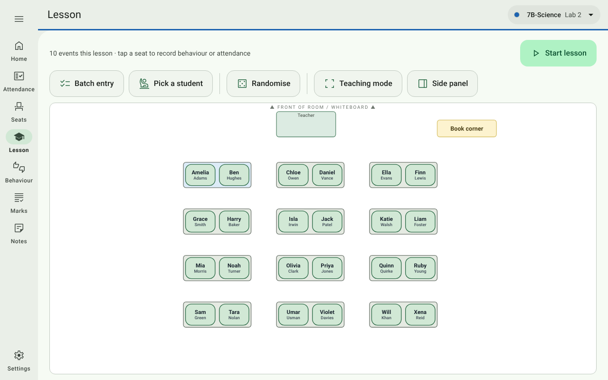

# ClassKernel

Fast, offline-first classroom management for teachers. A small Windows desktop app (Tauri 2, ~10 MB):
**no accounts, no server, no internet**. Everything is saved as plain `.csv` and `.md` files in a folder you choose.



**[Read the full documentation and user guide →](docs/README.md)**

## Install

Download the Windows installer (`.exe`) from the [Releases](../../releases) page and run it. On first launch, pick
a folder for your data — ideally inside OneDrive or Google Drive, so it's backed up and synced.

## What it does

| Page | |
| --- | --- |
| **Home** | Every class as a card in its own colour, with one-tap **Seating**, **Marks** and **Lesson**, plus your switched-on tools. |
| **Attendance** | One-tap Present / Absent / Late / Excused register, with rates and history. |
| **Seats** | Named seating plans. Seat students by hand, or **Randomise** with hidden keep-apart, keep-together and sit-at-the-front rules — once per lesson, then a PIN to reseat. Print for cover teachers. |
| **Lesson** | The seating plan is the interface: tap a seat to log behaviour, attendance or a bathroom trip. Batch entry, a random student picker, a full-screen or side-panel teaching mode, **Start lesson** (marks the class present; Randomise starts it too) and **End lesson** to save the seat history. |
| **Behaviour** | Filterable behaviour log and bathroom log. |
| **Marks** | Tests as a single mark or per question (tagged by topic and cognitive level), keyboard-first mark entry, a read-only **View** and a class **Markbook**, informal / examination **weighting**, and spreadsheet **templates** to fill in and import. SA levels or symbols. |
| **Notes** | Class details, colour and Markdown notes. |
| **Settings** | Students (with Adam numbers, and class lists from a spreadsheet), room-layout designer, seating rules, privacy mode, display size, time zone, teaching mode, behaviour buttons, topic bank by grade (grades can share one list), weighting, backups and **.xlsx export**. |

**Optional tools**, off until switched on in Settings → Tools:

| Tool | |
| --- | --- |
| **Class & student dashboards** | How the class and each student are doing: behaviour, answers, attendance, marks, topic strengths, seating insights. |
| **Parent reports** | One-page A4 reports per student for parent evenings. |
| **Test timer** | Full-screen countdown with reading and writing phases; keeps running as a pop-up. |
| **Clock** | Full-screen analog or flip clock, any time zone. |
| **Stopwatch** | LED-style lab stopwatch with laps. |
| **Graph paper generator** | Grids and axes at an exact mm size, saved as a 300 dpi PNG. |
| **Practical graph plotter** | Readings in; graph, line of best fit, gradient and R² out. |
| **Motion graph builder** | x–t, v–t and a–t graphs from one journey, so they always agree. |
| **Class noise meter** | Shows the room's noise against a limit and warns the class when it's too loud. |

## Your data

One folder of plain files that open in Excel or Notepad — one sub-folder per class. Saves are atomic, a backup of
the whole folder is taken at every launch (today's all kept, plus the last of each of the 14 days before), and
times are stored in UTC. See
[Your data and backups](docs/user-guide/11-your-data.md) and the [data file reference](docs/data-files.md).

## Development

```bash
npm install
npm run dev            # UI in a browser with an in-memory demo class
npm test               # unit tests
npm run test:e2e       # browser tests (first time: npx playwright install chromium)
npm run tauri dev      # desktop app (needs Rust)
npm run tauri build    # Windows installer
```

React + TypeScript + Vite and Zustand on a minimal Rust (Tauri 2) backend. CI runs the tests and builds the
installer on every push; tagging `v*` publishes a release. See [Development](docs/development.md), and
[`src/plugins/README.md`](src/plugins/README.md) to add a tool.
