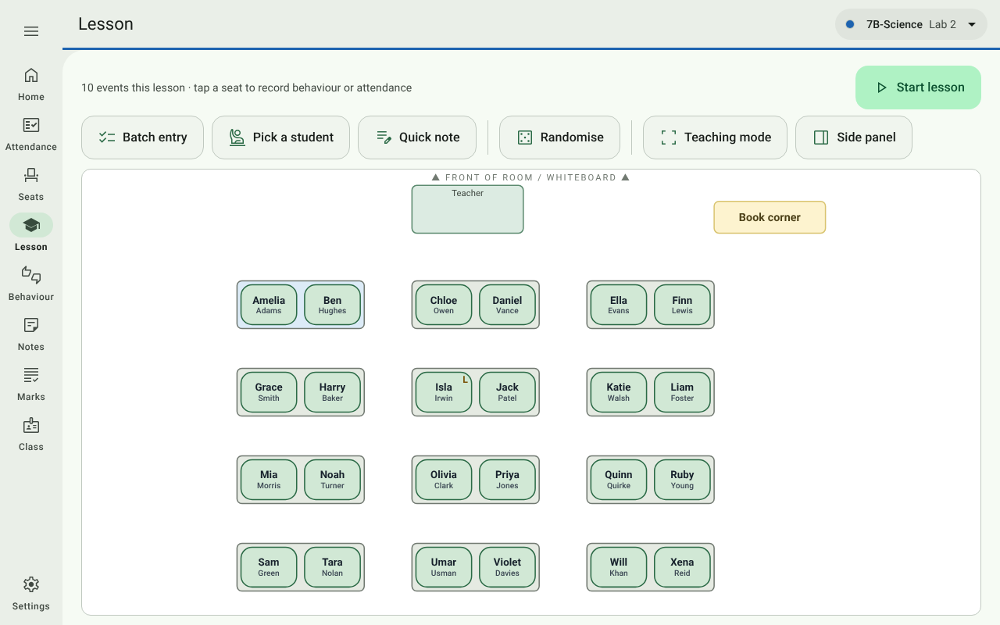

# ClassKernel

Two apps for teachers, from one repository:

- **ClassKernel** — fast, offline-first classroom management (below).
- **ClassKernel Science** — science teaching tools for the board: a chemistry reference, a titration simulator, a
  galvanic cell animator, graph plotters and graph paper. It comes with ClassKernel, in a window of its own (the
  installer offers it its own shortcuts), and as a website for any computer:
  **[j4ckr4bbit.github.io/ClassKernel](https://j4ckr4bbit.github.io/ClassKernel/)**. [Its guide →](docs/science/README.md)

ClassKernel is fast, offline-first classroom management for teachers. A small Windows desktop app (Tauri 2, ~10 MB):
**no accounts, no server, no internet** (unless you ask it to check for an update). Everything is saved as plain `.csv` and `.md` files in a folder you choose.



**[Read the full documentation and user guide →](docs/README.md)**

## Install

Download the Windows installer (`.exe`) from the [Releases](../../releases) page and run it. On first launch, pick
a folder for your data — ideally inside OneDrive or Google Drive, so it's backed up and synced.

Once installed, it updates itself when you ask: **Settings → General → Updates → Check for updates**.

The installer also offers **ClassKernel Science**, the science tools, in a window of its own with its own Start menu
and desktop shortcuts. ClassKernel opens it from Home and Settings → Tools either way.

## What it does

| Page | |
| --- | --- |
| **Home** | Every class as a card in its own colour, with one-tap **Seating**, **Marks** and **Lesson**, plus your switched-on tools. |
| **Attendance** | One-tap Present / Absent / Late / Excused register, with rates and history. |
| **Seats** | Named seating plans. Seat students by hand, or **Randomise** with hidden keep-apart, keep-together and sit-at-the-front rules — once per lesson, then a PIN to reseat. Prints on one landscape A4 page headed with the class, room, plan and date, for cover teachers. |
| **Lesson** | The seating plan is the interface: tap a seat to log behaviour, attendance, a trip **OUTSIDE** the classroom or a note, from a list, a grid of tiles or rings around the seat; behaviour and attendance taps can be undone from their message. Batch entry, a random student picker, a full-screen or side-panel teaching mode, **Start lesson** (marks the class present; Randomise starts it too) and **End lesson** to save the seat history. |
| **Behaviour** | Filterable behaviour log and Outside log. |
| **Notes** | Quick notes from lessons (tagged; Submit, Draft or Escape), detailed notes in sections (*Work ethic*, *Behaviour*, *Assessment*…), and the IEB's **Form F** teacher comment, printed ready to sign. One student's notes can be read by section. |
| **Marks** | Tests as a single mark or per question (tagged by topic and cognitive level), keyboard-first mark entry with a calculator beside it, a read-only **View** and a class **Markbook** (each named in the top bar, with its Back), informal / examination **weighting**, and spreadsheet **templates** to fill in and import. SA levels or symbols. |
| **Class** | Class details, colour and Markdown notes. |
| **Settings** | **General** (privacy mode, display size, Light / Dark / Match Windows and green or St Benedict's navy-and-gold colours, time zone, the parent-report header, classes and students from a spreadsheet, the data folder and backups), **Behaviour** (your behaviour buttons, each with a three-character code and an icon), **Teaching mode** (including the student pop-up style), **Assessments** (topic bank by grade — grades can share one list — cognitive levels, weighting), **Tools** (with the link to ClassKernel Science) and **.xlsx Export**. For the class chosen in the top bar: **Students** (with Adam numbers), the **room-layout designer** and **seating rules**. |

Made for a classroom touch panel: large buttons, a **privacy mode** that keeps marks and notes covered on the big
screen, and seats and dialogs that also work from the keyboard and with a screen reader. When Windows is set
to show fewer animations, the seat shuffle and the student picker calm down too. A **dark theme** (or Match Windows) and a
**navy-and-gold** colour scheme (St Benedict's College's colours) are chosen on each computer; printing is always in
the light colours.

**Optional tools**, off until switched on in Settings → Tools:

| Tool | |
| --- | --- |
| **Class & student dashboards** | How the class and each student are doing: behaviour, answers, attendance, marks, topic strengths, seating insights. |
| **Parent reports** | One-page A4 reports per student for parent evenings. |
| **Test timer** | Full-screen countdown with reading and writing phases; keeps running as a pop-up. |
| **Clock** | Full-screen analog or flip clock, any time zone. |
| **Stopwatch** | LED-style lab stopwatch with laps. |
| **Class noise meter** | Shows the room's noise against a limit and warns the class when it's too loud. |

## Your data

One folder of plain files that open in Excel or Notepad — one sub-folder per class. Saves are atomic, a backup of
the whole folder is taken on this computer at every launch (today's all kept, plus the last of each of the 14 days
before; on this computer, so Drive isn't re-uploading it each time), and times are stored in UTC. Changes are saved on this computer at once and sent to the (synced) folder together, every
2 minutes and at natural pauses (End lesson, Done, switching class, closing the app), so Google Drive isn't uploading
after every tap. If Google Drive or OneDrive hasn't started when the app does, it waits, then carries on from its own
copy on this computer and joins the changes back when the folder returns. See
[Your data and backups](docs/user-guide/11-your-data.md) and the [data file reference](docs/data-files.md).

## Development

```bash
npm install
npm run dev            # ClassKernel in a browser with an in-memory demo class
npm run dev:science    # ClassKernel Science in a browser
npm test               # unit tests, both apps and the shared package
npm run test:e2e       # browser tests (first time: npx playwright install chromium)
npm run build          # both apps
npm run tauri dev      # ClassKernel's desktop app (needs Rust)
npm run tauri build    # ClassKernel's Windows installer
```

React + TypeScript + Vite, as npm workspaces: `apps/classkernel/` (Zustand on a minimal Rust / Tauri 2 backend),
`apps/science/` (a static website) and `packages/ui/` (the look and the small pieces both share). CI runs the tests
and builds the installer on every push; tagging `v*` publishes a ClassKernel release, and every push to `main`
publishes the website. See [Development](docs/development.md), and
[`apps/classkernel/src/plugins/README.md`](apps/classkernel/src/plugins/README.md) to add a tool.
