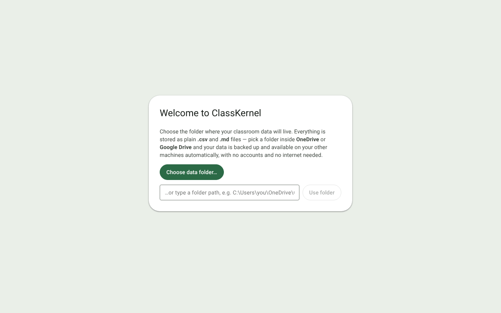
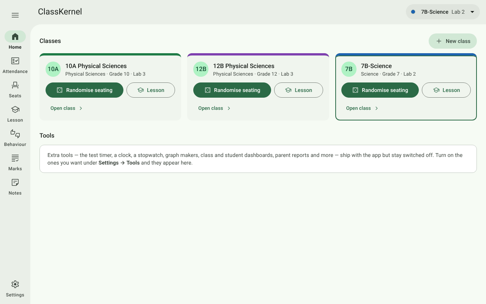
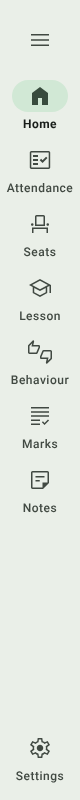
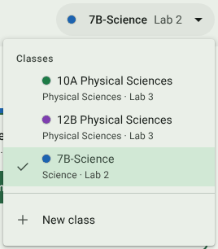
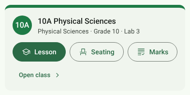
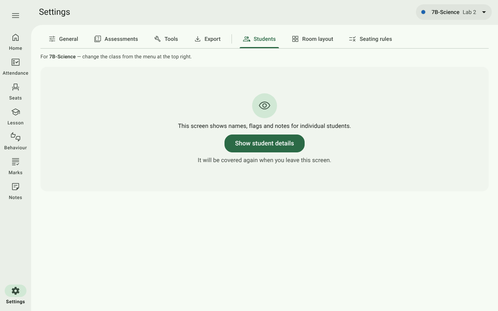
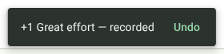

# 1. Getting started

[← Contents](../README.md) · Next: [Setting up a class →](02-setting-up-a-class.md)

## Install

ClassKernel is a Windows desktop app. Download the latest installer (`.exe`) from the
[Releases](https://github.com/J4ckR4bbit/ClassKernel/releases) page and run it. There is no account to create and
nothing to configure, and the app never needs the internet.

## First launch: choose a data folder

The first time it opens, ClassKernel asks where to keep your data.

- **Choose data folder…** opens the normal Windows folder picker.
- Or type a path in the box and press **Use folder**.

Everything the app records is saved in that folder as plain `.csv` and `.md` files that open in Excel or Notepad.
**Pick a folder inside OneDrive or Google Drive** and the sync client backs it up and carries it to your other
computers. ClassKernel itself never touches the network. More in [Your data and backups](11-your-data.md).

The app remembers the folder. Next time it opens straight onto the Home page, and takes a backup copy of the whole
folder as it starts.

## The screen

Every page has the same frame:

| Part | Where | What it does |
| --- | --- | --- |
| **Navigation rail** | Down the left | The places you teach from. Settings sits at the foot. |
| **Top bar** | Across the top | The page you're on (left) and the **class menu** (right). |
| **Class colour** | Under the top bar | A coloured line in the class's colour, on that class's pages. |

### The navigation rail

| Button | Opens |
| --- | --- |
| **Home** | Every class as a card, and your switched-on tools. |
| **Attendance** | The register for the chosen class. |
| **Seats** | Seating plans: place students by hand or **Randomise**. |
| **Lesson** | The live lesson: the seating plan you tap to record behaviour. |
| **Behaviour** | The behaviour log and the bathroom log. |
| **Marks** | Assessments and mark entry. |
| **Notes** | Class details, colour and free-form notes. |
| **Settings** | App settings, students, room layout, seating rules, tools and export. |

Press the **☰** button at the top to expand the rail into a drawer with full names. The drawer also lists the
[tools](09-teaching-tools.md) you've switched on. Press it again to collapse it. The app remembers your choice on
this computer.

 

### The class menu

You choose the class you're working with **once**, from the menu at the top right, and every page follows it:
Attendance, Seats, Lesson, Behaviour, Marks, Notes, the per-class Settings tabs and the dashboards.

- Each class shows with its colour dot and its subject and room.
- **New class** creates a class (see [Setting up a class](02-setting-up-a-class.md)).
- Archived classes are tucked under **Archived** at the bottom of the menu.

### Home

Home shows every active class as a card.

| Button | What it does |
| --- | --- |
| **Lesson** | Opens the class's live Lesson page. |
| **Seating** | Opens the class's Seats page, where you randomise or move students. |
| **Marks** | Opens the class's Marks page. |
| **Open class** | Opens the class's Class notes page: its details, colour and notes. |
| **New class** (top right of Home) | Creates a class. |

A class with a colour (set on its [Class notes](02-setting-up-a-class.md#class-notes-details-colour-and-notes) page)
shows it along the top of its card and in the circle with its initials.

Below the classes is the **Tools** section. It stays empty, with a short note, until you switch tools on under
**Settings → Tools**.

## Privacy on the big screen

ClassKernel assumes your screen may be on the classroom projector. With **privacy mode** on (the default), pages
that show individual marks, behaviour history, notes or analysis are covered until you press
**Show student details**.

The cover comes back as soon as you leave the page, switch class or enter teaching mode, so a screen of marks can't
be left on show by accident. Register-taking (Attendance) and the live Lesson stay usable in front of the class,
with flags, notes and history kept out of sight. You can change any of this under
[Settings → General](10-settings.md#privacy-on-the-big-screen).

## Undo

Most actions show a short message at the bottom of the screen. Where it makes sense, the message has an **Undo**
button for a few seconds.

## If a save fails

Every change saves to disk at once. If a save fails (for example, the folder is on a drive that has gone offline),
a red banner says *"Couldn't save … to disk — your changes are only in memory"* with a **Try again** button. Fix
the cause and press it before closing the app.
