# 2. Setting up a class

[← Getting started](01-getting-started.md) · [Contents](../README.md) · Next: [Attendance →](03-attendance.md)

Setting up a class takes four steps, all done once: **create the class**, **add students**, **draw the room**, and
(optionally) **set seating rules**. The class-specific setup lives under **Settings**, out of sight of the class.

## Create a class

Press **New class** on Home, or open the class menu (top right) and choose **New class**.

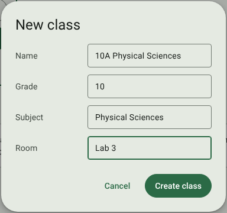

| Field | Notes |
| --- | --- |
| **Name** | Required. Also the name of the class's folder on disk, so characters Windows doesn't allow in file names (`< > : " / \ \| ? *`) are left out. |
| **Grade** | The grade the class is in, as a number: `8`, `10`, `12`. It picks the topic list used when you tag test questions (see [Marks](07-marks.md)) and the grade's weighting, and shows as *G08*, *G10* and so on. Type just the grade: not the year (`2026`) and not a leading zero (`08`), or the class won't match the grade's topic list. |
| **Subject**, **Room** | Shown on the class's Home card and in the class menu. |

Press **Create class**. The new class becomes the one you're working with.

## Class notes: details, colour and notes

Open **Notes** in the navigation rail.

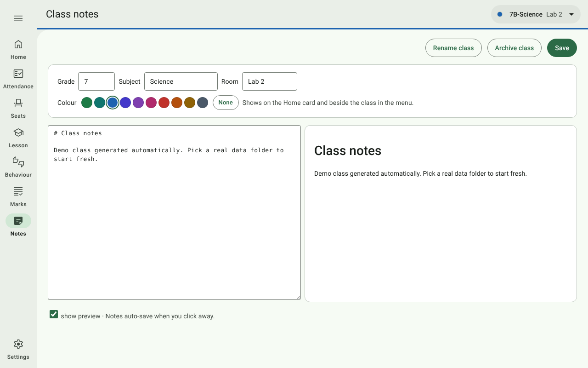

| Control | What it does |
| --- | --- |
| **Grade / Subject / Room** | Edit, then press **Save**. Type the grade as a plain number, e.g. `10` (see [Create a class](#create-a-class)). |
| **Colour** | Pick a swatch (saves at once) or **None**. The colour shows as a band on the Home card, a dot in the class menu, and a line under the top bar on the class's pages. |
| **Notes box** | Free notes in Markdown (headings with `#`, lists with `-`, links, …). They save when you click away. Tick **show preview** to see them formatted on the right. |
| **Rename class** | Renames the class and its folder on disk. |
| **Archive class** | Hides the class from Home and moves it under **Archived** in the class menu. Nothing is deleted; open it from the menu and press **Restore** to bring it back. |

## Students

Go to **Settings → Students**. Like every per-class Settings tab, it works on the class chosen in the top bar
(*"For 7B-Science — change the class from the menu at the top right"*). With privacy mode on, press
**Show student details** first.

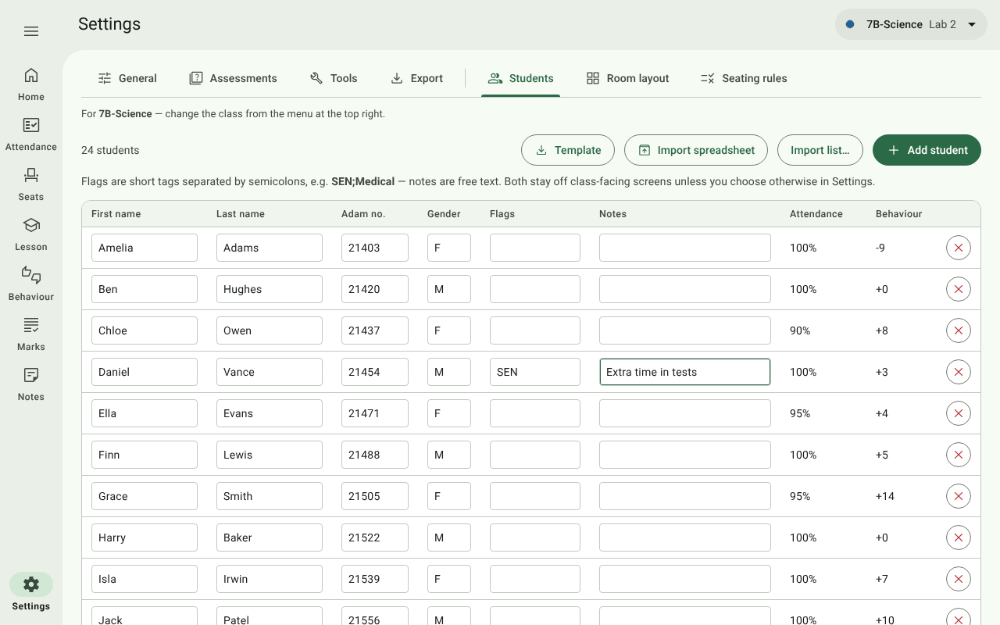

- **Add student** adds an empty row; type straight into it. Every change saves as you type.
- **Template** and **Import spreadsheet** set up or update the class from a spreadsheet; **Import list…** pastes a
  list of names (both below).
- **Adam no.** is the student's number in Adam, the school's administration system. It's optional, but with it
  filled in, spreadsheet imports of students and marks recognise the student even after a change of name.
- **Flags** are short tags separated by semicolons, e.g. `SEN;Medical`. They show as amber tags on the register
  and dashboards. **Notes** are free text. Both stay off class-facing screens unless you choose otherwise in
  [Settings → General](10-settings.md#privacy-on-the-big-screen).
- **Attendance** and **Behaviour** show each student's attendance rate and net behaviour points so far.
- **✕** removes a student (with Undo). Their attendance, behaviour and marks stay in the class's files.
- With the dashboards tool switched on, a **chart** button opens that student's dashboard.

### Import a list

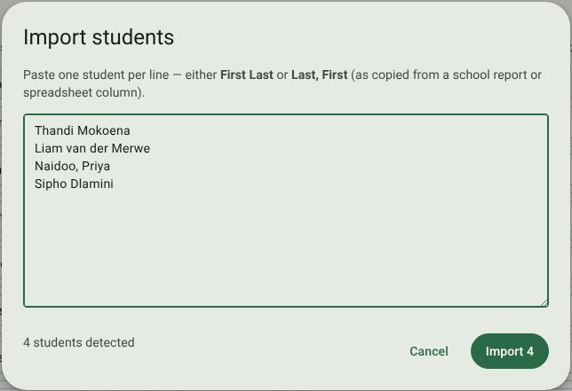

Paste one student per line, either as **First Last** or as **Last, First** (as copied from a school report or a
spreadsheet column). The dialog counts the students it found; press **Import** to add them.

### From a spreadsheet

For a class list with Adam numbers, flags and notes — or to update details for the whole class at once — use a
spreadsheet:

1. **Template** saves an Excel workbook of the class (`Students - <class>.xlsx`). Its **Students** sheet has the
   columns *Class, Surname, Name, Adam number, Gender, Flags, Notes, Student ID*, with a row for every student
   already in the class; a **Classes** sheet holds the class's grade, subject and room.
2. Fill it in or correct it in Excel, Google Sheets or LibreOffice: add rows for new students, change details,
   paste a list straight from Adam. Flags may be separated by `;` or `,`.
3. **Import spreadsheet** reads it back (`.xlsx` or `.csv`) and shows what it will do before anything is saved:

   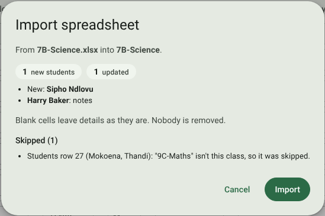

   - new students, and the details that will change for each existing one;
   - anyone in the class who isn't in the file (they stay as they are);
   - every row it **skipped** and why — for example, a row for another class.

   Press **Import** to apply it, or **Cancel**.

Students are recognised by their **Student ID** (ClassKernel's own number, in the last column), then their
**Adam number**, then their surname and name — so keep those columns, and sort the rows any way you like. A blank
cell leaves that detail as it is, and **nobody is ever removed** by an import.

To set up **every class** at once — say from the school's class lists at the start of the year — use
**Settings → General → Classes and students from a spreadsheet**. It works the same way, with all your classes in
one workbook (`Classes and students.xlsx`), and a class named in the file that doesn't exist yet is created
(see [Settings](10-settings.md#classes-and-students-from-a-spreadsheet)).

## Room layout

Go to **Settings → Room layout** and draw the room the way it really is. This layout is what the seating plan and
the live lesson are drawn on.

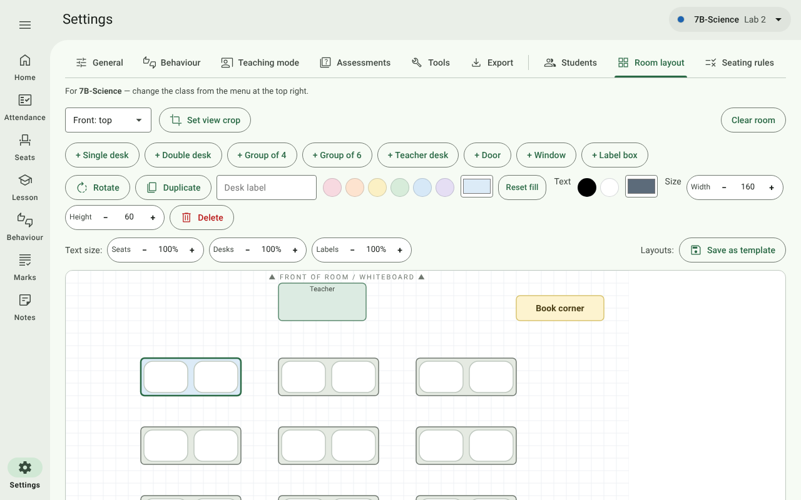

### Add furniture

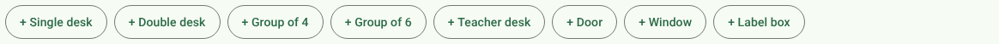

| Button | Adds | Seats |
| --- | --- | --- |
| **+ Single desk** | A one-person desk | 1 |
| **+ Double desk** | A two-person desk | 2 |
| **+ Group of 4** / **+ Group of 6** | A group table | 4 / 6 |
| **+ Teacher desk** | Your desk | – |
| **+ Door**, **+ Window** | Room features, for orientation | – |
| **+ Label box** | A free-text box (e.g. *Book corner*, *Fume cupboard*) | – |

New items appear in the middle of the room. **Drag** them into place; they snap to the grid.

### Change the selected item

Click an item to select it (it gets a coloured outline). A second toolbar appears:

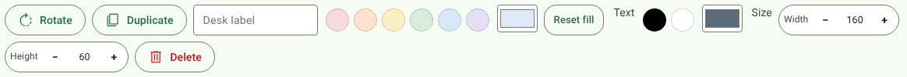

| Control | What it does |
| --- | --- |
| **Rotate** | Turns it 90°. |
| **Duplicate** | Adds a copy beside it — the quickest way to build rows of desks. |
| **Desk label** | A name for the desk (e.g. *Front left*), used by the teaching side panel and the seating insights. Unlabelled desks are numbered *Desk 1*, *Desk 2*, … |
| **Fill swatches** / colour box / **Reset fill** | The desk's colour. |
| **Text** (black, white or any colour) / **Reset text** | The colour of the label. |
| **Width** / **Height** − + | Resize in grid steps. |
| **Delete** | Removes it (with Undo). |

### The whole room

| Control | What it does |
| --- | --- |
| **Front: top / right / bottom / left** | Which edge is the front of the room (the whiteboard). Randomise fills front desks first, and *Sit near the front* rules use this edge. |
| **Set view crop** | Draws a dashed box around the furniture. Seats and Lesson then zoom to just that part of the room. Drag the box to move it and its corner handle to resize. **Remove view crop** undoes it. Without a crop, Seats and Lesson zoom to fit all the furniture anyway; a crop is for showing less than that. |
| **Clear room** | Removes every item (with Undo). |

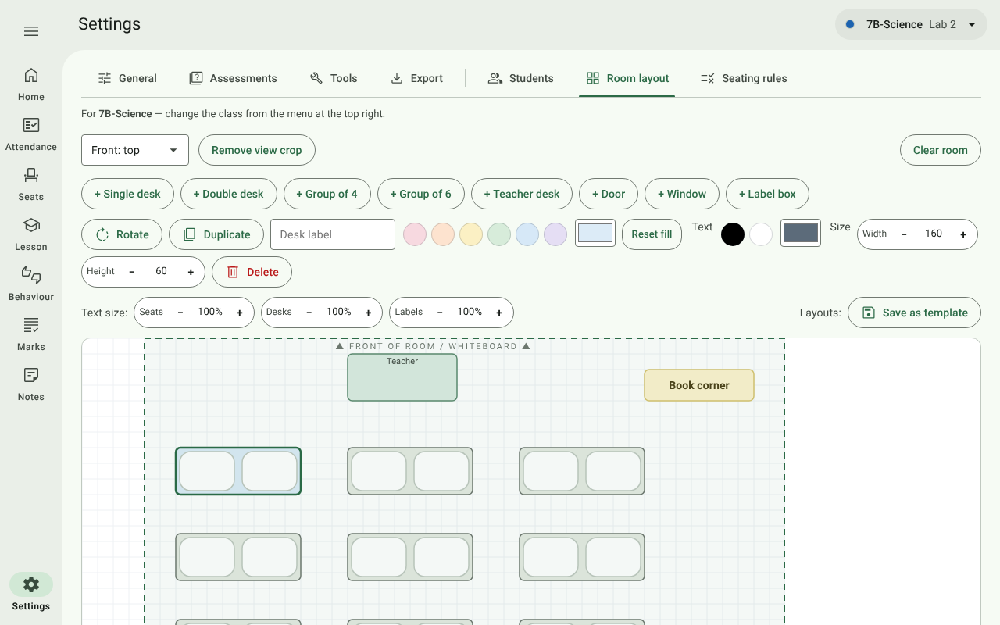

### Text size and templates

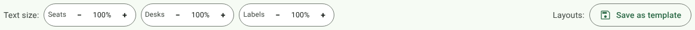

- **Text size: Seats / Desks / Labels** scales the student names on seats, desk labels and label boxes
  (50%–300%). Make them bigger for a large classroom panel.
- **Save as template** stores this room under a name. The template then appears as a button here in **every**
  class: press it to apply that layout (it replaces the class's current desks), or its **✕** to delete the
  template. Useful when several classes are taught in the same lab. If a template can't be read (for example, it
  was deleted on another computer and the sync hasn't caught up), the room is left as it was and a message says so.
  If a template can't be saved, the red *Couldn't save* banner appears with **Try again**; if one can't be
  deleted, it stays in the list and a message says so.

## Seating rules

Go to **Settings → Seating rules**. These rules are applied every time you press **Randomise**. They live here in
Settings, so the class only ever sees the shuffle, never who is being kept apart.

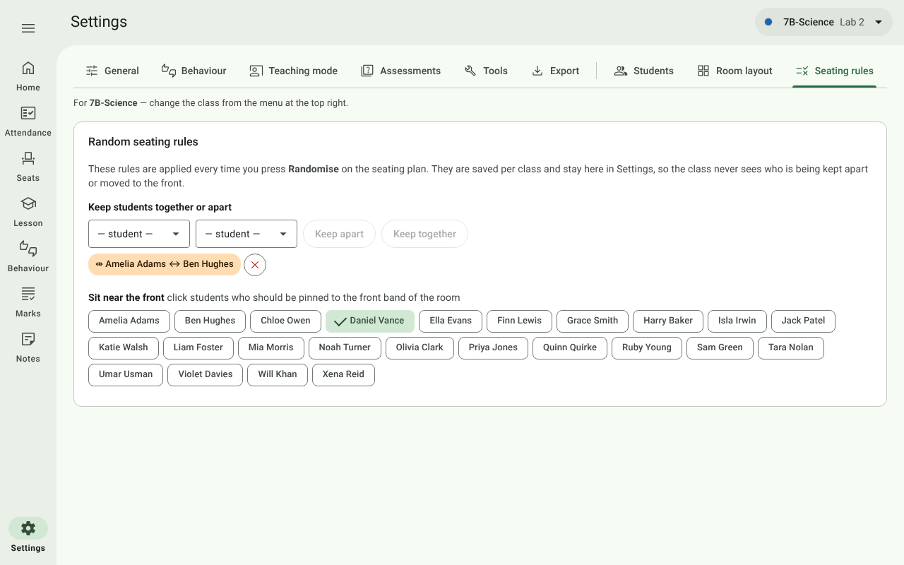

- **Keep apart** — pick two students and press **Keep apart**: they won't share a desk.
- **Keep together** — pick two students and press **Keep together**: they will share a desk.
- **Sit near the front** — click students' names to pin them to the front band of the room (useful for SEN or
  eyesight needs). Selected names show a tick.
- Each rule shows as a chip; its **✕** removes it.

If the rules can't all be met (for example, too many front-pinned students for the front desks), Randomise still
seats everyone and says how many rules it couldn't meet.

The [Seating insights](08-dashboards-and-reports.md#seating-insights) can suggest keep-apart pairs from your lesson
history.
