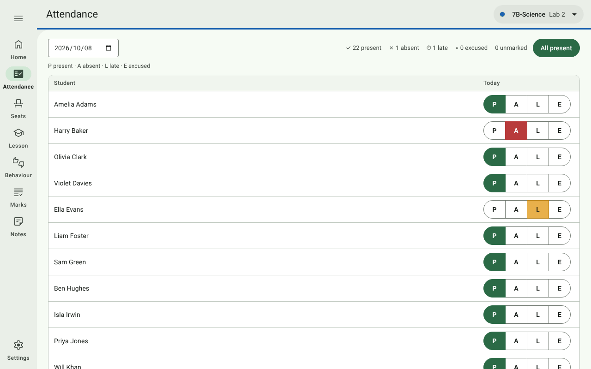
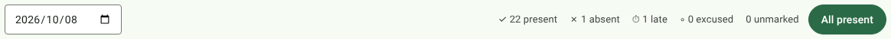
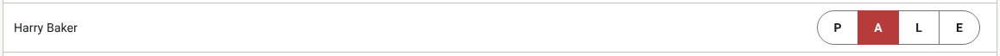
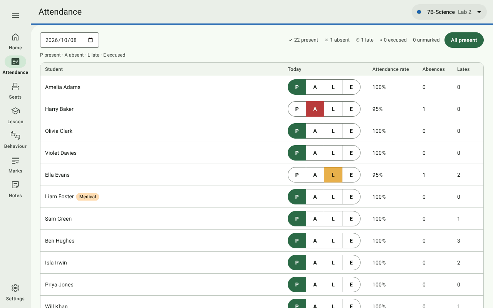

# 3. Attendance

[← Setting up a class](02-setting-up-a-class.md) · [Contents](../README.md) · Next: [Seats →](04-seats.md)

Open **Attendance** in the navigation rail. The register is for the class chosen in the top bar, on today's date.

## Taking the register

1. Press **All present**. Everyone is marked **P** (with Undo).
2. Change the exceptions with one tap each:

   

   | Button | Meaning |
   | --- | --- |
   | **P** | Present |
   | **A** | Absent |
   | **L** | Late |
   | **E** | Excused |

The counts across the top (*present, absent, late, excused, unmarked*) update as you go. Every tap saves
immediately. Students are listed by surname.

To take or correct the register for another day, change the **date** at the top left.

You can also mark attendance from the live lesson: tap a student's seat and use the same P / A / L / E buttons
(see [Lesson](05-lesson.md#tap-a-seat)).

## History and flags

The register is usually taken in front of the class, so it is never covered by the privacy screen. Instead, each
student's flags and attendance history stay hidden until you press **Show details** under the list.

| Column | Shows |
| --- | --- |
| Flags beside the name | e.g. **SEN**, **Medical** (from Settings → Students) |
| **Attendance rate** | Present and late, as a share of all register marks except excused ones (an excused day doesn't count against the student) |
| **Absences**, **Lates** | Counts so far |

The details are covered again when you leave the page.
