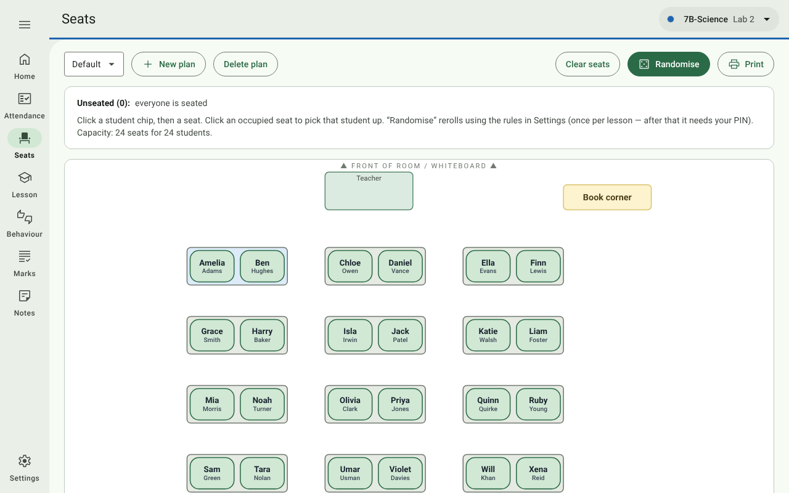
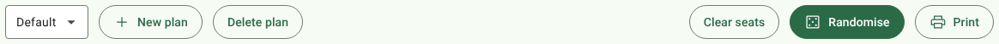
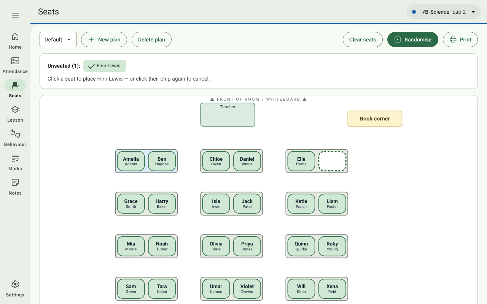
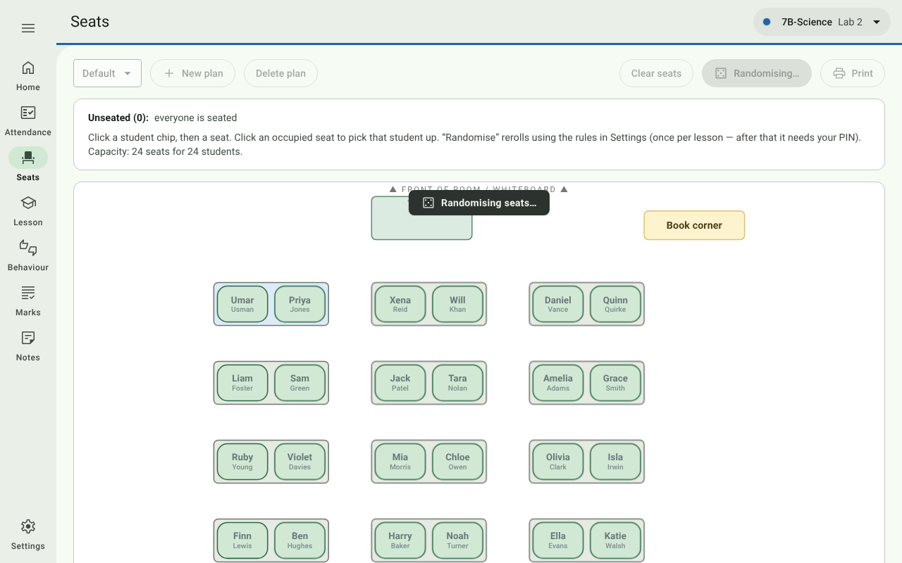
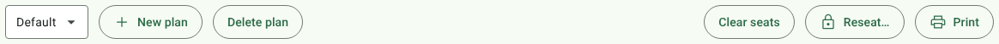
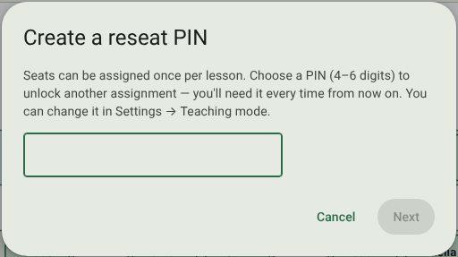

# 4. Seats

[← Attendance](03-attendance.md) · [Contents](../README.md) · Next: [Lesson →](05-lesson.md)

Open **Seats** in the navigation rail. The seating plan is drawn on the room you designed in
[Settings → Room layout](02-setting-up-a-class.md#room-layout), with the front of the room marked.

## The toolbar

| Control | What it does |
| --- | --- |
| **Plan menu** (e.g. *Default*) | Switches between the class's seating plans. |
| **New plan** | Starts another named plan, e.g. a *Test* layout beside a *Group work* layout. |
| **Delete plan** | Deletes the plan shown (asks first). |
| **Clear seats** | Empties every seat in the plan (with Undo). |
| **Randomise** | Rerolls the seating, honouring your [seating rules](02-setting-up-a-class.md#seating-rules). Once per lesson — see below. |
| **Print** | Prints the plan on one landscape A4 page, headed with the class, room, plan and date — e.g. for a cover teacher. |

The panel under the toolbar lists **Unseated** students and the room's **capacity** (seats for students).

## Seating students by hand

- **Place a student:** click their name chip under *Unseated*, then click an empty seat.
- **Move a student:** click their seat to pick them up (their chip appears, ticked, and empty seats get a dashed
  outline), then click the seat they should move to. Dropping onto an occupied seat sends that student back to
  *Unseated*.
- **Cancel:** click the ticked chip again.

Moving students by hand is never locked.

## Randomise

Press **Randomise** (**Seating** on the class's Home card brings you here). Names flash across the seats for about a
second so the class can see it really is a shuffle, then settle (slowly, and only a few times, if Windows is set to
show fewer animations). If the lesson hasn't been started yet, Randomise
starts it and marks the class present (see [Start lesson](05-lesson.md#start-lesson)).

How it seats the class:

- Students are spread **evenly** over the desks, front desks filled first.
- **Keep apart**, **keep together** and **sit near the front** rules from Settings are applied. If they can't all
  be met, everyone is still seated and a message says how many rules were missed.

## Once per lesson, and the reseat PIN

Seats are assigned **once per lesson**, whether you press Randomise on Seats or Lesson. After that the button
becomes **🔒 Reseat…**, so nobody reshuffles the class by accident.

The lock lifts when you **End lesson** (see [Lesson](05-lesson.md#end-lesson)) or on the next day. To assign seats
again within the same lesson, press **Reseat…** and enter your **reseat PIN**.

The first time you unlock, the app asks you to **create** a PIN (4–6 digits, typed twice). From then on that PIN is
needed every time. Change or remove it under
[Settings → General → Teaching mode](10-settings.md#teaching-mode).

The PIN is stored only as a scrambled hash in `settings.csv`, never as the digits themselves.
