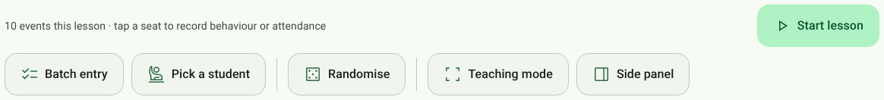
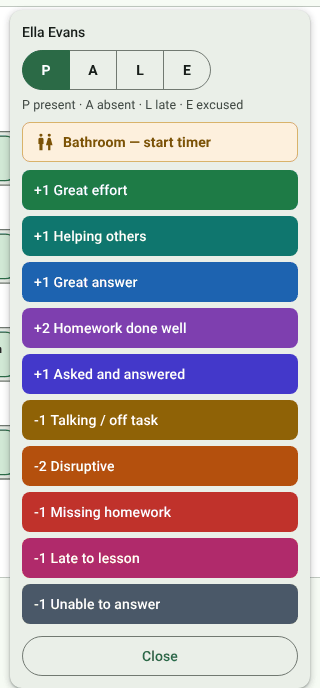
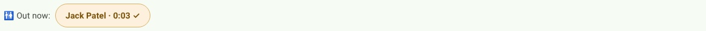
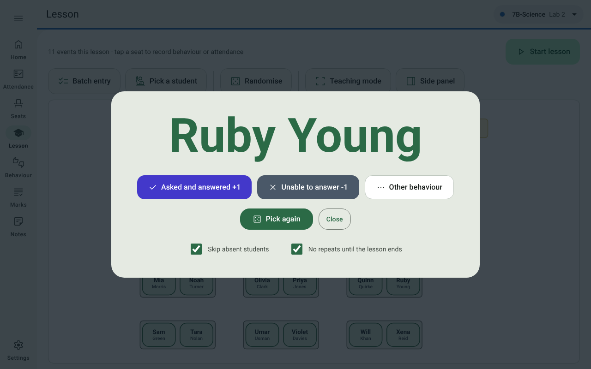
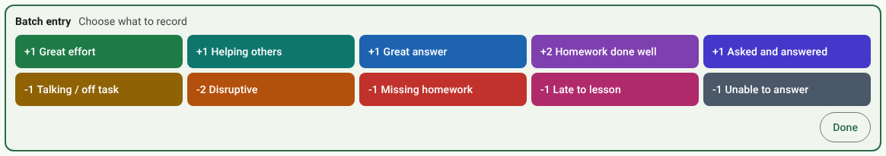
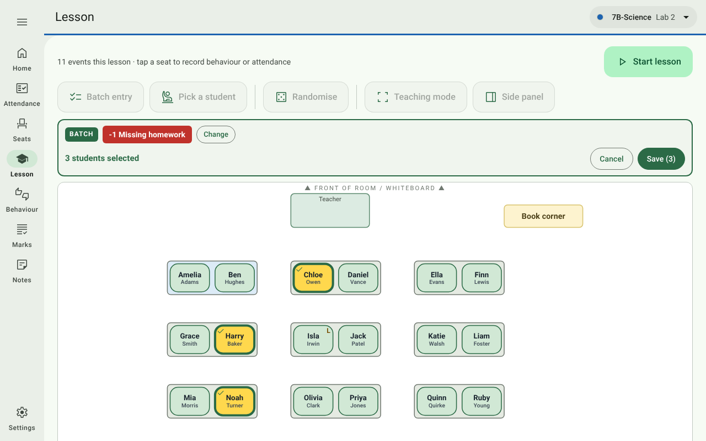
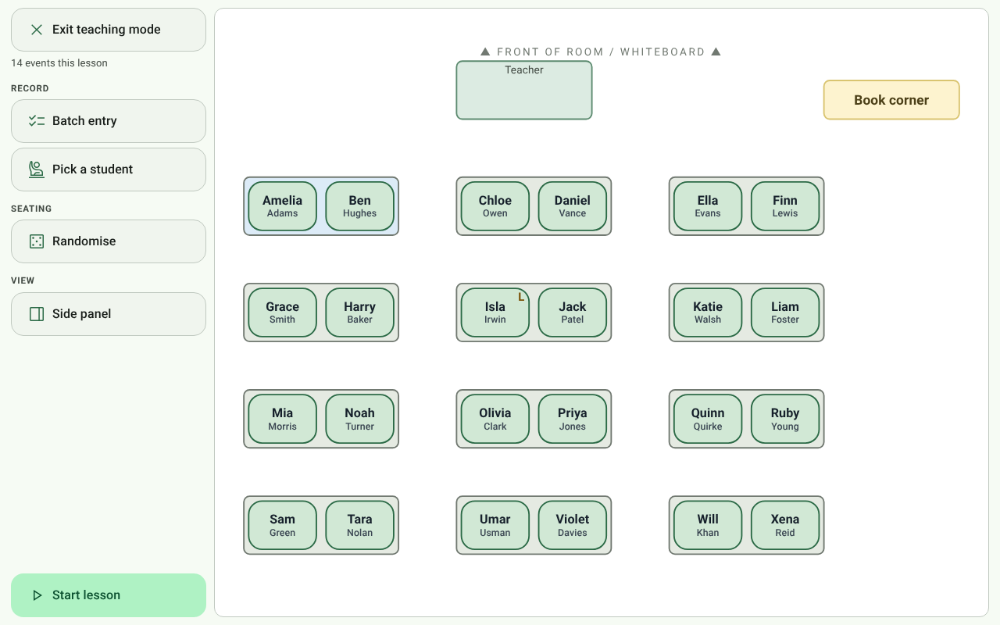
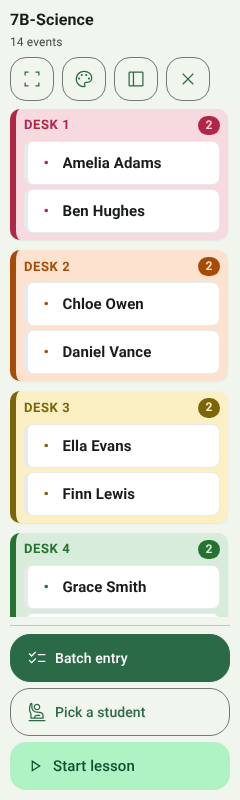
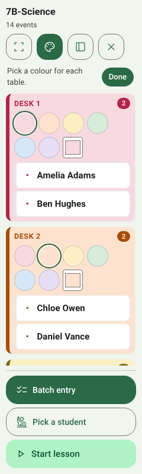
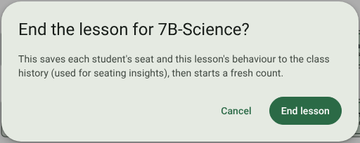

# 5. Lesson

[← Seats](04-seats.md) · [Contents](../README.md) · Next: [Behaviour log →](06-behaviour-log.md)

Open **Lesson** in the navigation rail (or **Lesson** on a class's Home card). In a live lesson **the seating plan is
the interface**: tap a student's seat to record behaviour or attendance for them.

A lesson needs a room layout and a seating plan. Without them the page links you to the step that's missing.

## The toolbar

| Control | What it does |
| --- | --- |
| ***n* events this lesson** | Everything recorded since the last **End lesson** (or since the start of today, if you've never ended one for this class). |
| **Plan menu** | Appears when the class has more than one seating plan. |
| **Start lesson** / **End lesson** | Starts the lesson and marks the class present, then becomes **End lesson**, which saves the lesson to the class history and starts a fresh count. See [Start lesson](#start-lesson) and [End lesson](#end-lesson). |
| **Batch entry** | Records one behaviour for several students at once. |
| **Pick a student** | Chooses a student at random to answer a question. |
| **Randomise** / **🔒 Reseat…** | Rerolls the seating, once per lesson (see [Seats](04-seats.md#once-per-lesson-and-the-reseat-pin)). Also starts the lesson if it isn't running yet. |
| **Teaching mode** | Opens your default [teaching mode](#teaching-mode). |
| **Side panel** / **Room plan** | Opens the *other* teaching mode. |

All the lesson buttons are large, so they're easy to hit on a classroom touch panel.

## Tap a seat

Tap any student's seat and a pop-up opens beside it:

- **P / A / L / E** marks today's attendance (present, absent, late, excused). An absent student's seat shows ✗.
- **Bathroom — start timer** times a bathroom trip (below).
- **Behaviour buttons**: positive ones first, then negative, each with its points. Tap one to record it. They are
  your own buttons, set up under
  [Settings → General → Behaviour buttons](10-settings.md#behaviour-buttons).
- **Close**, or a tap anywhere outside the pop-up, closes it without recording anything. Tapping another
  student's seat closes this pop-up and opens theirs. The student sheet in the side panel closes the same way.

Every recording shows a message with **Undo** for a few seconds. With privacy mode on, the message says
*"recorded"* rather than the student's name.

Flags (e.g. *SEN*) and notes are not shown in the pop-up unless you switch them on in
[Settings → General](10-settings.md#privacy-on-the-big-screen), for when safety information must be one tap away.

**Running points on the seats.** Each seat can show the student's points for this lesson, like a scoreboard. With
privacy mode on this is off by default; switch on *"Show each student's running behaviour points on their seat"*
in Settings if you want it. With privacy mode off, the points always show.

 

## Bathroom trips

Tap the student's seat, then **Bathroom — start timer**. Their seat gets a 🚻 badge and an **Out now** bar appears
above the plan with the time ticking:

When they're back, tap their chip in the **Out now** bar (or tap their seat and press **Back from bathroom**). The
trip — when they left, when they returned and for how long — goes into the
[bathroom log](06-behaviour-log.md#bathroom-log).

## Pick a student

Press **Pick a student**. Names flash past, then one lands, large enough for the back row to read.

| Control | What it does |
| --- | --- |
| **Asked and answered +1** | Records that the student answered, then closes the picker. |
| **Unable to answer −1** | Records that they couldn't, then closes the picker. |
| **Other behaviour** | Shows all your other behaviour buttons for this student. |
| **Pick again** | Picks another student. |
| **Close** (or **Esc**) | Closes the picker. |
| **Skip absent students** | Leaves out anyone marked absent or excused today. |
| **No repeats until the lesson ends** | Nobody is picked twice until everyone has had a turn; then a new round starts. |

Answers recorded here count as **questions, never as behaviour**. A student who can't answer is not flagged as
misbehaving on the dashboards; instead the dashboards show who answers well and who is rarely asked.

With privacy mode off, the picker also shows how often the student has been asked this lesson and how many they
answered.

## Batch entry

Batch entry records the same behaviour for many students in one go — say *Missing homework* for everyone who didn't
hand it in.

1. Press **Batch entry** and choose what to record:

   

2. Tap each student's seat. Selected seats turn yellow with a tick; tap again to deselect.

   

3. Press **Save (*n*)**. Nothing is recorded until you do, and the whole batch has a single **Undo**.

| Control | What it does |
| --- | --- |
| **Change** | Pick a different behaviour for the same students. |
| **Cancel** | Leave without recording anything. |
| **Done** | After saving, the panel is ready for the next batch; **Done** closes it. |

## Teaching mode

Teaching mode hides the navigation and settings so you can teach from the plan. It comes in two styles; choose the
default under [Settings → General → Teaching mode](10-settings.md#teaching-mode). Press **Esc** at any time to leave
it. Entering teaching mode also re-covers any private screens.

### Room plan (full screen)

The app fills the screen with the room plan. Tapping seats works exactly as above.

The buttons are grouped (**Record**, **Seating**, **View**), with **End lesson** set apart so it isn't hit by
accident. Choose which edge they sit on — left, right, top or bottom — under
[Settings → General → Teaching mode](10-settings.md#teaching-mode), so they're under your hand where you stand.

### Side panel

The side panel shrinks ClassKernel to a narrow column docked to the left or right edge of the screen, **always on
top**, so your slides and annotation software keep the rest. Students are listed by table, each table its own
coloured card.

&nbsp;&nbsp;

| Control | What it does |
| --- | --- |
| **Tap a student** | Opens the same actions as the seat pop-up (attendance, bathroom, behaviour). |
| **🎨** (palette) | Colour the tables: pick a pastel or any colour for each table (right-hand picture), then **Done**. **Auto** goes back to the automatic colour. Each table keeps its colour from lesson to lesson. |
| **Dock** button | Moves the panel to the other edge of the screen. |
| **Full-screen** button | Switches to the room-plan teaching mode. |
| **✕** (or **Esc**) | Leaves teaching mode. |
| **Batch entry**, **Pick a student**, **Start lesson** / **End lesson** | As above. In batch entry, tap students' rows to select them. |

Running tools (the test timer and the noise meter) show their pop-ups inside the panel.

## Start lesson

Press **Start lesson** at the start of the lesson, or **Randomise** the seating (on the Lesson or Seats page), which
starts it too. Starting a lesson:

- marks every student who has no attendance mark for today **present**. Marks already made (an absence from the
  register, say) stay as they are, so adjust the exceptions afterwards on [Attendance](03-attendance.md) or from a
  seat;
- turns the button into **End lesson**.

A lesson that is never ended stops running at the end of the day.

## End lesson

Press **End lesson** at the end of the lesson and confirm.

This:

- saves each student's **seat, seatmates and behaviour points** for the lesson to the class history (this is what
  the [seating insights](08-dashboards-and-reports.md#seating-insights) learn from);
- starts a fresh **events this lesson** count;
- **unlocks Randomise** for the next lesson;
- resets **Pick a student**'s no-repeat list;
- turns the button back into **Start lesson**.

Behaviour events and attendance are saved the moment you record them — End lesson doesn't need to be pressed for
them to be kept.
