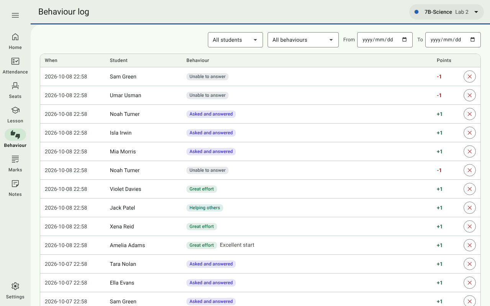
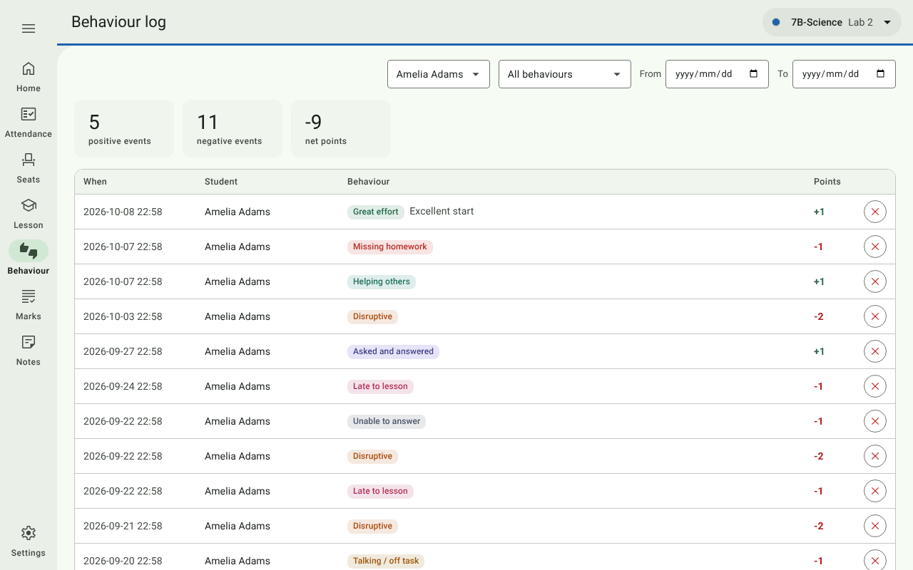
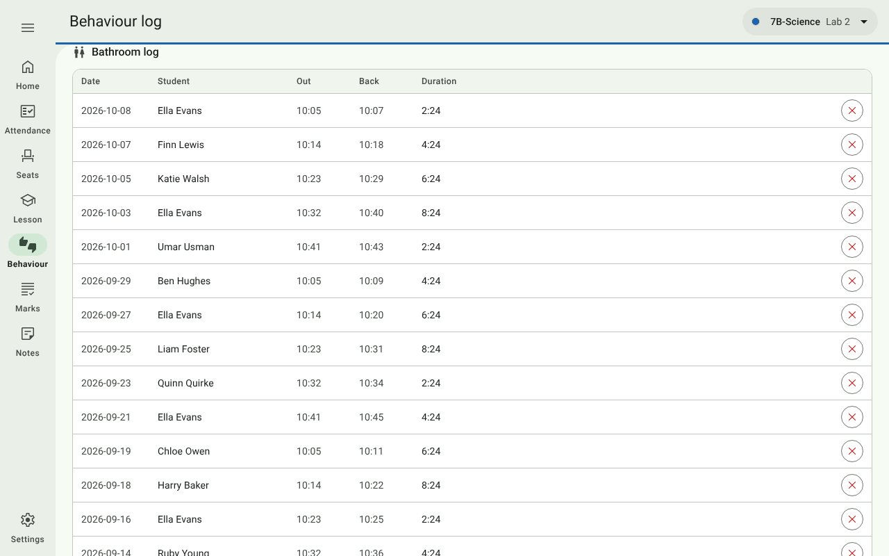

# 6. Behaviour log

[← Lesson](05-lesson.md) · [Contents](../README.md) · Next: [Marks →](07-marks.md)

Open **Behaviour** in the navigation rail. It lists everything recorded for the class, newest first. With privacy
mode on, press **Show student details** first.

## Filtering

| Filter | Shows |
| --- | --- |
| **All students** / a name | One student's entries. Three tiles appear on top: positive events, negative events and net points. |
| **All behaviours** / a behaviour | Only that behaviour, e.g. every *Late to lesson*. |
| **From** / **To** | Entries between two dates. |

The table shows the latest 300 matching entries (it says so when there are more).

## Correcting mistakes

The **✕** at the end of a row deletes that entry, with **Undo**. Use it for a tap on the wrong seat that you didn't
undo straight away.

With the [dashboards](08-dashboards-and-reports.md) switched on, each student's name is a link to their dashboard.

## Bathroom log

Below the behaviour table is the **Bathroom log**: every timed trip from the [Lesson](05-lesson.md#bathroom-trips)
page, with the date, when the student left and came back, and how long they were out. A trip still running shows
**still out**. The student and date filters at the top apply here too, and **✕** deletes a trip (with Undo).

