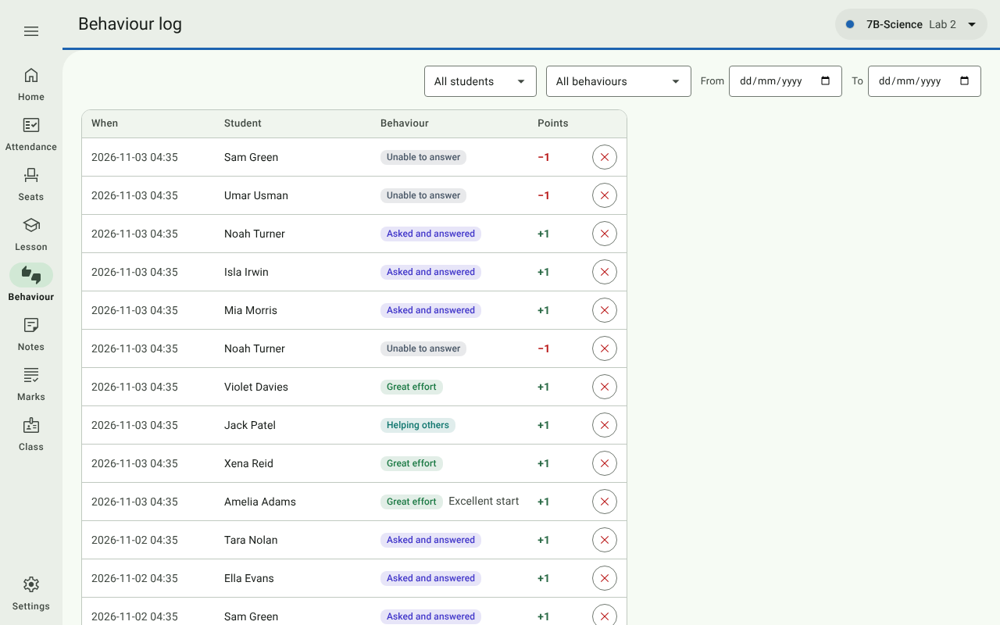
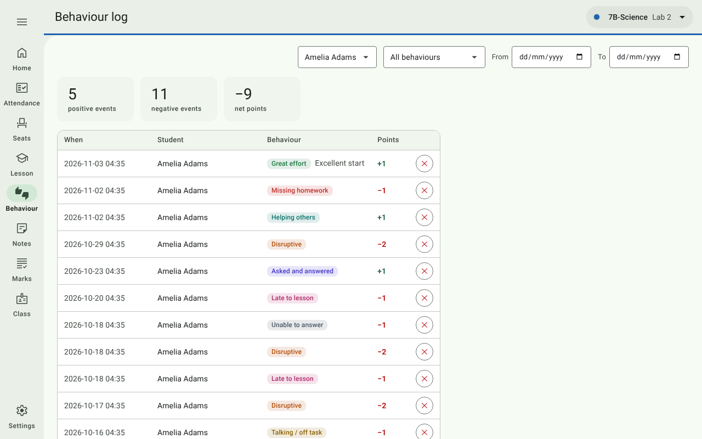
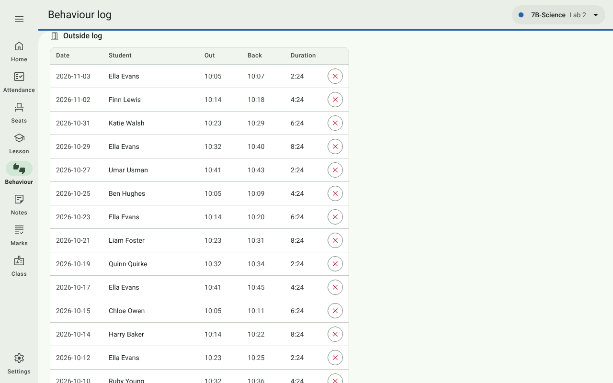
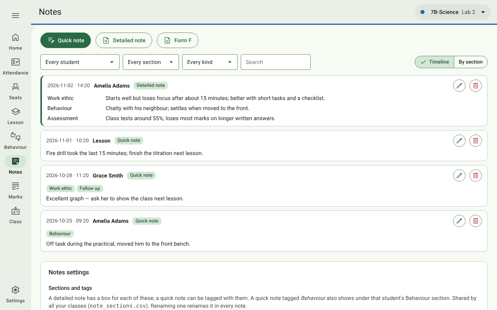
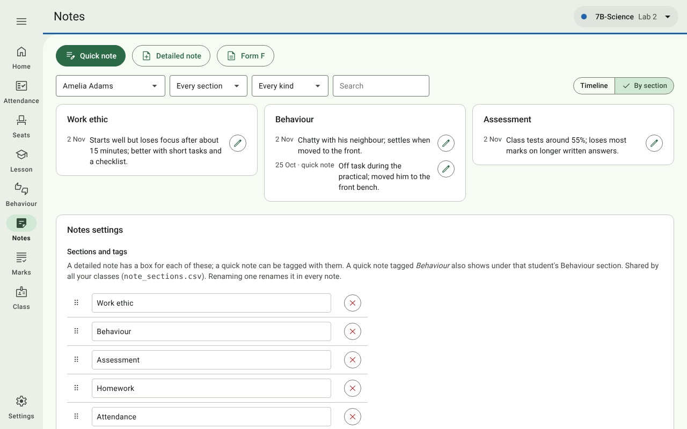
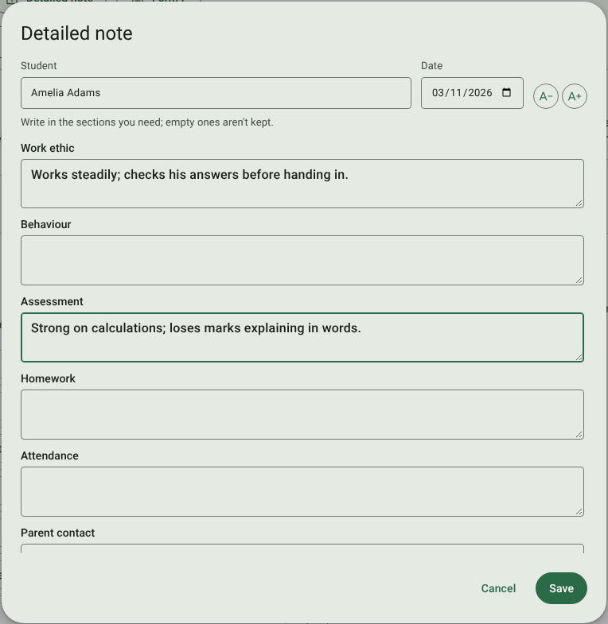
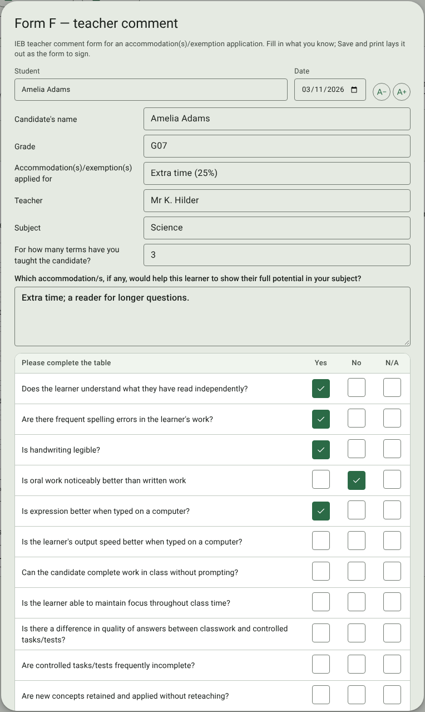
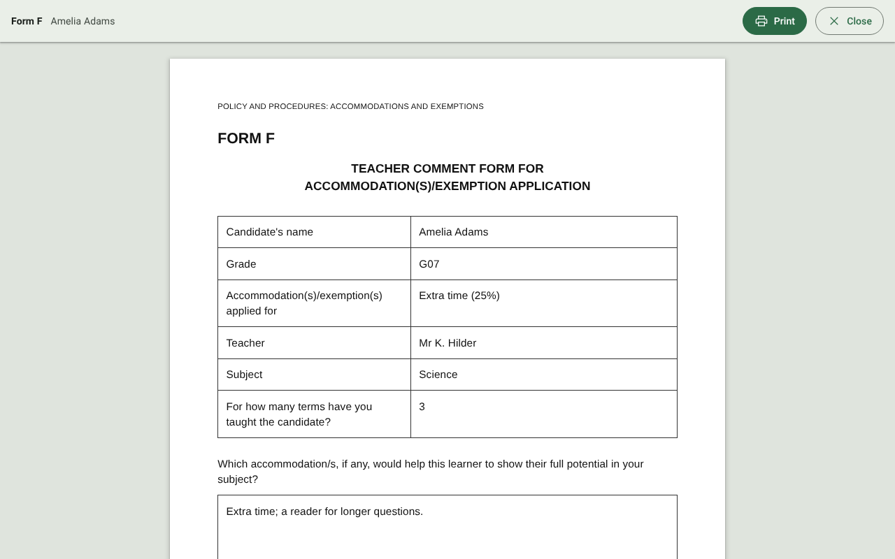
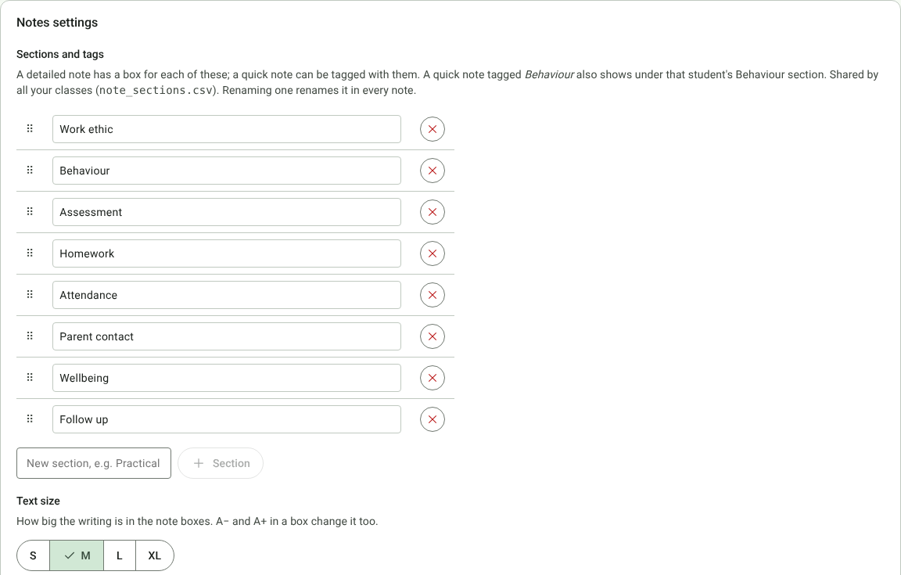

# 6. Behaviour log and notes

[← Lesson](05-lesson.md) · [Contents](../README.md) · Next: [Marks →](07-marks.md)

This chapter covers two pages: the [behaviour log](#filtering) (**Behaviour** in the navigation rail) and
[Notes](#notes).

Open **Behaviour** in the navigation rail. It lists everything recorded for the class, newest first. With privacy
mode on, press **Show student details** first.

## Filtering

| Filter | Shows |
| --- | --- |
| **All students** / a name | One student's entries. Three tiles appear on top: positive events, negative events and net points. |
| **All behaviours** / a behaviour | Only that behaviour, e.g. every *Late to lesson*. |
| **From** / **To** | Entries between two dates. |

The table shows the latest 300 matching entries (it says so when there are more).

## Correcting mistakes

The **✕** at the end of a row deletes that entry, with **Undo**. Use it for a tap on the wrong seat that you didn't
undo straight away.

With the [dashboards](08-dashboards-and-reports.md) switched on, each student's name is a link to their dashboard.

## Outside log

Below the behaviour table is the **Outside log**: every timed trip out of the classroom from the [Lesson](05-lesson.md#outside)
page, with the date, when the student left and came back, and how long they were out. A trip still running shows
**still out**. The student and date filters at the top apply here too, and **✕** deletes a trip (with Undo).

## Notes

Open **Notes** in the navigation rail. It holds everything you've written about the class's students and lessons,
newest first. With privacy mode on, press **Show student details** first.

There are three kinds of note:

| Kind | What it is | Written from |
| --- | --- | --- |
| **Quick note** | A line or two, with tags. About one student, or about the lesson. | A student's pop-up in a lesson (**Note**), the lesson toolbar's **Quick note**, or **Quick note** here. See [Notes in a lesson](05-lesson.md#notes). |
| **Detailed note** | A dated entry about one student, in sections: *Work ethic*, *Behaviour*, *Assessment*… | **Detailed note** here. |
| **Form F** | The IEB teacher comment form for an accommodation/exemption application. | **Form F** here. |

### Finding notes

| Control | Shows |
| --- | --- |
| **Every student** / a name | One student's notes, or **The lesson** for notes about a whole lesson. |
| **Every section** / a section | Detailed notes' text for that section, and quick notes tagged with it. |
| **Every kind** | Only quick notes, detailed notes or Form F. |
| **Search** | Notes containing some words. |
| **Timeline** / **By section** | Newest first, or (once a student is chosen) gathered under each section. |

**By section** shows one student's notes under each heading: a detailed note's *Behaviour* text sits beside the quick
notes tagged *Behaviour*. Quick notes with no tag go under **Other**.

Every note has **✎** to edit it and **🗑** to delete it (with Undo).

### Detailed notes

Press **Detailed note**, choose the student and the date (today unless you change it), and write in the sections you
need. Empty sections aren't kept.

### Form F

**Form F** is the IEB's *Teacher comment form for accommodation(s)/exemption application*, kept as a note so it's
with the student's other notes.

- **Candidate's name**, **Grade** and **Subject** come filled in from the class. **Teacher** comes from your name
  under [Settings → General → Parent reports](10-settings.md#parent-reports). Change any of them if you need to.
- Write in what was applied for, how many terms you've taught the candidate, and which accommodations would help.
- Tick **Yes**, **No** or **N/A** for each question. Tap a tick again to clear it.
- Add the percentage of assessment not completed under controlled conditions.

**Save** keeps it. **Save and print** also lays it out as the form, on two A4 pages, ready to sign:

To print it again later, press the **🖨** on its note.

### Notes settings

At the bottom of the Notes page:

- **Sections and tags** is one list: the sections of a detailed note and the tags of a quick note. It's shared by all
  your classes.
  - Drag **⠿** to reorder.
  - Edit a name and click away to rename it. That renames it in every note too.
  - **✕** removes it from the list; notes already written keep it.
  - Type a name and press **+ Section** to add one.
- **Text size** sets how big the writing is in the note boxes (**A−** / **A+** in a box change it too).
