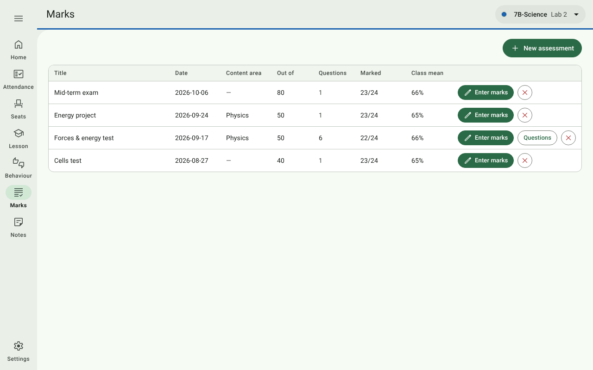
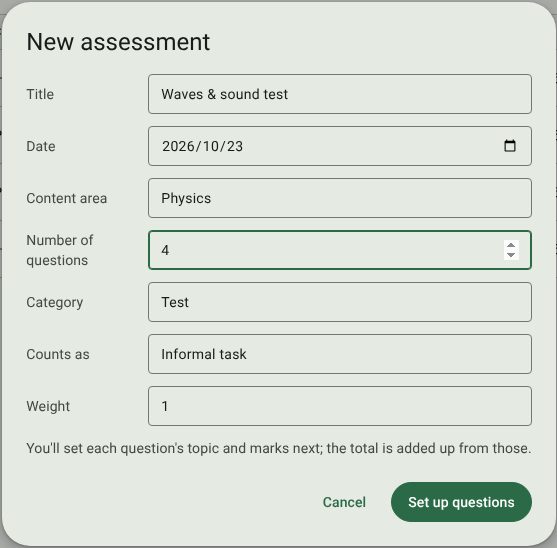
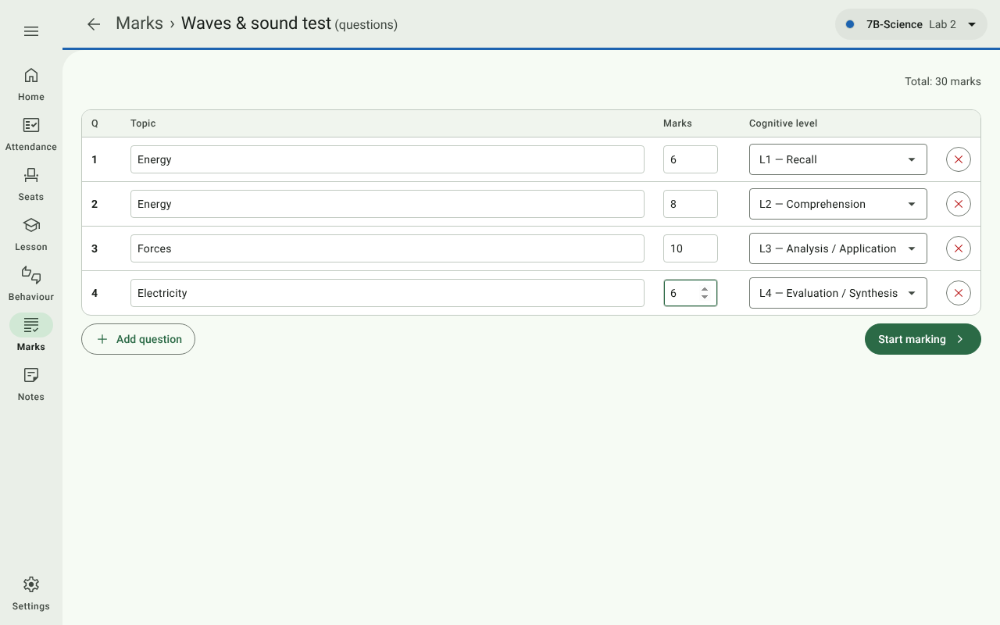
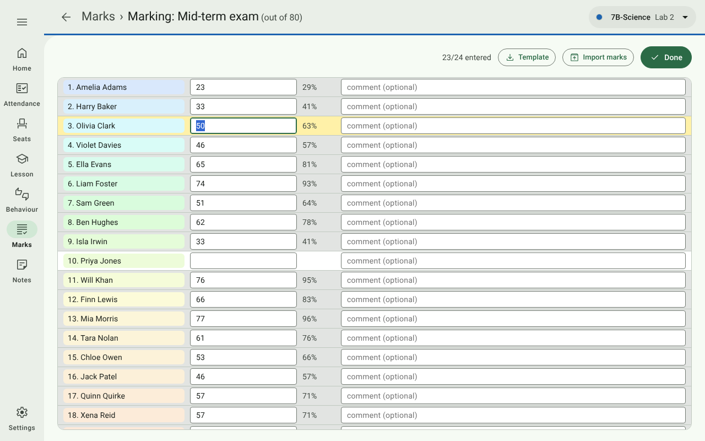
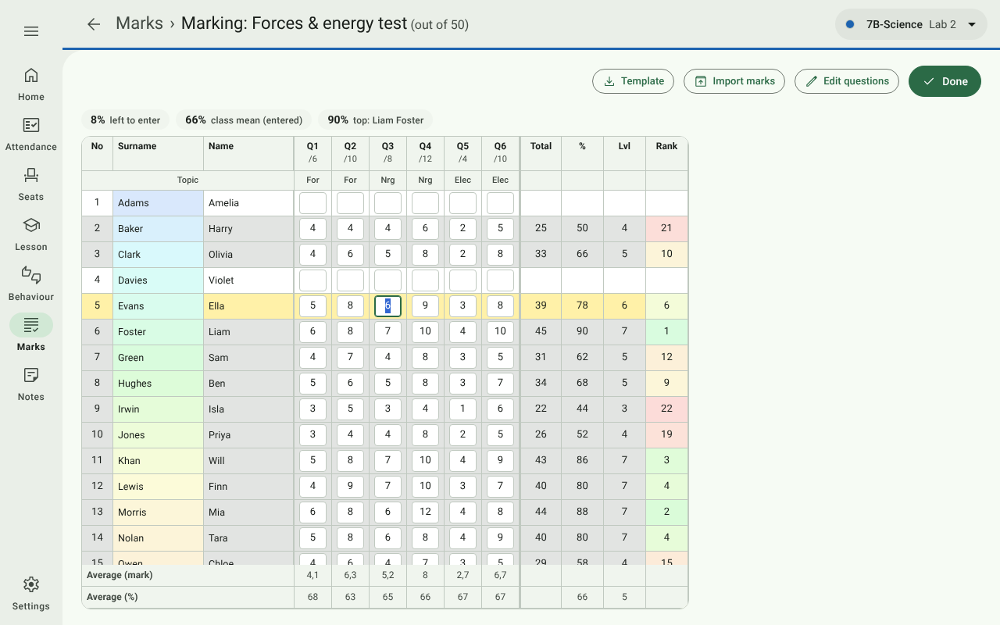
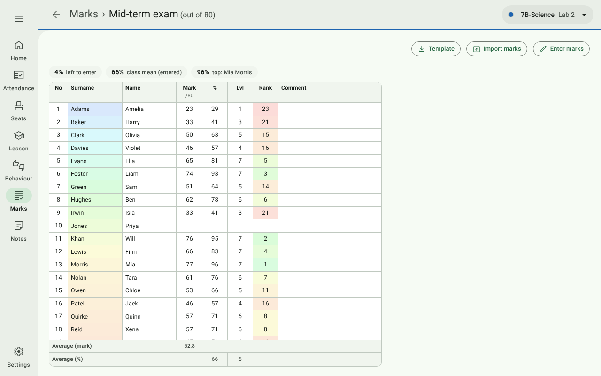
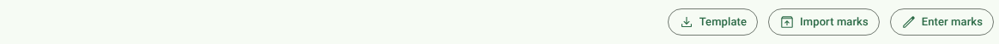
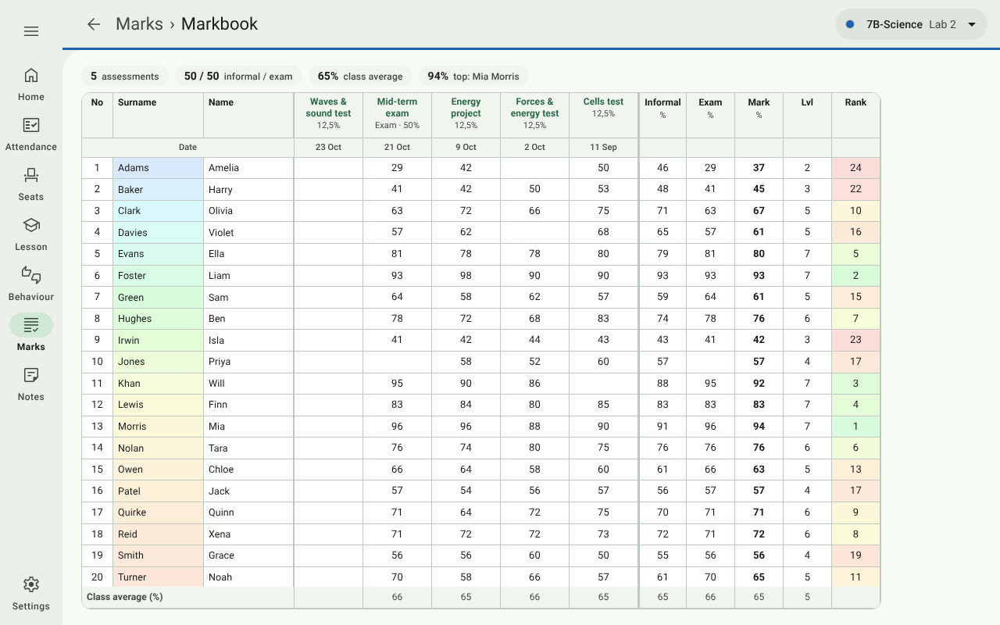
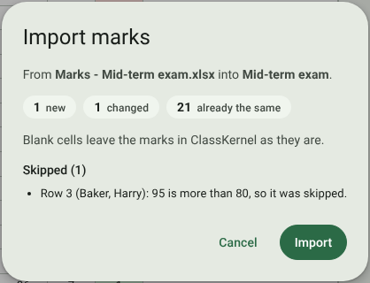

# 7. Marks

[← Behaviour log](06-behaviour-log.md) · [Contents](../README.md) · Next: [Dashboards and parent reports →](08-dashboards-and-reports.md)

Open **Marks** in the navigation rail. It lists the class's assessments, newest first.

| Column / button | Shows / does |
| --- | --- |
| **Content area** | The area the test covers (e.g. *Physics*), or — for mixed. |
| **Out of** | The total. For a test marked per question, the sum of its questions. |
| **Questions** | 1 for a single mark; otherwise the number of questions, as a button that opens them to edit. |
| **Counts as** | **Informal** or **Examination** — which side of the weighted mark it counts towards (see [Weighting](#weighting)). Change it here at any time. |
| **Weight · share** | Its weight among tasks of the same kind (1 = normal, 2 = counts double, 0 = doesn't count), and the share of the final mark that gives it. |
| **Marked** | How many students have a mark. |
| **Class mean** | The average percentage of the marks entered. |
| **View** | Shows the marks read-only (see [Viewing results](#viewing-results)). |
| **Enter marks** | Opens mark entry. |
| **✕** | Deletes the assessment and every mark entered for it (asks first). |
| **Markbook** (top right) | Every assessment for the class on one page (see [The markbook](#the-markbook)). |

## New assessment

Press **New assessment**.

| Field | Notes |
| --- | --- |
| **Title** | e.g. *Waves & sound test*. |
| **Date** | Defaults to today. |
| **Content area** | From the topic bank for the class's grade, or for the grade it shares a list with (Settings → Assessments). Choose *none / mixed* for a test across areas. |
| **Number of questions** | **1** records a single mark per student. **More than 1** records a mark per question, each tagged with a topic and cognitive level. |
| **Out of** | Only for a single mark. For per-question tests the total is added up from the questions. |
| **Category** | Free text, e.g. *Test*, *Quiz*, *Homework*, *Exam*, *Project*. The dashboards compare means by category. |
| **Counts as** | **Informal task** or **Examination**. A category containing *exam* (e.g. *June exam*) starts as Examination; you can change it. |
| **Weight** | 1 to start with; 2 to count double, 0 to leave it out of the weighted mark. |

A single-mark assessment goes straight to mark entry (**Create & mark**). A per-question test goes to its question
setup first (**Set up questions**).

## Setting up questions

For each question, give:

- **Topic** — type, or choose from the suggestions. Suggestions come from the class grade's topic bank (or the list
  that grade shares with another), filtered to the test's content area; you can still type a topic that isn't in
  the bank.
- **Marks** — what the question is out of.
- **Cognitive level** — from the list under Settings → Assessments (by default L1 *Recall* to L4
  *Evaluation / Synthesis*).

**Add question** adds a row; **✕** removes one. The total at the top right updates as you go. Press
**Start marking** when done. You can come back with the number in the **Questions** column of the list (or
**Edit questions** while marking).

The topic and level tags are what let the dashboards and parent reports show strengths by topic and by cognitive
level.

## Entering marks: one mark per student

Built for working through a pile of scripts:

- Type a mark and press **Enter** (or **↓**) to jump to the next student. **↑** goes back. Half marks can be typed
  with a decimal comma or point (`12,5` or `12.5`).
- The percentage appears beside each mark. A mark over the total shows **> max!**.
- Leave a box blank for a student who was absent or didn't write.
- An optional **comment** per student shows on their dashboard.
- **The student you're typing in is highlighted yellow**; a student turns **grey** once their mark is in. The count
  at the top right (*23/24 entered*) shows how many are done.
- A light tint down the name column — blue at the top, through green, yellow and orange, to red at the bottom —
  shows how far down the list you are at a glance.
- **Template** and **Import marks** fill the marks in from a spreadsheet instead (see
  [Marks from a spreadsheet](#marks-from-a-spreadsheet)).

Press **Done** to finish. Every mark is saved the moment you type it.

## Entering marks: per question

The grid is laid out like a mark sheet: one row per student (by surname), one column per question, with each
question's maximum (e.g. */6*) and topic short label under its number.

**Moving around**

| Key | Moves |
| --- | --- |
| **Enter** | Across to the next question (at the end of a row, to the next student). Under Settings → Assessments you can make Enter move **down** instead. |
| **Tab** | Always the other way to Enter. **Shift** reverses either. |
| **Arrow keys** | One cell. |

**While you mark**

- Marks can be typed with a decimal comma or point. A mark above the question's maximum is corrected to the
  maximum; a negative one to 0.
- Leave a cell blank for a question not answered.
- The row you're typing in is **yellow**; a row turns **grey** once every question has a mark. The surname column
  carries the same blue-to-red position tint.
- **Total**, **%**, **level or symbol** and **rank** fill in on the right as you type. The **Rank** column is tinted
  green for the top student through yellow and orange to red for the lowest. Tied students share the better place:
  two tied for first are both 1, and the next is 3.
- The line above the students shows the share still **left to enter**, the **class mean** so far and the **top**
  student.
- The **Average (mark)** and **Average (%)** rows at the bottom show how each question went.
- Only the student rows scroll; the title, headings and average rows stay in place.

Press **Done** to finish.

## Viewing results

**View** on the list shows an assessment's marks **read-only**, so you can look at results — or show them to a
colleague — without any risk of changing a mark.

- For a **single-mark** test: each student's mark, %, level or symbol, rank (tinted as above) and comment, with the
  class figures above the list and the average mark and % below it.
- For a test **marked per question**: the same grid as marking, with plain numbers.

**Enter marks** switches to marking. **Template** and **Import marks** are here too. The top bar names the page you
are on (for example **Marks › Mid-term exam**), and its **←** takes you back to the list. It's in the same place on
every page opened from within Marks: the markbook, a test's questions and marking.

## The markbook

**Markbook** (top right of the Marks list) shows every assessment for the class on one page.

- One row per student; one column per assessment, **newest first**, as a percentage. Under each test's name is its
  **share of the final mark** (examinations are marked *Exam*) and its date. Tap a test's name to open its
  results.
- On the right: each student's **Informal** and **Exam** averages, their weighted **Mark**, its level or symbol,
  and their **rank**.
- The **Class average** row at the bottom gives the mean under every column.
- The line at the top shows the number of assessments, the grade's informal / exam split, the class average and the
  top student.

## Weighting

A student's **weighted mark** is the one ClassKernel uses everywhere: the markbook, both dashboards (averages, ranks
and top students) and parent reports. It is worked out in two steps:

1. **Within each side**, every task counts by its **weight**. The informal tasks give an informal average; the
   examinations give an examination average. A weight of 2 counts double; 0 leaves a task out.
2. **The two sides are blended** by the grade's split, set under
   [Settings → Assessments → Weighting](10-settings.md#weighting-informal-tasks-and-examinations) — 50 / 50 until
   you change it. A student who hasn't written an examination yet is marked on their informal tasks alone (and the
   other way round).

The **share** column shows what this means for each task. For example, with a 50 / 50 split, three informal tasks
of weight 1 and one examination, each informal task is 16,7% of the final mark and the examination 50%.

## Marks from a spreadsheet

You can fill in a test's marks outside ClassKernel — in Excel, Google Sheets or LibreOffice, or by a colleague —
and import them.

1. On the test's marking page or results page, press **Template**. It saves an Excel workbook of the class for
   that test (`Marks - <title>.xlsx`), including any marks already entered:
   - for a single mark: *No, Surname, Name, Mark (out of …), Comment, Adam number, Student ID*;
   - for a test marked per question: one column per question, headed with its maximum.
2. Fill in the marks. Keep the heading row; sort the rows any way you like.
3. Press **Import marks** and choose the file (`.xlsx`, or a `.csv` separated by commas or semicolons). Before
   anything is saved, you see what will happen:

   

   - how many marks are **new**, **changed** or **already the same**;
   - every cell **skipped** and why: an unknown student, not a number, below 0 or above the maximum;
   - a warning if the file was made for a **different test**.

   Press **Import** to apply it, or **Cancel**.

Students are matched by **Student ID**, then **Adam number**, then surname and name. A blank cell leaves that mark
as it is. For a test marked per question, each student's total is worked out again from their questions.

## Levels or symbols

Results are shown everywhere (marking grid, markbook, dashboards, parent reports and spreadsheet exports) on one
scale, chosen under [Settings → Assessments](10-settings.md#assessments):

| Level | 7 | 6 | 5 | 4 | 3 | 2 | 1 |
| --- | --- | --- | --- | --- | --- | --- | --- |
| **%** | 80+ | 70–79 | 60–69 | 50–59 | 40–49 | 30–39 | below 30 |

| Symbol | A | B | C | D | E | F |
| --- | --- | --- | --- | --- | --- | --- |
| **%** | 80+ | 70–79 | 60–69 | 50–59 | 40–49 | below 40 |

The level or symbol is taken from the **rounded** percentage the screens show, so 79,6% shows as 80% and is a 7
(an A).

Numbers are shown the South African way, with a decimal comma (`8,5`) and a space between thousands (`1 234`).
