# 8. Dashboards and parent reports

[← Marks](07-marks.md) · [Contents](../README.md) · Next: [Teaching tools →](09-teaching-tools.md)

The analysis lives in two optional tools: **Class & student dashboards** and **Parent reports**. Switch them on
under [Settings → Tools](10-settings.md#tools); they then appear under **Tools** on Home and in the expanded
navigation drawer. Both work on the class chosen in the top bar, and only **read** your data — they never change
it.

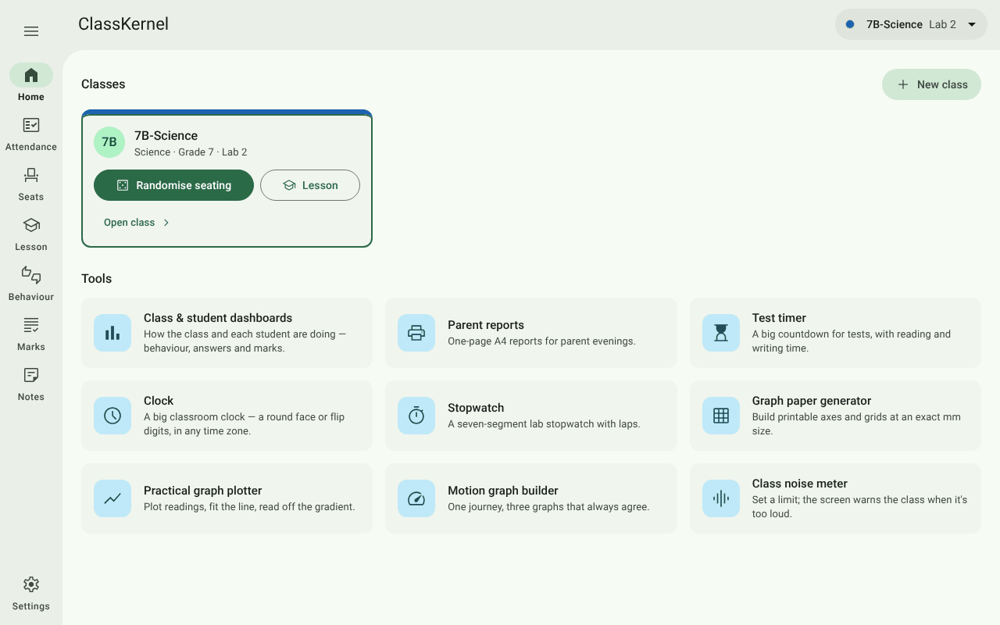

## Class & student dashboards

Open the dashboards from their card on Home. With privacy mode on, press **Show student details**.

The dashboards have two tabs, **Class** and **Student**, and one **period** filter for both:
**Last 2 weeks**, **Last 4 weeks** or **All** (remembered on this computer). Each tab opens with a short written
summary built from fixed, explainable rules, so you can always see why someone is mentioned.

### Class tab

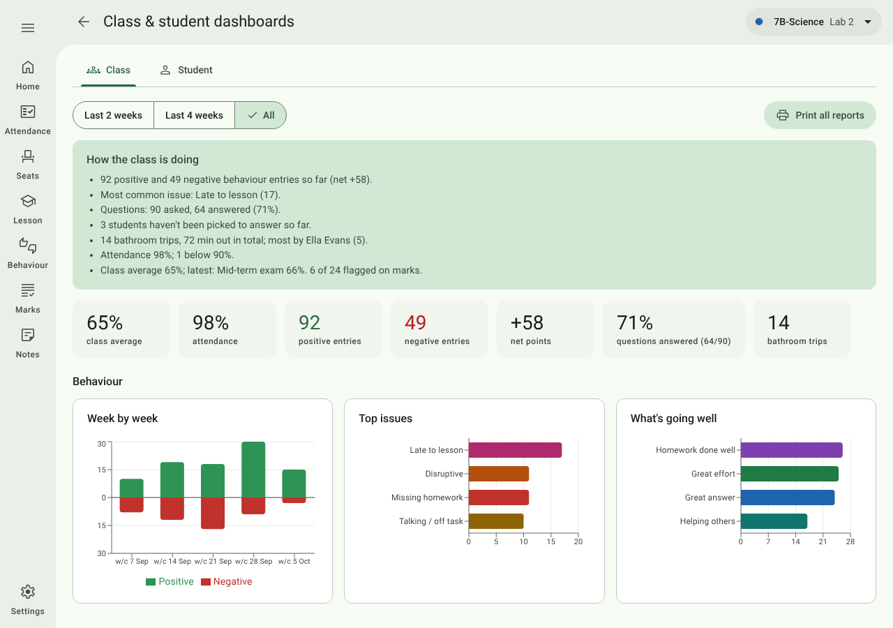

**Summary and tiles** — class average, attendance, positive and negative entries, net points, questions answered
(from Pick a student) and bathroom trips.

**Behaviour** — positive and negative entries week by week, the **top issues**, and **what's going well**.

**Students** — the people who stand out, each list with the rule that puts a student on it. Tap a name to open
that student's dashboard.

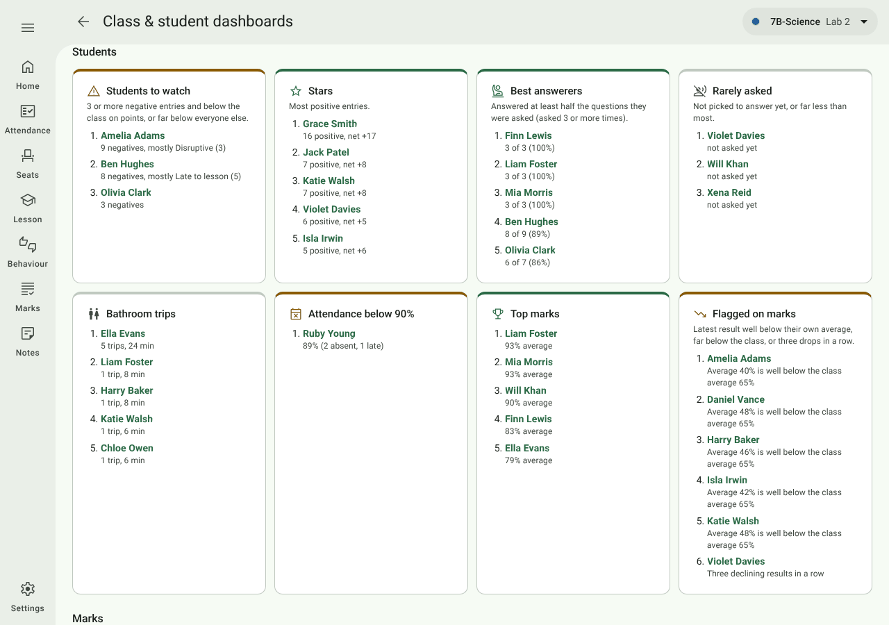

| List | Who is on it |
| --- | --- |
| **Students to watch** | 3 or more negative entries and below the class on points, or far below everyone else. |
| **Stars** | Most positive entries. |
| **Best answerers** | Answered at least half the questions they were asked (asked 3 or more times). |
| **Rarely asked** | Not picked to answer yet, or far less than most. |
| **Bathroom trips** | Most trips, with time out. |
| **Attendance below 90%** | With their absences and lates. |
| **Top marks** | Highest average. |
| **Flagged on marks** | Latest result well below their own average, far below the class, or three drops in a row. |

Answers from Pick a student count as questions, never as behaviour, so a student who can't answer isn't listed as
one to watch.

**Marks** — the class mean by assessment, the mark distribution of any assessment (choose it from the menu),
attendance against marks (one dot per student; hover for the name), and the mean by category when there is more
than one category.

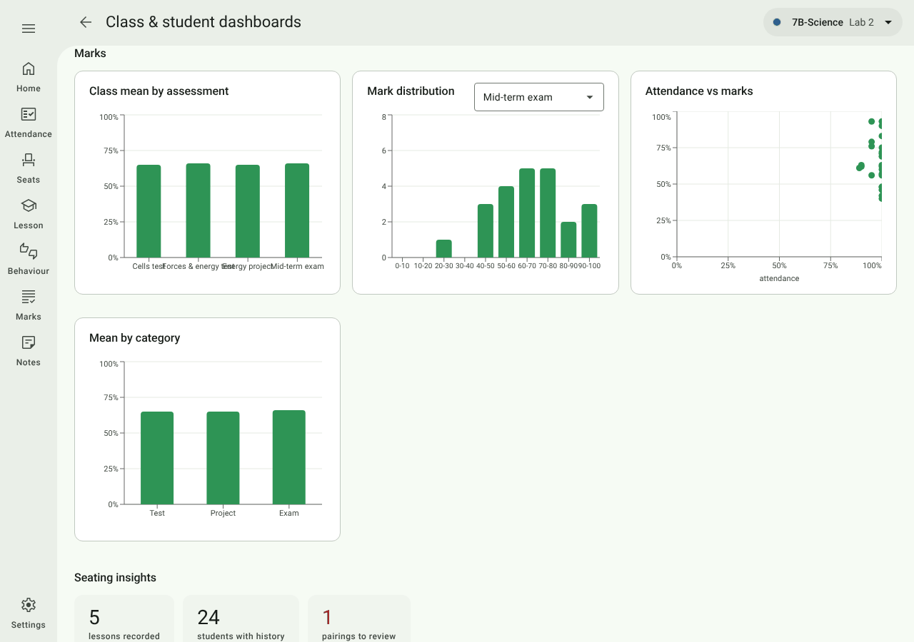

### Seating insights

At the bottom of the Class tab. These learn from the seat history saved each time you press
[End lesson](05-lesson.md#end-lesson), so they fill in after a few lessons.

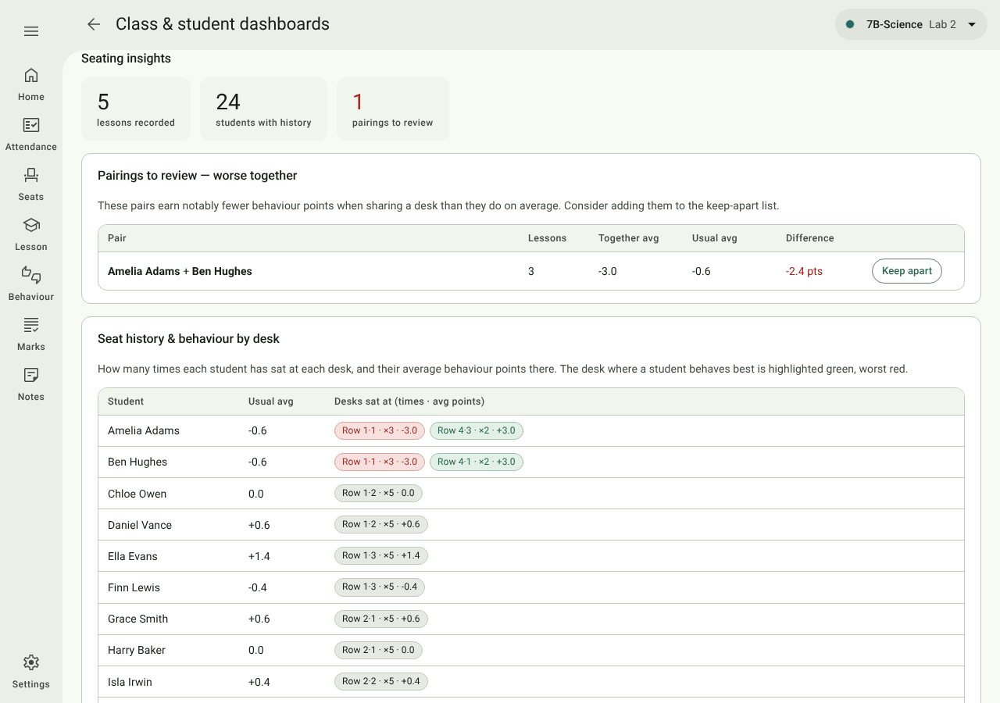

- **Pairings to review — worse together**: pairs who earn notably fewer behaviour points sharing a desk than they
  do on average. **Keep apart** adds the pair to the class's
  [seating rules](02-setting-up-a-class.md#seating-rules) in one tap.
- **Seat history & behaviour by desk**: how often each student has sat at each desk and their average points
  there. The desk where they do best is green, worst red.

### Student tab

Everything recorded for one child. Step through the class with **‹ ›** or choose a name from the menu. You can also
get here from the **chart** button in Settings → Students, or a student's name in the Behaviour log.

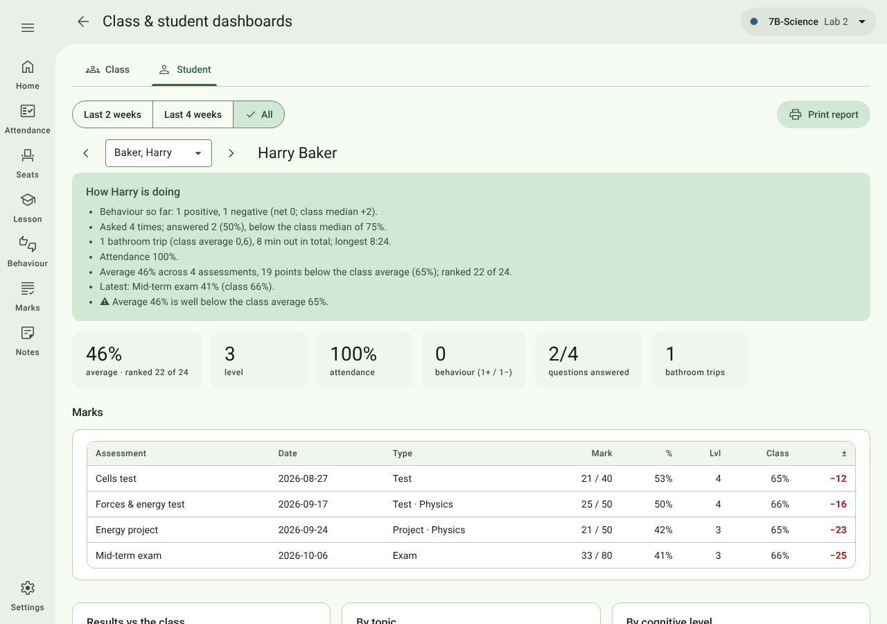

- **Flags and notes** beside the name.
- **Summary and tiles**: average and rank in the class, level or symbol, attendance, behaviour, questions answered,
  bathroom trips.
- **Marks**: every assessment with mark, %, level or symbol, the class mean and the gap to it (±); their trend
  against the class; and, for tests marked per question, strengths **by topic** and **by cognitive level** beside
  the class's.

  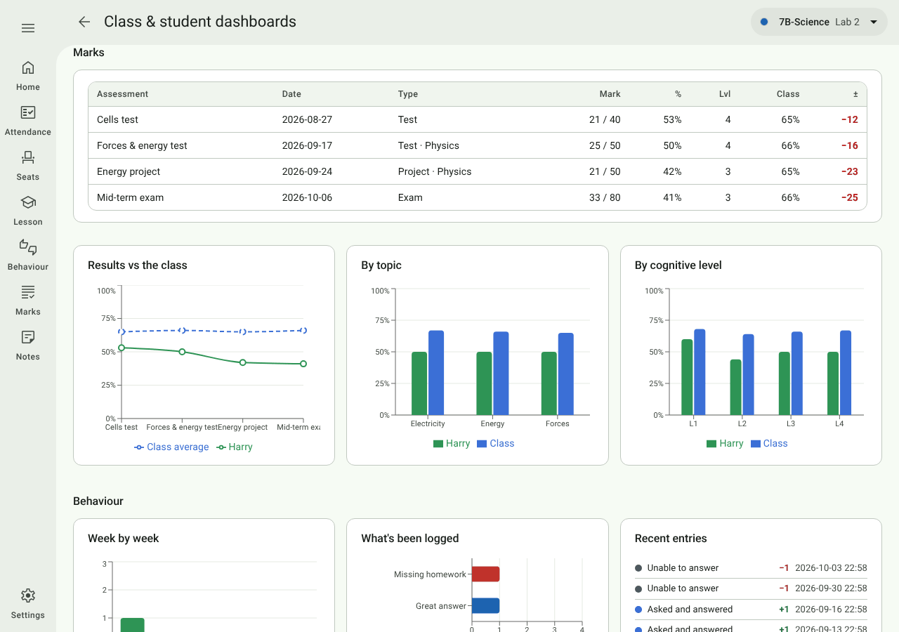

- **Behaviour**: week by week, what's been logged, and the latest entries.
- **Questions** (answered / unable), **Bathroom** trips with times, and **Attendance** with the dates absent or
  late.

  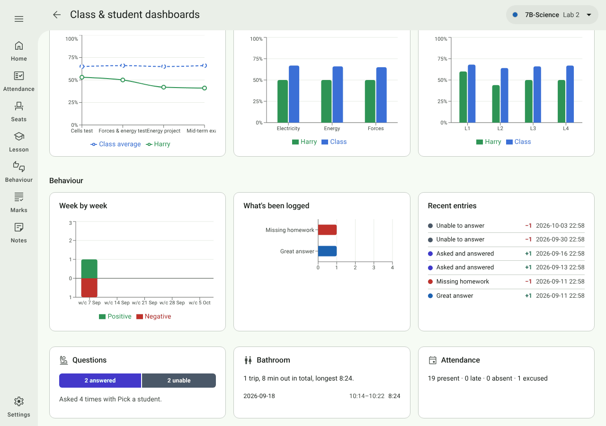

## Parent reports

A one-page A4 report per student for parent evenings. There are two ways in:

- the **Parent reports** card on Home — the whole class, or one student; or
- with the dashboards on too, **Print report** on a student's tab, or **Print all reports** on the Class tab (shown
  once the student details are uncovered).

Both open a full-screen print preview: options on the left, the pages on the right exactly as they will print.

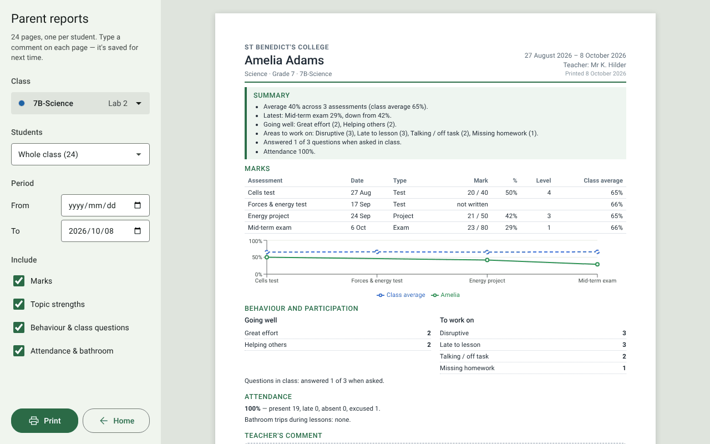

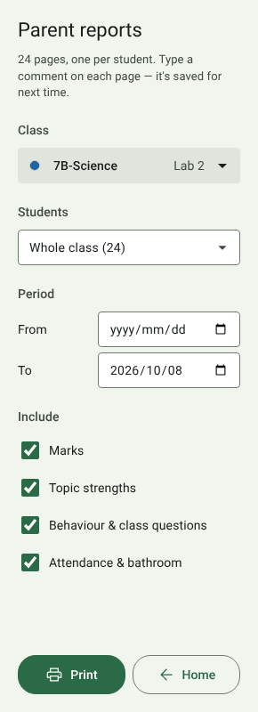

| Option | What it does |
| --- | --- |
| **Class** | (From the Home card) the class menu, since the preview covers the top bar. |
| **Students** | (From the Home card) **Whole class**, one page each, or one student. |
| **Period: From / To** | The dates the report covers. **From the start** clears the start date. |
| **Include** | Tick the sections to print: *Marks*, *Topic strengths*, *Behaviour & class questions*, *Attendance & bathroom*. Remembered on this computer. |
| **Print** | Prints the pages (or saves a PDF via the Windows printer list). |
| **Close** / **Home** (or **Esc**) | Leaves the preview. |

Put your **school name** and **your name** at the top of every page under
[Settings → General → Parent reports](10-settings.md#parent-reports).

 

**On each page**

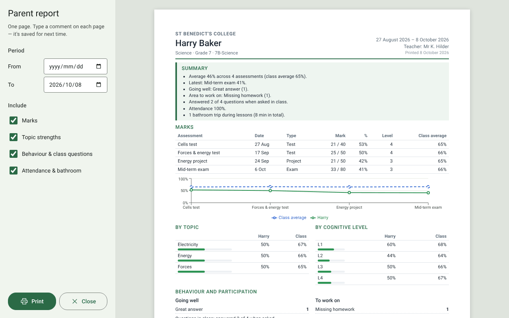

- A **parent-friendly summary** — no class rank and no staff-only wording.
- **Marks** against the class average, with a small trend chart.
- **Topic strengths** by topic and by cognitive level (for tests marked per question).
- **Behaviour** as *Going well* and *To work on*, and questions answered in class.
- **Attendance** and bathroom trips.
- A **Teacher's comment** box: type straight onto the page. It is saved with the class (in
  `report_comments.csv`) when you click away, and is there next time. Leave it empty and it prints as blank lines
  to handwrite on.
- **Notes from our meeting**: blank lines for notes during the meeting.

A long report may run onto a second page rather than be cut off.
