# 9. Teaching tools

[← Dashboards and parent reports](08-dashboards-and-reports.md) · [Contents](../README.md) · Next: [Settings →](10-settings.md)

ClassKernel ships with extra tools that stay **switched off** until you want them, so the app is exactly as simple
as you need. Switch any of them on under [Settings → Tools](10-settings.md#tools). They then appear as cards under
**Tools** on Home and in the expanded navigation drawer.

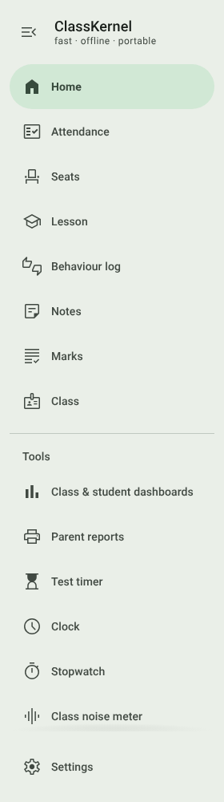

| Tool | In one line |
| --- | --- |
| [Class & student dashboards](08-dashboards-and-reports.md#class--student-dashboards) | How the class and each student are doing. |
| [Parent reports](08-dashboards-and-reports.md#parent-reports) | One-page A4 reports for parent evenings. |
| [Test timer](#test-timer) | A big countdown with reading and writing time. |
| [Clock](#clock) | A full-screen classroom clock. |
| [Stopwatch](#stopwatch) | A lab stopwatch with laps. |
| [Graph paper generator](#graph-paper-generator) | Printable grids and axes at an exact size. |
| [Practical graph plotter](#practical-graph-plotter) | Readings in, graph and gradient out. |
| [Motion graph builder](#motion-graph-builder) | x–t, v–t and a–t graphs that always agree. |
| [Block on a slope](#block-on-a-slope) | Will it slide? A slope question run, with its free-body diagrams. |
| [Collisions and impulse](#collisions-and-impulse) | Two trolleys collide: momentum, kinetic energy and the impulse. |
| [Generator](#generator) | Turn the coil; Φ, ΔΦ/Δt and the emf are drawn against time. |
| [Circuit builder](#circuit-builder) | Build an exam-style circuit, run it and read the meters. |
| [Photoelectric effect and spectra](#photoelectric-effect-and-spectra) | Photons in, photoelectrons out; hydrogen's energy levels and line spectrum. |
| [Reaction rates](#reaction-rates) | Collision theory in a beaker, with the Maxwell–Boltzmann curve. |
| [Galvanic cell animator](#galvanic-cell-animator) | An animated cell whose reading follows the Nernst equation. |
| [Electrolytic cell](#electrolytic-cell) | Switch on the supply: what forms at each electrode, and how much. |
| [Chemistry reference](#chemistry-reference) | The periodic table, with every element's details a tap away. |
| [Titration simulator](#titration-simulator) | A burette, a flask, an indicator and the pH curve. |
| [Class noise meter](#class-noise-meter) | Warns the class when it's too loud. |

Each tool opens full-page with a **←** back to Home in the top bar. Tools are built into the app, so they work
offline like everything else, and the graph tools save through the normal Windows *Save as* dialog.

**In a browser.** Every tool except the dashboards and parent reports is also on the
[ClassKernel tools website](https://j4ckr4bbit.github.io/ClassKernel/), for a computer without ClassKernel installed. Each tool has its own address to
bookmark (for example `…/#/galvanic-cell`). There, pictures are saved as downloads and the test timer's presets are
remembered by that browser; nothing is uploaded.

 

## Test timer

A big countdown for tests and timed tasks.

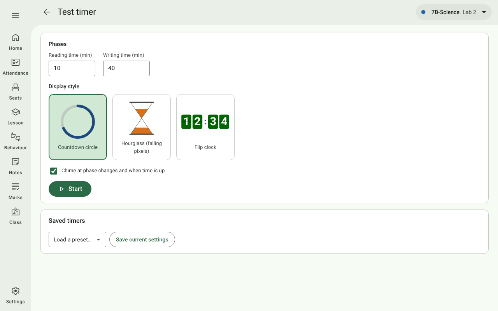

**Setting up**

- **Reading time** and **Writing time** in minutes. Set either to 0 to leave that phase out.
- **Display style**: **Countdown circle**, **Hourglass** (falling pixels) or **Flip clock**.
- **Chime** at each phase change and when time is up.
- **Saved timers**: **Save current settings** stores the setup as a preset (e.g. *10 read · 40 write*); choose one
  from **Load a preset…** next time. Each preset has a **Delete** button.

Press **Start**.

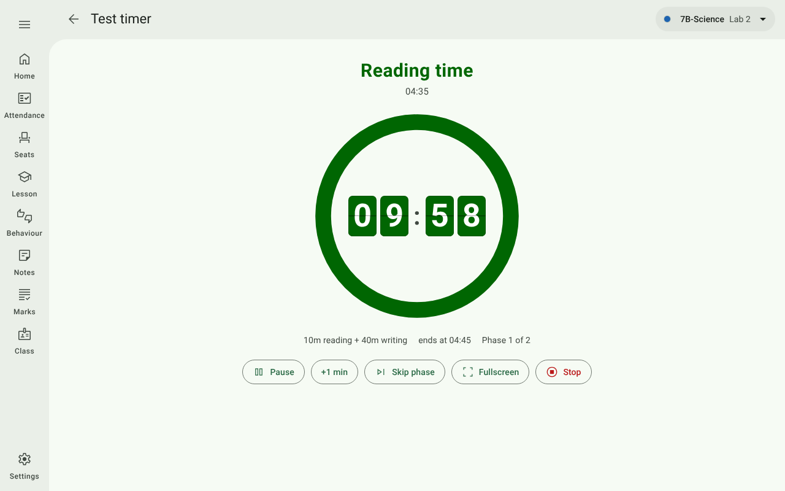

**While it runs**

The screen shows the phase (*Reading time*, *Writing time*, then *Time's up*), the time now, and when the phase
**ends**. The colour moves from green through blue and orange to red as each phase runs down.

| Button | What it does |
| --- | --- |
| **Pause** / **Resume** | Stops and restarts the countdown. |
| **+1 min** | Adds a minute to the current phase. |
| **Skip phase** / **End** | Jumps to the next phase, or ends the last. |
| **Fullscreen** | Fills the screen. |
| **Stop** | Stops the timer and goes back to the setup. |

**On other screens** the timer keeps running as a small pop-up in the bottom-right corner (inside the side panel in
teaching mode). It has a pause button, and tapping it (or its open button) returns to the full timer. When time is
up the pop-up turns red and stays until you close it.

## Clock

A full-screen classroom clock.

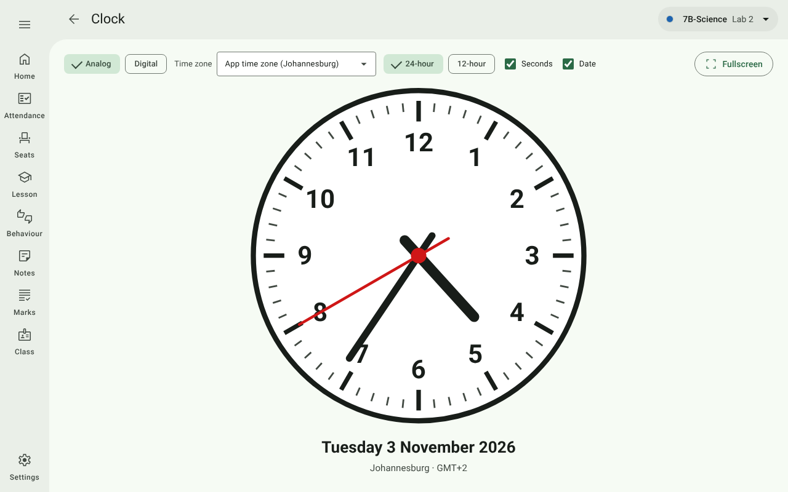

| Control | Choices |
| --- | --- |
| **Analog** / **Digital** | A round face, or the timer's flip digits. |
| **Time zone** | The app's time zone (Settings → General) or any other — handy for a field trip or an overseas exam centre. |
| **24-hour** / **12-hour** | Hour format. |
| **Seconds**, **Date** | Show or hide them. |
| **Fullscreen** | Fills the screen. |

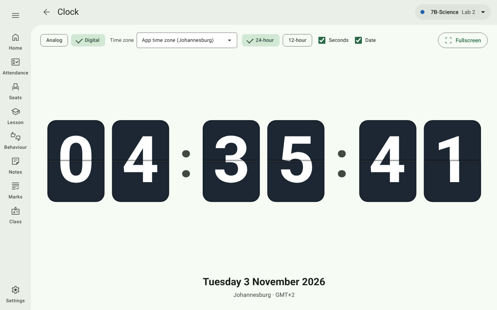

The clock saves nothing to your data; this computer just remembers the face and options you last chose.

## Stopwatch

A seven-segment LED-style stopwatch to hundredths of a second, for practicals and races.

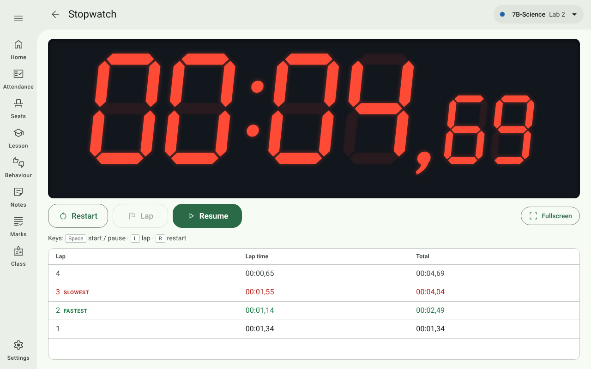

| Button | Key | What it does |
| --- | --- | --- |
| **Start** / **Pause** / **Resume** | **Space** | Starts and pauses. |
| **Lap** | **L** | Records a lap while running. |
| **Restart** | **R** | Clears the time and laps. |
| **Fullscreen** | | Fills the screen. |

Laps are listed newest first, with each lap's time and the running total; the **fastest** and **slowest** laps are
marked. The stopwatch keeps running if you leave the screen. Nothing is saved.

## Graph paper generator

Builds graph paper and axes at an exact size, for worksheets and tests.

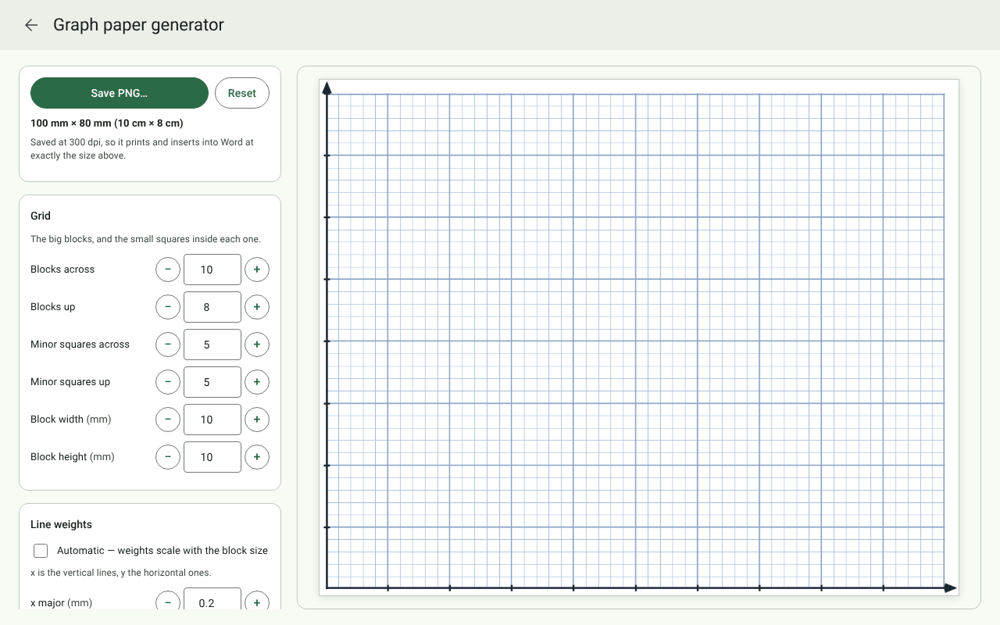

| Section | Settings |
| --- | --- |
| **Grid** | Blocks across and up, minor squares in each block, and the block width and height in mm. |
| **Line weights** | **Automatic** (scaled to the block size), or set each line's weight in mm. |
| **Axes & arrows** | The **quadrants**: quadrant 1 only (the axes cross bottom-left), quadrants 1 & 2 (top half), quadrants 1 & 4 (right half) or all four (the axes cross in the middle). Then dark lines on the x- and y-axes, arrows at any of their four ends, and the arrowhead size. With an odd number of blocks, the spare one goes on the positive side. |
| **Tick marks** | Ticks on either axis, with their length and weight. |
| **Colours** | Major and minor gridlines, each axis, and the ticks. |

The preview updates as you change things. The size line at the top (e.g. *100 mm × 80 mm*) is the printed size.
**Save PNG…** saves a 300 dpi image that drops into Word at exactly that size. **Reset** goes back to the defaults.
A sheet too large to draw says so instead of saving.

## Practical graph plotter

Type or paste a table of readings and get the plotted graph, a least-squares line of best fit, and its gradient.

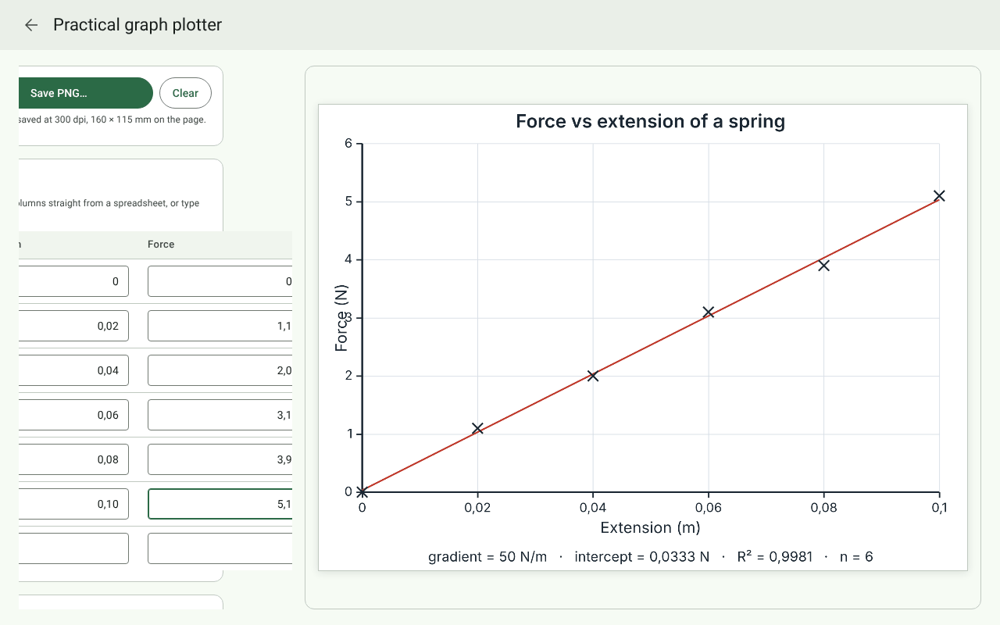

| Section | What to do |
| --- | --- |
| **Readings** | Type x and y values, or paste two columns straight from a spreadsheet. Decimal commas (`0,02`) are fine. A spare empty row is always kept at the bottom; **✕** removes a reading. |
| **The line** | **Draw the line of best fit**, **Force it through the origin**, and **Print the gradient under the graph**. The **gradient**, **y-intercept** and **R²** show here as you type. |
| **Labels** | The title, each axis's name and its unit (e.g. *Extension*, `m`). The gradient's unit is built from them (`N/m`). |
| **The sheet** | Start both axes at zero, gridlines, the printed width and height in mm, and the colours of the points and the line. |

**Save PNG…** saves a 300 dpi image at the printed size, for a practical write-up or a memo. **Clear** empties the
readings.

## Motion graph builder

Describe a journey a stage at a time and get the **position–time**, **velocity–time** and
**acceleration–time** graphs worked out from it, so the three can never contradict each other.

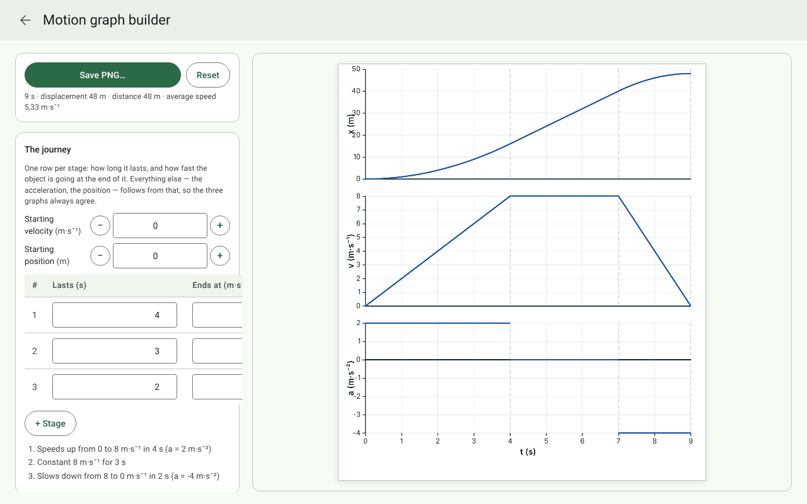

**The journey**

- **Starting velocity** (m·s⁻¹) and **starting position** (m).
- One row per stage: how long it **lasts** (s) and the velocity it **ends at** (m·s⁻¹). The acceleration and
  position follow from these.
- **+ Stage** adds a stage; **✕** removes one. Under the table each stage is described in words (e.g. *Speeds up
  from 0 to 8 m·s⁻¹ in 4 s (a = 2 m·s⁻²)*), and the top panel sums up the displacement, distance and average speed.

**The figure**

- Each graph can be **Drawn**, **Blank** (axes only, for learners to draw on) or **Off**.
- **Question: v–t given** draws the v–t graph and blanks the other two. **Memo: all drawn** draws all three. Same
  journey, so the question and the memo can never drift apart.

**The sheet** — dashed lines at each stage boundary, gridlines, a title, the width, the height of each graph, and
the curve colour.

**Save PNG…** saves a 300 dpi image; **Reset** goes back to the example journey.

## Block on a slope

An inclined-plane question on the board: set it up, ask the class whether the block will move, then run it. The
block stays put while static friction can hold it, or slides — speeding up, slowing down, stopping — exactly as
Fnet = ma says, with its free-body diagrams beside it.

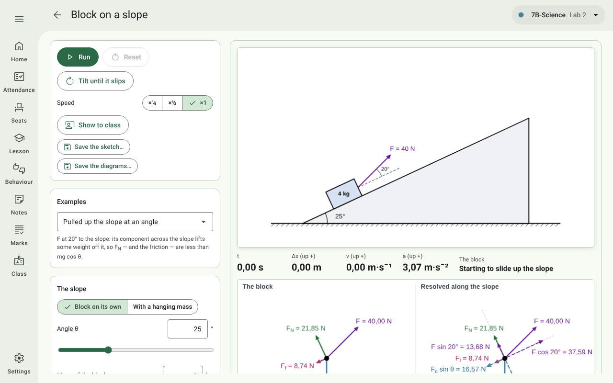

**Setting it up**

- **Block on its own** or **With a hanging mass** (a light string over a frictionless pulley at the top of the slope).
- The **angle** θ, the block's **mass** (and the hanging mass), **μₛ** and **μₖ**, or **Frictionless**. Numbers take a
  comma or a point.
- An **applied force F** (block on its own): its size, up or down the slope, and its **angle to the slope** —
  positive tilts it away from the surface (a pull, drawn from the front of the block), negative into it (a push,
  drawn onto the back); **Make it horizontal** sets a horizontal push.
- **The start**: where the block starts on the slope, its **starting velocity** (up the slope positive — give it a
  push) and the slope's length.

**Running it**

- **Run**, **Pause**, **Reset**, at full, half or quarter speed. The readings show t, the displacement, v and a (up the
  slope positive) and what the block is doing ("At rest: static friction holds it", "Moving up the slope, slowing
  down"…). A block that comes to rest is checked again: it stays if static friction can hold it, or slides back.
- **Tilt until it slips** raises the angle slowly from where it is until the block slides, and says where: with
  nothing but its weight, the normal force and friction, at tan θ = μₛ — whatever the mass.
- **Cut the string** (with a hanging mass), mid-run: the block carries on alone and the hanging mass falls freely.
- The run stops at the bottom or top of the slope, when the hanging mass reaches the floor or the pulley, or after
  the block has been at rest for two seconds.

**The free-body diagrams**, drawn the way the SAG asks: the block as a dot, every force an arrow pointing away from
it, **drawn to scale** so the relative sizes are right. *The block* shows the forces as they act; *Resolved along the
slope* adds the weight's components Fg sin θ and Fg cos θ as dashed arrows (and an angled F's
components), on dashed axes along and across the slope; with a pulley, a third shows the hanging mass. Label them
with the data-sheet **symbols** (Fg, FN, Ff, and F and T as the question names them) or in
**words** (weight, normal force, static or kinetic friction, applied force, tension), with or without their sizes in N.
Friction at rest is drawn as large as it needs to be, not at its maximum.

**The memo** under the graph works the current moment: Fg = mg; the components of the weight; the normal
force from equilibrium across the slope; Ffs(max) = μₛFN and whether it holds the block (and how
much static friction acts) or kinetic friction μₖFN acts against the motion; Newton's second law for the block
— or for each body with a hanging mass, giving a and T — and, while it slows, where it comes to rest
(Δx = v² / 2a). The **velocity–time graph** traces the run.

**Examples**, the shapes the papers use, with fresh values: at rest on a rough slope; sliding down a rough slope; a
frictionless slope; tilt it until it slips; given a push up the slope (it stops and slides back); pulled up at an
angle; pushed up at constant velocity (Fnet = 0); pulled up by a hanging mass; a hanging mass held by friction;
cut the string.

**Question mode** hides every number, the memo and the sizes on the diagrams; **Show to class** fills the screen
with the sketch and the readings beside the diagrams. **Save the sketch…** saves the situation as a black-and-white
300 dpi PNG for a question paper (F and the angles labelled; with question mode on, F without its size), and **Save
the diagrams…** the free-body diagrams for a memo. g = 9,8 m·s⁻². The set-up is remembered on this computer;
nothing is saved to your data.

## Collisions and impulse

Two trolleys on a frictionless horizontal track — A on the left, B on the right — for the momentum, impulse and
Newton's third law work in Paper 1. They collide (or a spring pushes them apart), and the tool draws what happens and
works the memo the IEB way.

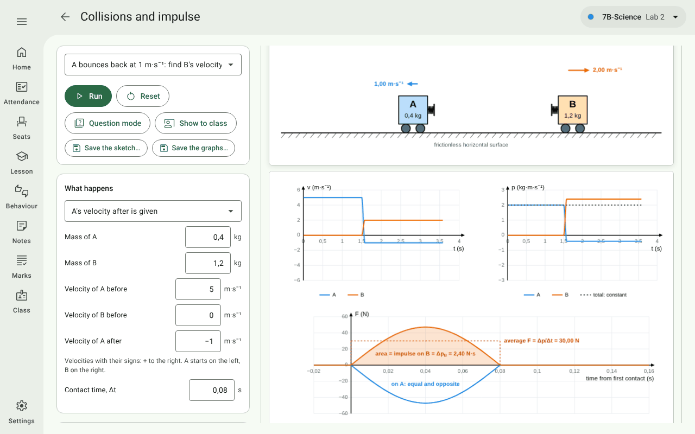

**Setting it up**

- **Example** starts from one of the usual questions: A catches B and they stick together; a head-on collision; an
  elastic collision of equal masses (they swap velocities); a light ball bouncing off a heavy one; A's velocity after
  is given, find B's; a spring pushes two trolleys apart; a car runs into a truck.
- Or choose **what happens** yourself: *they stick together*, *an elastic collision*, *A's velocity after is given* (as
  the papers usually give it) or *a spring pushes them apart* — with the two **masses**, the **velocities before**
  (with their signs) and, where it is given, **A's velocity after**.
- **Contact time, Δt** — how long they push on each other.

**Running it.** **Run** plays the run: they approach, collide — slowed down through the contact so the class can see
it (*Slow motion through the collision*) — and move apart, each with a velocity arrow and its speed. The bumpers are
springs for a bounce, putty pads when they stick, and a thread holds the spring compressed before an explosion.
**Reset** starts again.

**The graphs**, drawn as it runs: velocity and momentum against time for A and B — the total momentum a flat line —
and the force on each during the contact, equal and opposite, with the area under B's curve (the impulse, Δp) shaded
and the average force Δp/Δt dashed beside it. **Compare at double the contact time** keeps the first force graph
dashed and runs it again: the same area, half the height — airbags and crumple zones.

**The memo** under it: the sign convention, the momenta before, Σp before = Σp after solved for the unknown velocity,
ΣEₖ before and after to decide **elastic** or **inelastic** (and where the kinetic energy went), Δp of each, and the
impulse and the average force with Newton's third law. It says so when the numbers can't happen — A passing through B,
or kinetic energy gained in a collision. **Positive is to the right / to the left** turns the whole memo and the
graphs round, the velocities you type included.

**Question mode** hides what happens after the collision (the velocities, Σp and Eₖ after, the numbers on the graphs
and the memo);
**Show to class** puts the track and the graphs side by side across the screen. **Save the sketch…** and **Save the
graphs…** save black-and-white 300 dpi PNGs. The set-up is remembered on this computer; nothing is saved to your data.

## Generator

An AC or DC generator drawn the way the papers draw it, and the three graphs they ask about — the flux, its rate
of change and the emf against time — drawn as the coil turns.

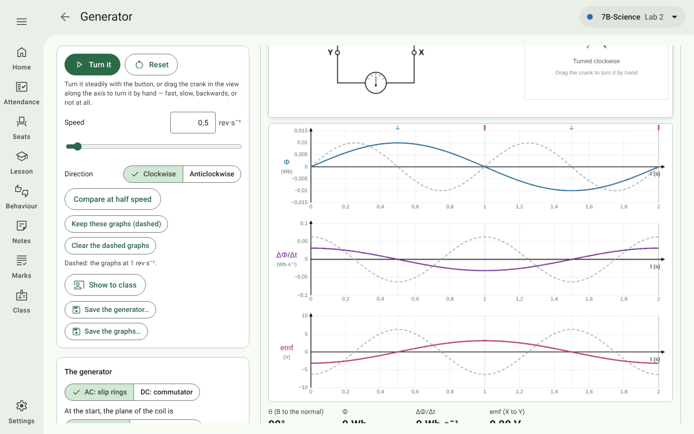

**The generator**

- **AC: slip rings** or **DC: commutator** (a split ring). A rectangular coil between **N** and **S**, brushes leading
  to the terminals **X** and **Y**, and a centre-zero meter between them whose needle swings both ways for AC and one
  way for DC.
- Beside it, the coil **seen along its axis**: the coil as a line between the poles with its sides **P** and **Q**
  marked ⊙ or ⊗ with the induced current, the normal to the coil and the angle **θ** between it and B (as in
  Φ = BA cos θ), and the crank.
- **Turns N**, **field B** and **area A**; whether the coil's plane starts **parallel** or **perpendicular** to the field.

**Turning it**

- **Turn it** turns the coil steadily at the chosen **speed** (revolutions a second), **clockwise** or
  **anticlockwise** as seen from the rings, until the graphs are full (or round and round, with *Stop when the graphs
  are full* off). **Reset** puts the coil back to its start with clear graphs.
- Or **drag the crank** to turn it by hand — fast, slow, backwards or not at all. The coil follows with a little
  inertia, the graphs show exactly what your hand did, and holding it still shows the emf dropping to zero.

**The graphs** — Φ (Wb), ΔΦ/Δt (Wb·s⁻¹) and the emf across X and Y (V), drawn as the coil turns, **against time**
(1, 2, 4 or 8 seconds across) or **against the angle of rotation** (one or two turns across, marked every 90°, 0°
where the coil started — the axes the papers give for "sketch the emf against the angle of rotation"). Against the
angle a run stops after its turns, and the **Turned** reading says how far the coil has gone. Dotted lines mark where the coil's plane is **perpendicular** to the field (⊥: Φ largest,
emf zero) and **parallel** to it (∥: Φ zero, emf largest). **Keep these graphs** holds them dashed so the next run
can be compared; **Compare at half speed** does it in one go — Φ is just as big, but ΔΦ/Δt and the emf halve. Against
time the period doubles; against the angle of rotation it doesn't — still one cycle per 360°, only half as tall —
the two changes the papers ask candidates to draw. Numbers on the axes can be turned off for
shape-only sketches.

**The notes** under it say where the coil is and what that means, and give Φ = BA cos θ, **Faraday's law** and
**Lenz's law** in the SAG's words (emf = −N ΔΦ/Δt), the peak emf NBAω and the period, and what the slip rings or
the commutator do.

The SAG examines these relationships **qualitatively**; the numbers are there to compare runs. **Save the
generator…** and **Save the graphs…** save black-and-white 300 dpi PNGs; **Show to class** puts the generator and the
graphs side by side across the screen. The set-up is remembered on this computer; nothing is saved to your data.

## Circuit builder

Draw a circuit the way the exam papers do — black and white, the IEC symbols, wires at right angles — then run it:
the ammeters and voltmeters show their readings, each lamp glows with the power it uses, and the current moves round
the wires.

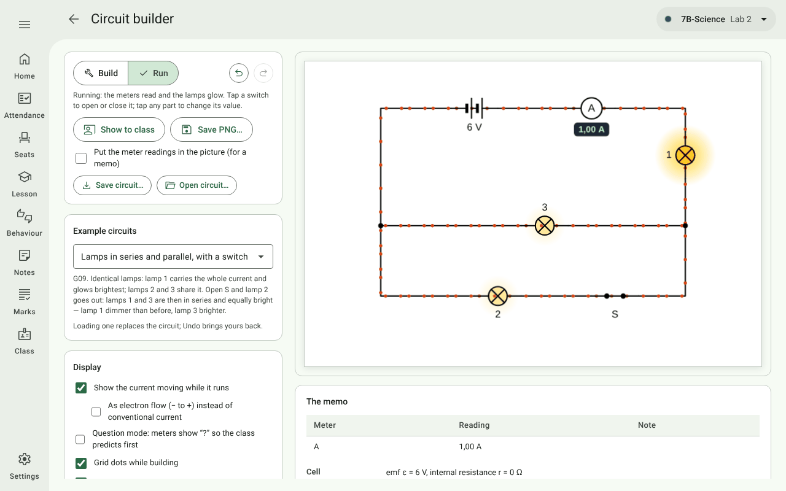

**Building** (the **Build** button)

- **Parts**: cell or battery (emf and internal resistance; 1 to 4 cells drawn, the long plate is +), resistor, lamp,
  rheostat, ammeter, voltmeter, switch, fuse and diode. Lamps are drawn as a circle with a cross, resistors as plain
  rectangles.
- Tap a part, then tap the grid to place it (**Across** or **Down**; drag before you let go to move it). Drop a part
  on a wire and it cuts itself in.
- **Wires**: drag from a part's end or any point on a wire, round corners as you go. Where three wires meet there is
  a junction dot; a wire end or terminal joined to nothing is circled in red.
- **Select** a part to move it (drag), **Turn** it (R), put its **label** on the other side or **Delete** it (Del);
  tap a wire to select it up to the next junction. **Erase** removes whatever you drag over. **Ctrl+Z** undoes,
  **Ctrl+Y** redoes; the arrows move the whole circuit.
- The selected part's panel sets its label (digits after a letter print as a subscript: R1 → R₁), its value and
  whether the value is printed beside it (12 Ω, emf = 12 V; r = 1 Ω, 2 A).

**Running** (the **Run** button)

- The circuit zooms to fill the space. Each meter shows its reading in a box beside it, to 2 decimal places or 3
  significant figures.
- **Tap a switch** to open or close it. Tap any other part to change its value: slide a rheostat and watch the
  current, the brightness and the terminal voltage follow.
- A lamp's glow follows its power, P = I²R, against **A lamp glows fully at … W**. That stays fixed while you open and
  close switches, so a lamp that dims really is using less power; **Set it to the brightest lamp now** rescales it.
- A **fuse** blows when the current is over its rating and stays blown until you tap it to replace it.
- **Show the current moving** animates conventional current (orange dots, + to −) or, ticked, electron flow (blue,
  − to +), faster where the current is bigger. It moves even when Windows is set to show fewer animations.
- **Question mode** turns every reading into “?” for the class to predict; **Show to class** fills the screen.

**The memo** under the circuit: every meter's reading; for each cell the current, the terminal voltage worked as
V = ε − Ir with the lost volts, the external resistance V ÷ I and the power; and R, V, I and P for every other part,
with each lamp's brightness, each switch, fuse and diode's state. Warnings name a short circuit, a blown fuse, loose
ends or a missing cell.

**Examples** — the shapes the papers keep using, with fresh values: series lamps with an ammeter and a voltmeter
(G08–G09); lamps in series and parallel with a switch (G09); parallel resistors with an ammeter per branch (G09–G10);
internal resistance — emf, terminal voltage and lost volts (G12); two switches (G11–G12); a rheostat and a lamp
(G11); diodes (G12); a fuse in the main line (G08); and meters connected the wrong way round (a voltmeter in
series, an ammeter across a lamp). Loading one replaces the circuit; Undo brings yours back.

**The physics** is the exam's: ideal meters (an ammeter has no resistance, a voltmeter infinite), ohmic lamps,
ideal diodes (they conduct only along the arrow, with no voltage drop) and plain wire with no resistance — so a wire
across a part shorts it out, and a voltmeter in series reads the emf while nothing flows. The circuit is solved by
nodal analysis; a cell with no internal resistance and nothing but wire across it is reported as a short circuit
(the current shows as ∞).

**Saving**: **Save PNG…** saves the diagram cropped to the circuit at 300 dpi (a lamp comes out about 9 mm across, as
on a printed paper), without the grid, the glow or the current — tick *Put the meter readings in the picture* for a
memo version. **Save circuit…** writes the circuit to a small `.json` file and **Open circuit…** reads one back. This
computer remembers the circuit you were working on; nothing goes into your data folder.

## Photoelectric effect and spectra

Photons and electrons, for the last topic of Paper 1, in two tabs. Every number is worked with the data sheet's
constants — h = 6,6 × 10⁻³⁴ J·s, c = 3 × 10⁸ m·s⁻¹, mₑ = 9,1 × 10⁻³¹ kg, 1 eV = 1,6 × 10⁻¹⁹ J — so it matches what a
candidate gets.

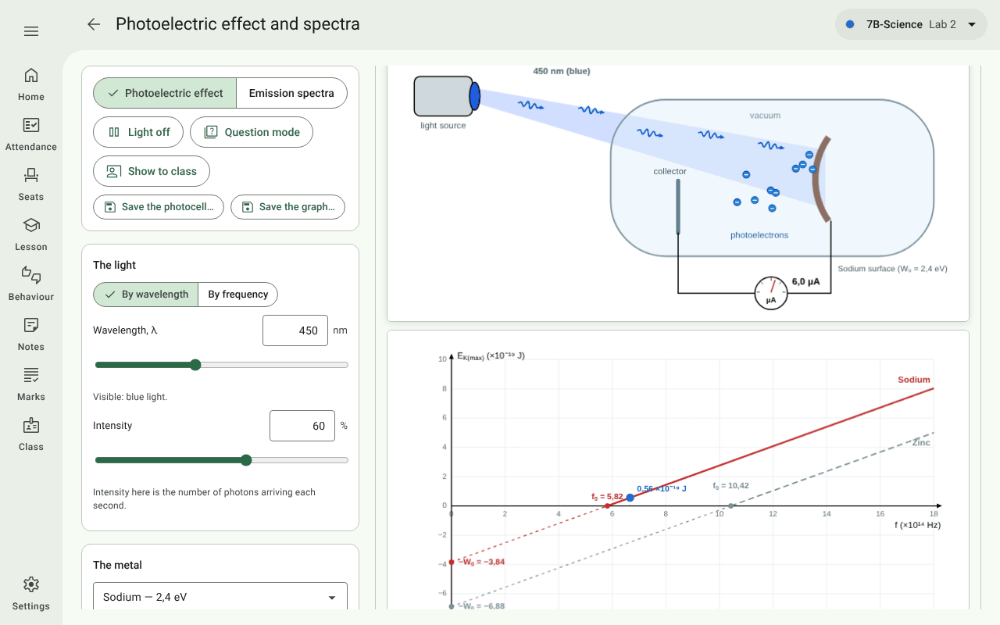

**Photoelectric effect**

- A vacuum photocell: light from a source falls on a curved **metal surface**; the photons are drawn as wave packets in
  the light's colour (grey for ultraviolet and infrared, which can't be seen), the **photoelectrons** cross to the
  **collector**, and a **microammeter** reads the current.
- **The light**: set it **by wavelength** (100–1 000 nm) or **by frequency** (3–30 × 10¹⁴ Hz), and its **intensity** —
  here, the number of photons arriving each second. **Light off** stops it.
- **The metal**: caesium, potassium, sodium, calcium, magnesium, aluminium, zinc, tungsten, copper, gold or platinum,
  with typical work functions — or **Your own work function** for the value a paper gives. Its f₀ and λ₀ are shown.
- Below the threshold frequency the photons are absorbed and **no electrons are emitted**, however intense the
  light; above it, more intense light means more electrons a second (a bigger current), and a higher frequency means
  faster ones (a bigger Eₖ(max)).
- **The graph**: **Eₖ(max) against frequency** — a straight line with gradient h, f₀ where it meets the frequency axis
  and −W₀ where it meets the energy axis (*Extend the line*), the light now marked on it; **Compare with** another metal
  draws its parallel line. Or **Eₖ(max) against intensity** (flat) and **current against intensity** (through the
  origin). Energy in J or eV; *Show the gradient (h)* adds a gradient triangle.
- **The memo**: nm to m and f = c/λ (or λ = c/f), E = hf in J and eV, W₀ in J, f₀ and λ₀, the comparison that decides
  whether electrons are emitted, E = W₀ + Eₖ(max), v_max from Eₖ(max) = ½mv², and the electrons a second at that
  intensity. **Exam points** sum up what the examiners look for (electrons not atoms; compare f with f₀ or E with W₀;
  intensity versus frequency; the significance of the effect).

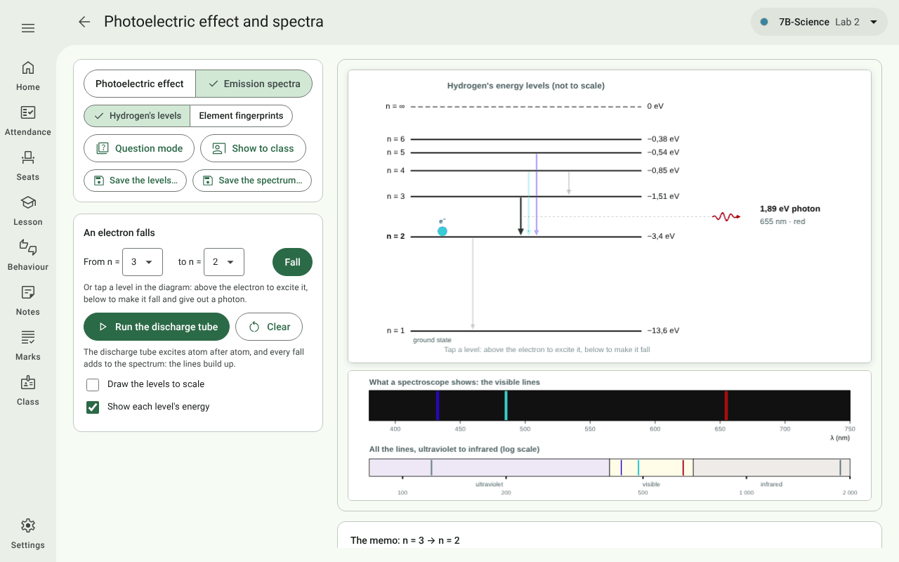

**Emission spectra**

- **Hydrogen's levels**: the energy-level diagram (n = 1 to 6 and n = ∞, −13,6 eV to 0 eV, as the papers give them;
  not to scale, or *to scale*), with the electron on its level. **Tap a level** above the electron to excite it, or
  below it to make it fall — or choose **from n = … to n = …** and press **Fall**. Each fall draws its arrow, sends out a
  photon with its energy and wavelength, and adds its line to the spectrum: the **visible strip** a spectroscope shows,
  and **all the lines** from ultraviolet to infrared on a log scale. **Run the discharge tube** excites atom after atom
  so the lines build up; **Clear** starts again.
- The memo for the last fall: ΔE = E(upper) − E(lower) in eV and J, f = E/h, λ = c/f in m and nm, the colour and the
  series. (With the data sheet's rounded constants the red line comes out at 655 nm; measured, it is 656 nm.)
- **Element fingerprints**: the line spectra of hydrogen, helium, neon, sodium and mercury tubes (measured lines), with
  the tube glowing its colour. **Mystery tube** adds an unnamed spectrum for the class to identify; **Reveal** names it.

**Question mode** hides the photon energy, Eₖ(max), v_max, the current and the memos; **Show to class** fills the screen
with the pictures and a small bar of buttons. **Save the photocell…**, **Save the graph…**, **Save the levels…** and
**Save the spectrum…** save black-and-white 300 dpi PNGs. Photons and electrons keep moving even when Windows is set to
show fewer animations. The set-up is remembered on this computer; nothing is saved to your data.

## Reaction rates

Collision theory for the Grade 11 and 12 rates work in Paper 2: a metal reacting with an acid (like magnesium in
hydrochloric acid), seen as particles, with the two graphs the papers draw.

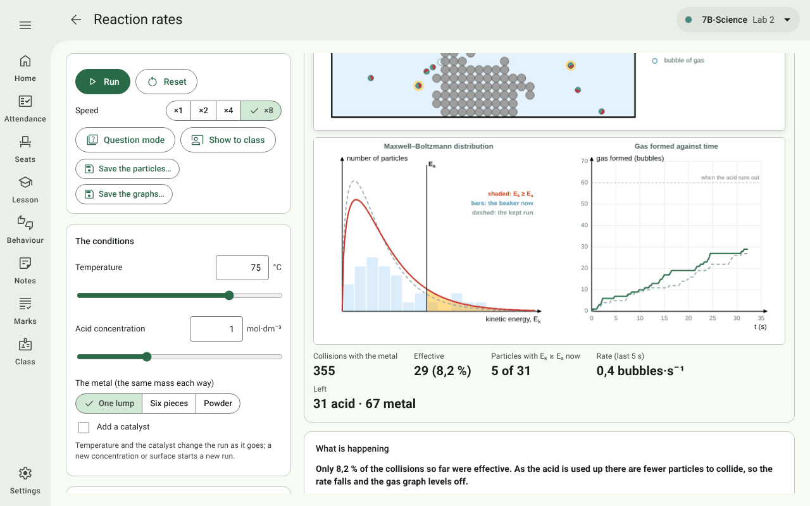

**The beaker.** The acid's particles move through the solution and hit the metal at the bottom. Each particle has a
**reactive end** (its red half), and **glows** when its kinetic energy is at least the activation energy. A collision
with enough energy and the reactive end facing the metal is **effective** — a burst, the metal atom dissolves, the acid
particle is used up and a bubble of gas rises; the others bounce off, marked as *not enough energy* (grey) or *the
wrong way round* (purple). A key beside the beaker says which is which.

**The conditions**

- **Temperature** (0–100 °C) and **Add a catalyst** change the run as it goes: watch more particles glow, or the
  catalyst's lower Eₐ appear on the graph.
- **Acid concentration** (0,5–2 mol·dm⁻³) and **the metal** — *one lump*, *six pieces* or a *powder*, the same number of
  atoms each way, so more exposed — start a new run.
- **Run**, **Pause** and **Reset**; **speed** ×1 to ×8.

**The graphs**

- **The Maxwell–Boltzmann distribution**: number of particles against kinetic energy for the conditions now, with
  **Eₐ** marked (and the catalysed Eₐ, further left) and the particles beyond it **shaded**. *Show the beaker's particles
  under the curve* adds bars of the particles actually in the beaker — they follow the curve, and shrink as the acid is
  used up.
- **Gas formed against time**: steep at first, levelling off as the acid is used up, and flat once the limiting reagent
  has run out (the dotted line, hidden in question mode, shows where).

**Compare two experiments.** **Keep this run and start again** keeps both graphs dashed; change one condition and run
again. The notes then say what changed and why, in collision-theory terms — more particles with Eₖ ≥ Eₐ, more
collisions per unit time, so more effective collisions per unit time. **Exam points** list the rest: the definition of
a catalyst, the effect of each factor on the curve, ways of measuring a rate, and why the final amount depends only on
the limiting reagent.

**Readings** under the pictures: collisions with the metal, how many were effective (and what percentage), the
particles with Eₖ ≥ Eₐ now, the rate over the last 5 s and what is left of each reactant.

**It is a model.** One effective collision stands for one metal atom reacting (magnesium really takes two H⁺), and
the activation energy is scaled down so the shaded tail is big enough to see; a real reaction is far more sensitive to
temperature than this beaker. The notes say so too.

**Question mode** hides the explanations and where the gas graph will level off; **Show to class** puts the beaker and
the graphs side by side. **Save the particles…** and **Save the graphs…** save black-and-white 300 dpi PNGs. The
conditions are remembered on this computer; nothing is saved to your data.

## Galvanic cell animator

An animated galvanic cell for the board, for the Grade 12 electrochemistry work: two beakers, their electrodes, the
salt bridge and the wire with a voltmeter. Electrons move along the wire from the anode to the cathode, ions move
in the solutions and through the salt bridge, and the voltmeter reading is worked out from the standard electrode
potentials and the **Nernst equation**, so it answers every "what happens to the reading if…" question honestly.

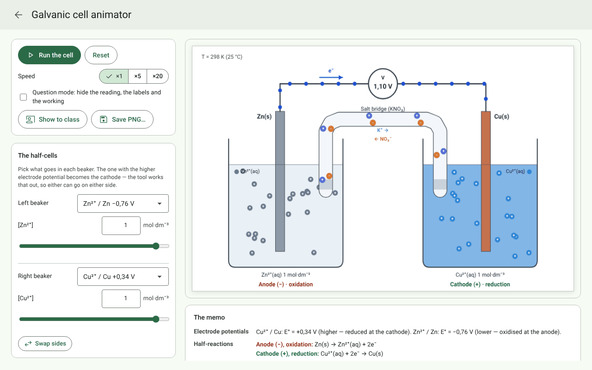

**The half-cells**

- Pick what goes in the **left** and **right** beaker from the data sheet's table of standard reduction potentials:
  the metal / metal-ion couples from Mg to Ag, the **standard hydrogen electrode** (H⁺ / H₂ on platinum) and the
  Fe³⁺ / Fe²⁺ couple on platinum. The half-cell with the higher electrode potential becomes the cathode; the tool
  works that out, so either can go on either side, and **Swap sides** mirrors the picture.
- Under each is a slider and a box for every concentration (mol·dm⁻³, from 10⁻⁴ to 2) and, for hydrogen, the gas
  pressure (kPa). The same half-cell on both sides at different concentrations makes a **concentration cell**.

**Conditions**

- **Temperature** from 273 K to 373 K (E° is taken as the data sheet's value at any temperature).
- **Salt bridge in place**: untick it and the circuit is open — the EMF is unchanged but the voltmeter reads 0 V and
  nothing moves. Choose the **electrolyte** (KNO₃, NaNO₃, NH₄NO₃ or KCl); its ions are drawn moving through the
  bridge, cations towards the cathode and anions towards the anode.
- **Electrodes** small or large. The reading doesn't change — the point of offering it.

**Running the cell**

**Run the cell** lets it discharge: the reactant concentration falls, the product concentration rises, the anode
thins and the cathode thickens, a coloured solution fades, and the reading drops until the reaction reaches
equilibrium (Q = K) and the cell is **flat** at 0 V. **Speed** ×1, ×5 or ×20; **Pause** holds it; **Reset** puts
the chosen half-cells back at standard conditions. The electrons and ions keep moving even when Windows is set to
show fewer animations: here the movement is what the class is watching.

**Question mode** hides the reading (the voltmeter shows **?**), the anode / cathode labels, the electron and ion
directions and the memo, for the class to predict first. **Show to class** fills the screen with the picture and a
small bar of buttons (Run, Question mode, Close — or Esc).

**The memo** under the picture gives the working the way it is marked: both E° values and which is reduced, the
two half-reactions and the balanced net equation, E°cell = E°cathode − E°anode, the cell notation (anode on the
left, with and without the conditions), the Nernst equation with Q, RT/nF and the result (and its 0,059/n log Q
form at 25 °C), and the points to make: electron flow, the salt bridge's job, which electrode loses or gains mass,
the stronger oxidising and reducing agents, what happens as the cell runs and what doesn't change the EMF. If the
concentrations have turned a cell round compared with standard conditions, it says so.

**Save PNG…** saves the picture as it is — answers shown or hidden — for a worksheet or a memo. Nothing is saved to
your data.

## Electrolytic cell

An electrolytic cell for the board, for the Grade 12 electrochemistry work: a DC supply with an ammeter, one beaker
and two electrodes. The tool works out what is reduced at the cathode and oxidised at the anode from the standard
electrode potentials, so it gives the right answer for any electrolyte and electrodes you choose, not only the
textbook set-ups.

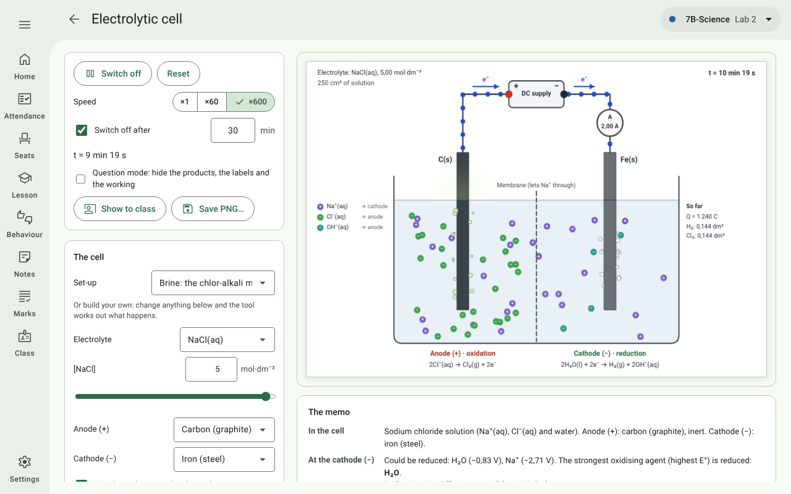

**The cell**

- **Set-up** picks one of the usual cells: CuCl₂(aq) or CuSO₄(aq) with carbon electrodes, CuSO₄(aq) with copper
  electrodes, **refining** impure copper, copper-, silver- or nickel-**plating** a spoon, **brine** in the
  chlor-alkali membrane cell, dilute NaCl(aq), **acidified water** with the gases collected, KI(aq), and molten NaCl
  or PbBr₂.
- Or build your own: choose the **electrolyte** (CuCl₂, CuSO₄, NaCl, KI, dilute H₂SO₄, AgNO₃ or NiSO₄ solution, or
  molten NaCl or PbBr₂), its **concentration** (250 cm³ of it), the **anode (+)** and the **cathode (−)**: carbon or
  platinum (inert), copper, impure copper, silver, nickel, iron, or an iron spoon. The set-up then reads *Your own*.
- **Membrane between the electrodes** (NaCl solution only) keeps the chlorine and the sodium hydroxide apart.
- **Collect the gases in tubes** stands a graduated tube over each electrode, so the volumes can be compared —
  hydrogen and oxygen 2 : 1 from acidified water.

**What it decides, and how.** At the cathode the strongest oxidising agent (the highest E°) is reduced; at the anode
the strongest reducing agent (the lowest E°) is oxidised — an active anode itself, an anion, or water. In a solution,
water competes at both electrodes; in a melt there is no water. The one exception the course teaches is built in: a
**concentrated chloride** solution (at least 0,5 mol·dm⁻³ Cl⁻) gives Cl₂ at the anode, although water's E° is lower;
a dilute one gives O₂. As the cell runs, what is used up runs out: when the Cu²⁺ has gone, hydrogen forms at the
cathode instead, and an active anode that has dissolved away breaks the circuit.

**Running it**

**Switch on** turns the supply on: electrons move along the wires, cations move to the cathode and anions to the
anode, gas bubbles off, metal plates out (the cathode thickens, a spoon takes on the metal's colour), an active anode
thins, a blue Cu²⁺ solution fades, iodine browns the solution, impure copper leaves sludge under the anode, and a
molten metal collects (sodium floats, lead sinks). Set the **current** (0,1 A to 5 A) — it stays steady, whatever
voltage that takes. **Speed** ×1 (real time), ×60 (a minute a second) or ×600; **Switch off after** a set number of
minutes stops it exactly there, for a "2,00 A for 30 minutes" question. **Reset** starts the same cell again. Like the
galvanic cell, everything moves even when Windows is set to show fewer animations.

**Question mode** hides the anode and cathode labels, the half-reactions, which way the electrons and ions go, the
gas names and the memo — but the bubbles and the plating still show, for the class to observe and explain.
**Show to class** fills the screen with the picture and a small bar of buttons (Switch on, Question mode, Close — or
Esc).

**The memo** under the picture: what is in the cell; at each electrode, every species that could react with its E°,
which one does and why (the chloride exception explained when it applies), and the half-reaction; the net equation
(or "no net reaction" for refining and plating); E°cell = E°cathode − E°anode, negative, and so the least voltage the
supply must give; **Faraday's law** for the charge that has passed — Q = It, n(e⁻) = Q / F, and the mass of metal
plated or the volume of gas at STP at each electrode (F = 96 500 C·mol⁻¹, Vm = 22,4 dm³·mol⁻¹); and the points to
make: the electrode signs compared with a galvanic cell, where the electrons and ions go, the energy change, inert
electrodes, why water and not Na⁺ is reduced from brine, the uses of the chlor-alkali products, the colour and mass
changes, the sludge in refining, and why an object to be plated must be the cathode.

**Save PNG…** saves the picture as it is — answers shown or hidden, with the ammeter showing the current — for a
worksheet or a memo. Nothing is saved to your data.

## Chemistry reference

A chemistry reference for the board, built in modules that sit as tabs across the top: the **periodic table**,
**substances and their bonds**, the **polyatomic ions**, a **quiz**, the **data sheet**'s tables and an
**equation balancer**.

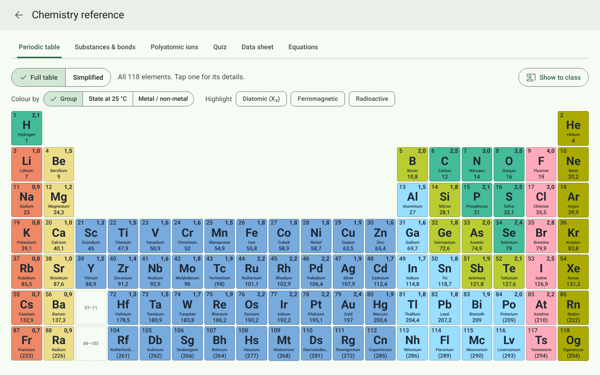

**The periodic table**

- Each block is laid out as the **data sheet** prints it — atomic number top left, electronegativity top right,
  symbol, relative atomic mass (Cl 35,5; Cu 63,5; masses in brackets for elements with no stable isotope) — so the
  board matches the exam paper.
- **Colour by**: **Group** (alkali metals, alkaline earth metals, transition metals, post-transition metals,
  metalloids, non-metals, halogens, noble gases, lanthanides, actinides), **State at 25 °C** or **Metal / non-metal**.
  The colours are a colour-blind-safe set and the key always names them; tap a key entry to show only that set.
- **Highlight**: the **diatomic** elements (H₂, N₂, O₂, F₂, Cl₂, Br₂, I₂), the **ferromagnetic** ones (Fe, Co, Ni, Gd)
  and the **radioactive** ones. Everything else fades.
- **Full table** or **Simplified**: the first 20 elements in their own places with groups 3–12 collapsed to a gap,
  so the blocks are big, and under them Cr, Mn, Fe, Co, Ni, Cu, Zn, Br, Kr, Sr, Ag, Sn, I, Xe, Ba, Pt, Au, Hg, Pb and
  U in atomic-number order.
- **Show to class** fills the screen; Esc or **Close** comes back.

**An element's pop-up** — tap any element. It opens with the element's data-sheet block, in type sized for the
board:

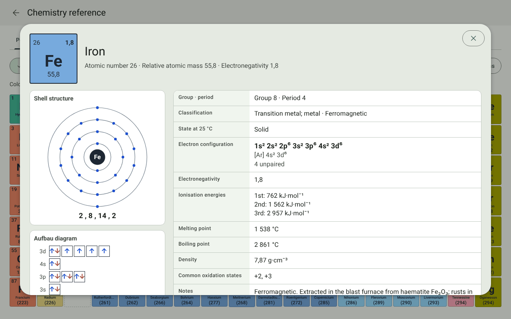

- A **shell structure** (Bohr) diagram with the electrons per shell (2, 8, 14, 2), and an **Aufbau diagram** of
  orbital boxes with arrows, filled by Hund's rule, lowest energy at the bottom.
- The **electron configuration** in spdf notation, in filling order as the course writes it
  (1s² 2s² 2p⁶ 3s² 3p⁶ 4s² 3d⁶), the noble-gas shorthand ([Ar] 4s² 3d⁶), valence and unpaired electrons. The
  exceptions (Cr, Cu, Ag, Au…) are right.
- Group and period, classification, state at 25 °C, **electronegativity**, the **1st, 2nd and 3rd ionisation
  energies**, **melting and boiling points**, density, **common oxidation states** and a line of notes: what it is
  like, what it is used for, what it does in the lab.

The deeper properties are kept for hydrogen to barium and the simplified table's extras; the lanthanides, actinides
and the heaviest elements show the data-sheet values and their configuration only. Values come from the data sheet,
the NIST Atomic Spectra Database (ionisation energies) and the CRC Handbook (melting and boiling points), and a
**Check** line flags the few worth confirming against a printed table. Every value sits in one editable file,
`src/plugins/chemistry/elements.ts`, so a teacher who finds one wrong can correct it.

**Substances & bonds**

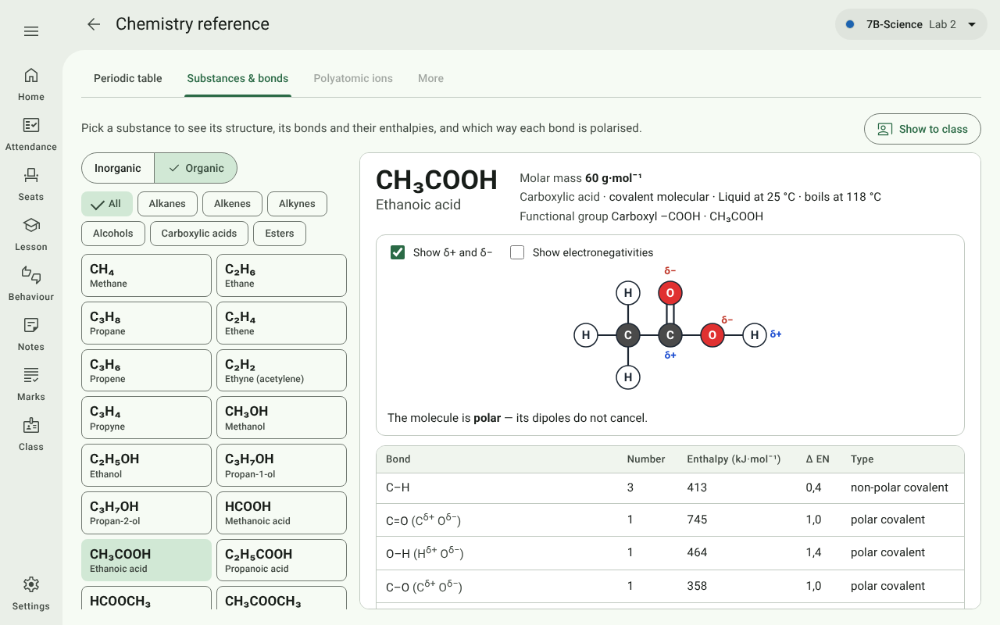

- **Inorganic**: the elements (H₂, O₂, O₃, N₂, the halogens, carbon, copper, sodium), oxides, acids (HCl, H₂SO₄,
  HNO₃, H₃PO₄, H₂CO₃…), bases, salts (NaCl to KMnO₄ and K₂Cr₂O₇) and the other molecules the course meets (water,
  H₂O₂, ammonia, H₂S). **Organic**: the first three members of the alkanes, alkenes, alkynes, alcohols (both
  propanols), carboxylic acids and the common esters, each with its functional group, condensed formula and boiling
  point. Filter by group with the chips; tap a card.
- The chosen substance shows its **structural formula** (drawn as the textbook does, chains left to right and
  branches at right angles), the **molar mass** from the data sheet, its bonding and state, and whether the molecule
  as a whole is **polar**. An ionic substance shows its **ions**, polyatomic ones drawn in brackets with their charge.
- **Show δ+ and δ−** puts the partial charges on each polar bond; **Show electronegativities** prints each atom's
  value under it.
- The **bond table** lists every bond type with how many there are, the **average bond enthalpy** (kJ·mol⁻¹), the
  electronegativity difference and its type (non-polar covalent up to 0,4, polar covalent up to 2,1, ionic above),
  and the energy to break every bond in a mole — the numbers a ΔH-from-bond-enthalpies question needs. A salt
  adds a row for its ionic lattice.

Bond enthalpies are the CRC Handbook's averages and the notes say where a particular compound differs (C=O in CO₂).
Substances live in `src/plugins/chemistry/substanceData.ts`, the enthalpy table and polarity limits at the top of
`src/plugins/chemistry/bonds.ts`, the polyatomic ions in `src/plugins/chemistry/ions.ts`.

**Polyatomic ions**

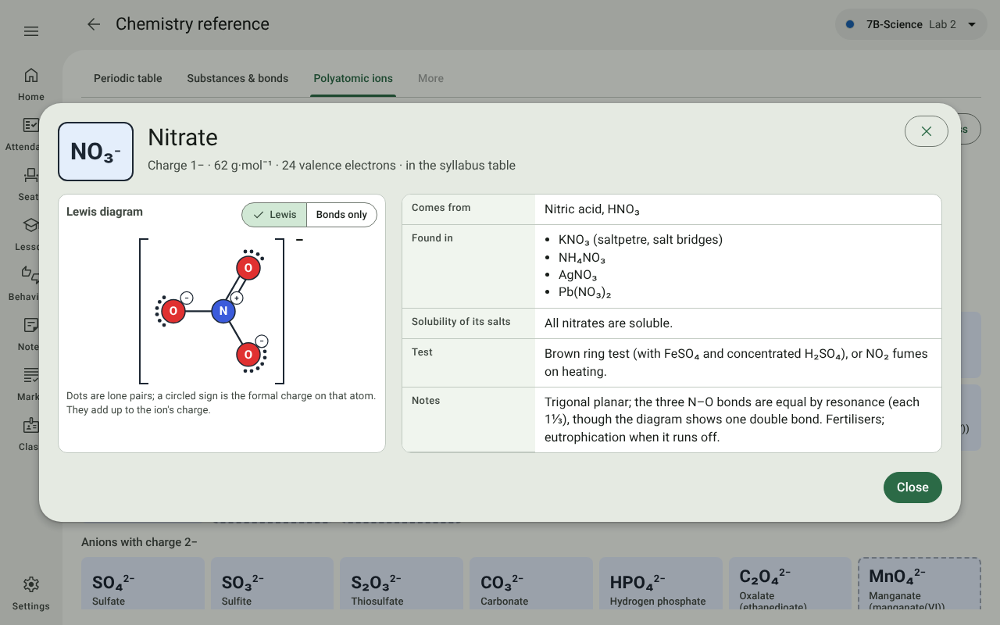

- The ions as cards grouped by charge — the cations, then the 1−, 2− and 3− anions — with the SAG's table of
  common polyatomic ions marked and the extras that come up in practicals (thiocyanate, iodate, manganate…) edged
  with a dash. Filter to the **Syllabus table**, the cations or one charge.
- Tap an ion for its pop-up: the formula and charge, its molar mass and valence electron count; a **Lewis diagram**
  with the lone pairs as dots and the **formal charge** circled on the atoms that carry it (they add up to the ion's
  charge: +1 on the N of nitrate, −1 on two of its oxygens, none on the sulfur of sulfate), or the bonds alone;
  what it **comes from** (its acid), where it is **found** (the common salts), the **solubility rule** for its
  salts, its **colour** and **test** where the course has one, and notes.
- The Lewis diagram is worked out from the electron count, so the diagram and the charges always agree with the
  structure drawn. Where resonance spreads a double bond over several equal bonds (nitrate, carbonate, ethanoate),
  one form is drawn and the notes say so.

The `syllabus` flag in `src/plugins/chemistry/ions.ts` marks the SAG table as best known; check it against your copy.

**Quiz**

- A question on the board with 2, 4 or 6 choices; the class answers and you tap their choice (or press A–F). The
  right answer goes green, a wrong one red, an explanation appears, and **Next question** (or Space) moves on. A
  running score with a Reset; **Reveal** shows the answer without choosing.
- **Ask about**: symbol → name, name → symbol, group and period, electron configuration (up to krypton), ion →
  name, name → ion, or molar mass (with the wrong answers a learner actually gets: a subscript missed, a mass
  doubled). **From** the simplified table or syllabus ion table, or everything.

**Data sheet**

- **Reduction potentials**: Table 4A in order of E°, or 4B alphabetically, searchable. Tap two rows and the cell
  they make is worked out: which is the cathode, the two half-reactions with their multipliers, E°cell =
  E°cathode − E°anode, and the stronger oxidising and reducing agents.
- **Constants** and the chemistry **formulae** as the data sheet prints them, searchable.

**Equations**

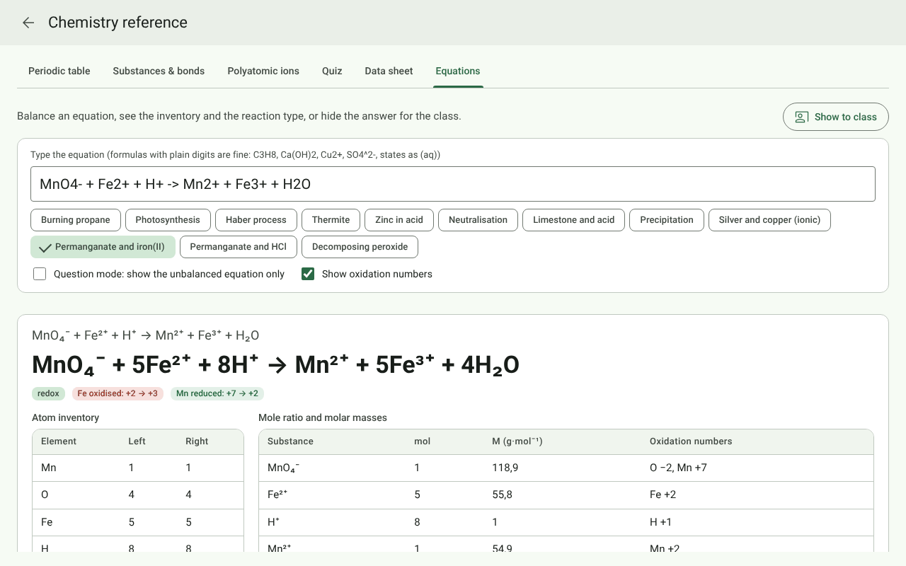

- Type a skeleton equation (`C3H8 + O2 -> CO2 + H2O`; plain digits become subscripts, `Cu2+` and `SO4^2-` are
  charges, `(aq)` and the other states are kept) or pick an example. It is balanced exactly, including the charge
  in ionic equations.
- Under the balanced equation: the **reaction type** (synthesis, decomposition, combustion, single or double
  displacement, precipitation, neutralisation, redox), which element is **oxidised** and which **reduced** with
  their oxidation numbers, the **atom inventory** the class writes, the mole ratio and the **molar masses**, and the
  **oxidation numbers** in every substance by the school rules.
- **Question mode** shows the unbalanced equation only until you reveal it.

## Titration simulator

A titration on the board: a burette over a conical flask on a stirrer, the pH graph beside it, and the memo
underneath.

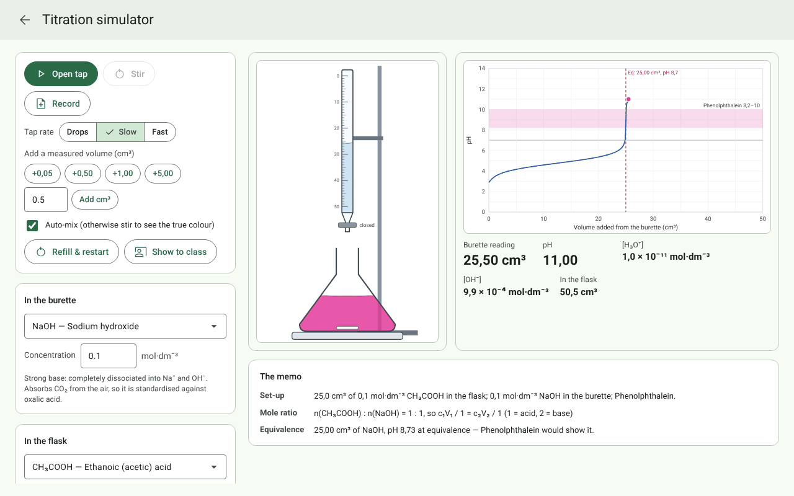

**Setting up**

- **In the burette** and **in the flask**: pick any of the strong acids (HCl, HNO₃, H₂SO₄), weak acids (HF,
  ethanoic, methanoic, oxalic, phosphoric, carbonic), strong bases (NaOH, KOH, Ba(OH)₂, Ca(OH)₂, Mg(OH)₂), weak bases
  (ammonia, sodium carbonate, sodium hydrogen carbonate) or water, with a **concentration** for each and the flask's
  **volume**. Either can go in either; **Swap burette and flask** turns the titration round. A note under each
  solution gives its Ka or Kb and what it is used for, and the tool warns when a hydroxide is set stronger than it
  dissolves.
- **Indicator**: methyl orange, bromocresol green, methyl red, litmus, bromothymol blue, phenol red,
  phenolphthalein (each with its range), universal indicator, or none.
- **Unknown** hides the flask's concentration and the equivalence volumes, so the class has to find the end point
  from the colour and work the concentration out.

**Running it**

- **Open tap** runs titrant in at the chosen rate (**Drops**, **Slow**, **Fast**) until you **Close tap** or the
  burette is empty; or add a measured volume: **+0,05** (a drop), **+0,50**, **+1,00**, **+5,00** or any amount you
  type.
- With **Auto-mix** off, the drops land as a plume of their own colour — the pink flash of phenolphthalein near the
  end point — until you **Stir**; the pH shown is the mixed value.
- The **burette reading**, **pH**, **[H₃O⁺]**, **[OH⁻]** and the volume in the flask read out live; **Record** adds the
  reading to a table (marked on the graph as crosses).
- The **graph** of pH against volume added is drawn as a probe would trace it, up to the volume run in; **Show the
  whole curve** reveals it all. The indicator's range is a band across it and the equivalence points are dashed
  lines (unless Unknown is on).
- **Refill & restart** empties the flask back to its sample and refills the burette. **Show to class** fills the
  screen with the bench and the graph.

**The memo** gives the set-up, the mole ratio (n(H₂SO₄) : n(NaOH) = 1 : 2 and the cₐVₐ / cᵦVᵦ relation), each
equivalence volume with the pH there and which indicators would show it, and the recorded readings.

The pH is worked out from the full charge balance of everything in the flask, so strong, weak, polyprotic and
mixed cases all behave, including the two end points of sodium carbonate and the buffer region of a weak acid.
Ka and Kb values are the CRC Handbook's at 25 °C; they sit in one editable file, `src/plugins/titration/chemistry.ts`.
The titration keeps going if you leave the screen; nothing is saved.

## Class noise meter

Listens through the computer's microphone and shows the class how loud the room is against a limit you set.
**Nothing is recorded or saved**; the microphone is only open while the meter runs.

**Reading the display**

- The big figure is the noise as a **percentage of your limit**: 100% means *at the limit*, so "stay under 100" is
  the whole rule for the class. The **dB(A)** reading is under it.
- The status reads *Nice and quiet*, *Getting close…* (within 5 dB(A) of the limit) or *Too loud!*, and the colours
  go green, amber, red to match.
- The **bar** runs from 0 to 150% of the limit, with the limit marked at 100%.
- The **graph** shows the last 5 minutes in dB(A), with the limit as a dashed line.
- When the room stays over the limit for a second, the screen **flashes red** with a *TOO LOUD — bring it down*
  banner. It clears after two seconds back under the limit.

**Controls**

| Control | What it does |
| --- | --- |
| **Start** / **Stop** | Opens and closes the microphone. |
| **Show to class** | Fills the screen with just the display (right). **✕** or **Esc** returns to the controls. |
| **Keep below − +** | The limit in dB(A) (30 to 110; 65 to start with). |
| **Microphone** | Appears when the computer has more than one. |
| **This session** | The peak level, the number of alarms and the time over the limit. **Reset** clears them. |
| **Calibrate** | A PC microphone can't measure true loudness by itself. Once per microphone, while the meter runs, hold a phone sound-meter app beside the computer, type its reading and press **Set**. Until then the display says *Not calibrated — readings are approximate*. |

**On other screens** the meter keeps listening, as a small pop-up in the bottom-right corner (inside the side panel
in teaching mode) showing the % and dB(A) in the same colours, with **Stop** and a button back to the meter. It
stacks with the test timer's pop-up. Switching the tool off in Settings also stops it.

