# 9. Teaching tools

[← Dashboards and parent reports](08-dashboards-and-reports.md) · [Contents](../README.md) · Next: [Settings →](10-settings.md)

ClassKernel ships with extra tools that stay **switched off** until you want them, so the app is exactly as simple
as you need. Switch any of them on under [Settings → Tools](10-settings.md#tools). They then appear as cards under
**Tools** on Home and in the expanded navigation drawer.

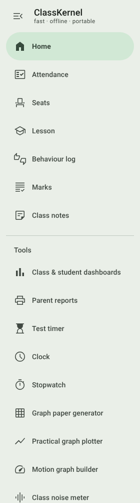

| Tool | In one line |
| --- | --- |
| [Class & student dashboards](08-dashboards-and-reports.md#class--student-dashboards) | How the class and each student are doing. |
| [Parent reports](08-dashboards-and-reports.md#parent-reports) | One-page A4 reports for parent evenings. |
| [Test timer](#test-timer) | A big countdown with reading and writing time. |
| [Clock](#clock) | A full-screen classroom clock. |
| [Stopwatch](#stopwatch) | A lab stopwatch with laps. |
| [Graph paper generator](#graph-paper-generator) | Printable grids and axes at an exact size. |
| [Practical graph plotter](#practical-graph-plotter) | Readings in, graph and gradient out. |
| [Motion graph builder](#motion-graph-builder) | x–t, v–t and a–t graphs that always agree. |
| [Class noise meter](#class-noise-meter) | Warns the class when it's too loud. |

Each tool opens full-page with a **←** back to Home in the top bar. Tools are built into the app, so they work
offline like everything else, and the graph tools save through the normal Windows *Save as* dialog.

 

## Test timer

A big countdown for tests and timed tasks.

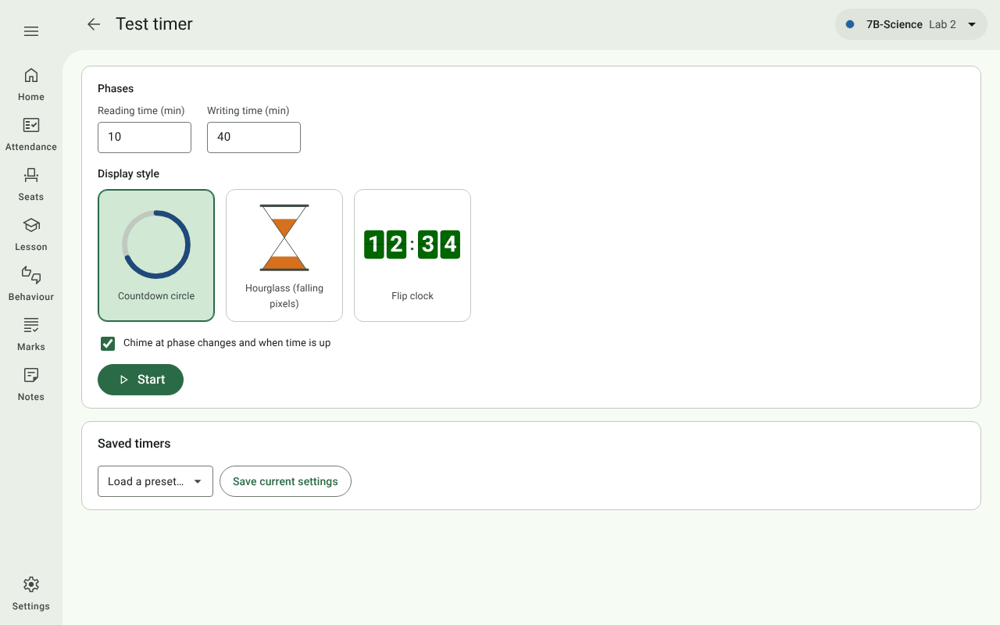

**Setting up**

- **Reading time** and **Writing time** in minutes. Set either to 0 to leave that phase out.
- **Display style**: **Countdown circle**, **Hourglass** (falling pixels) or **Flip clock**.
- **Chime** at each phase change and when time is up.
- **Saved timers**: **Save current settings** stores the setup as a preset (e.g. *10 read · 40 write*); choose one
  from **Load a preset…** next time. Each preset has a **Delete** button.

Press **Start**.

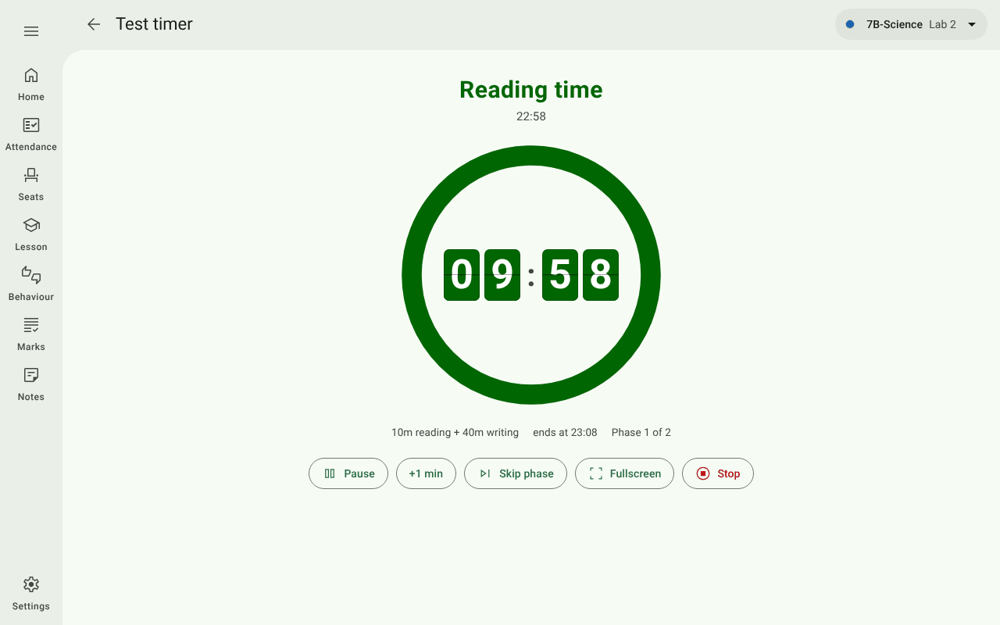

**While it runs**

The screen shows the phase (*Reading time*, *Writing time*, then *Time's up*), the time now, and when the phase
**ends**. The colour moves from green through blue and orange to red as each phase runs down.

| Button | What it does |
| --- | --- |
| **Pause** / **Resume** | Stops and restarts the countdown. |
| **+1 min** | Adds a minute to the current phase. |
| **Skip phase** / **End** | Jumps to the next phase, or ends the last. |
| **Fullscreen** | Fills the screen. |
| **Stop** | Stops the timer and goes back to the setup. |

**On other screens** the timer keeps running as a small pop-up in the bottom-right corner (inside the side panel in
teaching mode). It has a pause button, and tapping it (or its open button) returns to the full timer. When time is
up the pop-up turns red and stays until you close it.

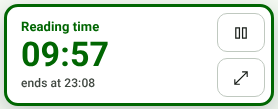

## Clock

A full-screen classroom clock.

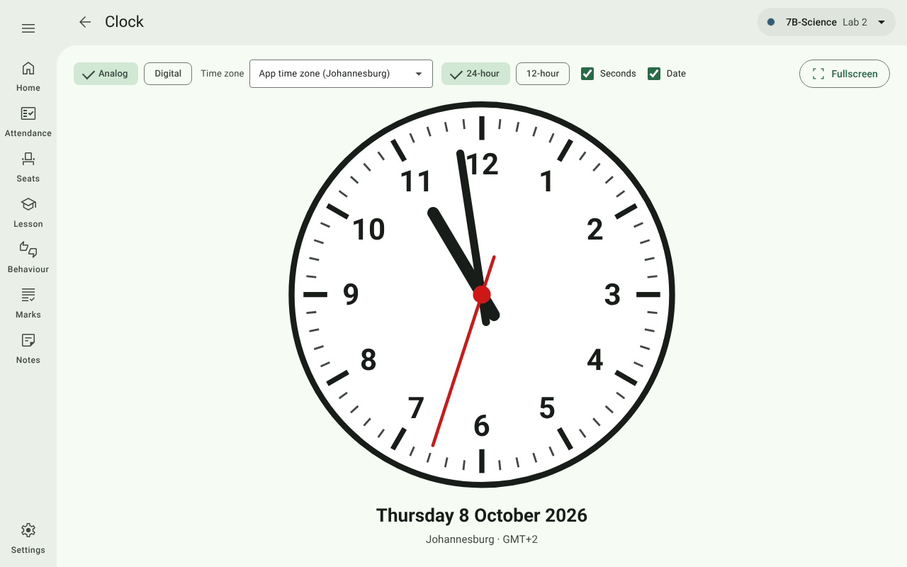

| Control | Choices |
| --- | --- |
| **Analog** / **Digital** | A round face, or the timer's flip digits. |
| **Time zone** | The app's time zone (Settings → General) or any other — handy for a field trip or an overseas exam centre. |
| **24-hour** / **12-hour** | Hour format. |
| **Seconds**, **Date** | Show or hide them. |
| **Fullscreen** | Fills the screen. |

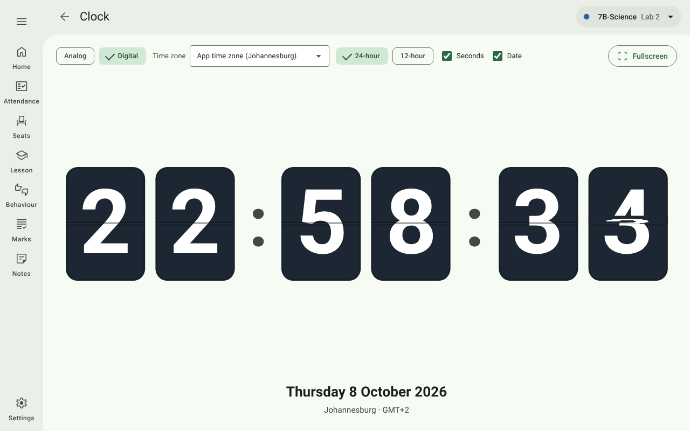

The clock saves nothing to your data; this computer just remembers the face and options you last chose.

## Stopwatch

A seven-segment LED-style stopwatch to hundredths of a second, for practicals and races.

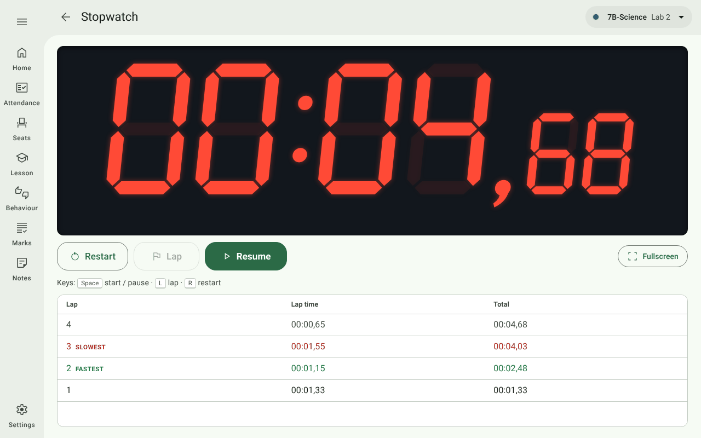

| Button | Key | What it does |
| --- | --- | --- |
| **Start** / **Pause** / **Resume** | **Space** | Starts and pauses. |
| **Lap** | **L** | Records a lap while running. |
| **Restart** | **R** | Clears the time and laps. |
| **Fullscreen** | | Fills the screen. |

Laps are listed newest first, with each lap's time and the running total; the **fastest** and **slowest** laps are
marked. The stopwatch keeps running if you leave the screen. Nothing is saved.

## Graph paper generator

Builds graph paper and axes at an exact size, for worksheets and tests.

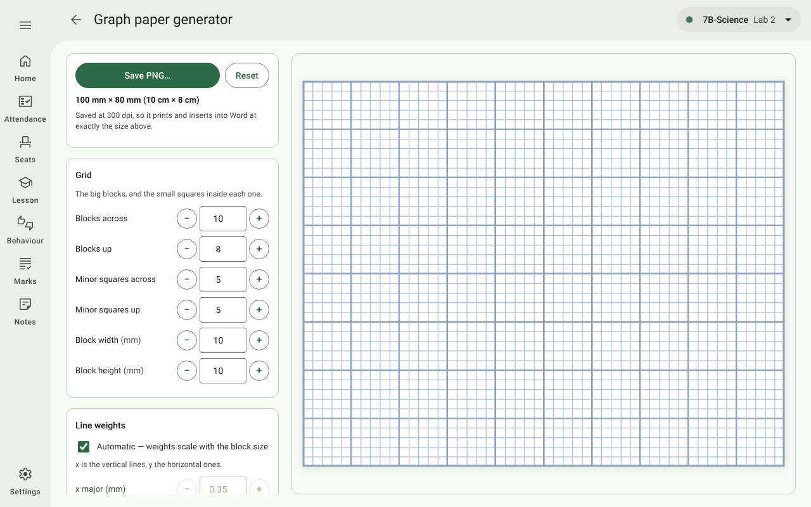

| Section | Settings |
| --- | --- |
| **Grid** | Blocks across and up, minor squares in each block, and the block width and height in mm. |
| **Line weights** | **Automatic** (scaled to the block size), or set each line's weight in mm. |
| **Axes & arrows** | Dark lines on the x- and y-axes, arrows at their ends, the **x-axis position** (bottom for quadrant 1, or middle for quadrants 1 and 4), and the arrowhead size. |
| **Tick marks** | Ticks on either axis, with their length and weight. |
| **Colours** | Major and minor gridlines, each axis, and the ticks. |

The preview updates as you change things. The size line at the top (e.g. *100 mm × 80 mm*) is the printed size.
**Save PNG…** saves a 300 dpi image that drops into Word at exactly that size. **Reset** goes back to the defaults.
A sheet too large to draw says so instead of saving.

## Practical graph plotter

Type or paste a table of readings and get the plotted graph, a least-squares line of best fit, and its gradient.

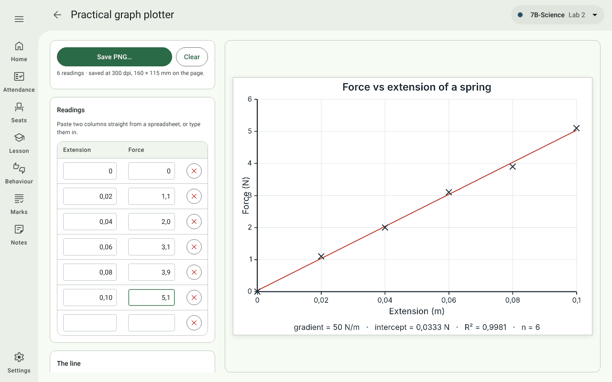

| Section | What to do |
| --- | --- |
| **Readings** | Type x and y values, or paste two columns straight from a spreadsheet. Decimal commas (`0,02`) are fine. A spare empty row is always kept at the bottom; **✕** removes a reading. |
| **The line** | **Draw the line of best fit**, **Force it through the origin**, and **Print the gradient under the graph**. The **gradient**, **y-intercept** and **R²** show here as you type. |
| **Labels** | The title, each axis's name and its unit (e.g. *Extension*, `m`). The gradient's unit is built from them (`N/m`). |
| **The sheet** | Start both axes at zero, gridlines, the printed width and height in mm, and the colours of the points and the line. |

**Save PNG…** saves a 300 dpi image at the printed size, for a practical write-up or a memo. **Clear** empties the
readings.

## Motion graph builder

Describe a journey a stage at a time and get the **position–time**, **velocity–time** and
**acceleration–time** graphs worked out from it, so the three can never contradict each other.

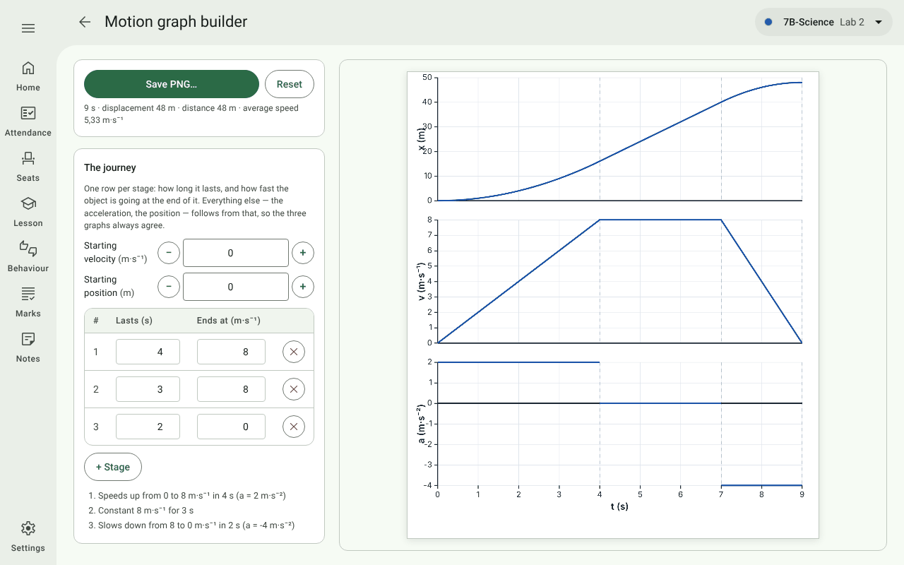

**The journey**

- **Starting velocity** (m·s⁻¹) and **starting position** (m).
- One row per stage: how long it **lasts** (s) and the velocity it **ends at** (m·s⁻¹). The acceleration and
  position follow from these.
- **+ Stage** adds a stage; **✕** removes one. Under the table each stage is described in words (e.g. *Speeds up
  from 0 to 8 m·s⁻¹ in 4 s (a = 2 m·s⁻²)*), and the top panel sums up the displacement, distance and average speed.

**The figure**

- Each graph can be **Drawn**, **Blank** (axes only, for learners to draw on) or **Off**.
- **Question: v–t given** draws the v–t graph and blanks the other two. **Memo: all drawn** draws all three. Same
  journey, so the question and the memo can never drift apart.

**The sheet** — dashed lines at each stage boundary, gridlines, a title, the width, the height of each graph, and
the curve colour.

**Save PNG…** saves a 300 dpi image; **Reset** goes back to the example journey.

## Class noise meter

Listens through the computer's microphone and shows the class how loud the room is against a limit you set.
**Nothing is recorded or saved**; the microphone is only open while the meter runs.

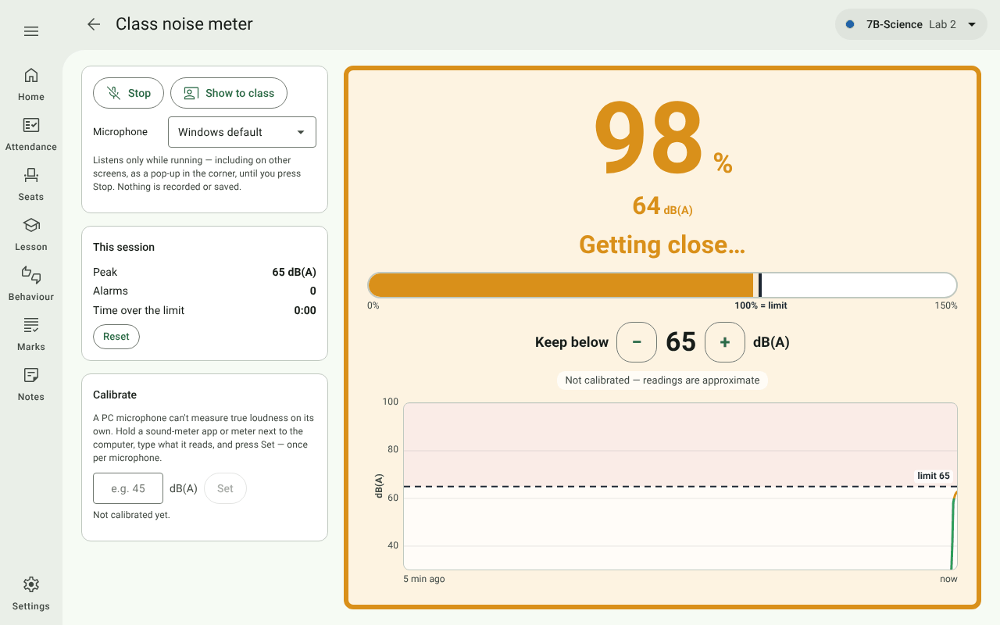

**Reading the display**

- The big figure is the noise as a **percentage of your limit**: 100% means *at the limit*, so "stay under 100" is
  the whole rule for the class. The **dB(A)** reading is under it.
- The status reads *Nice and quiet*, *Getting close…* (within 5 dB(A) of the limit) or *Too loud!*, and the colours
  go green, amber, red to match.
- The **bar** runs from 0 to 150% of the limit, with the limit marked at 100%.
- The **graph** shows the last 5 minutes in dB(A), with the limit as a dashed line.
- When the room stays over the limit for a second, the screen **flashes red** with a *TOO LOUD — bring it down*
  banner. It clears after two seconds back under the limit.

**Controls**

| Control | What it does |
| --- | --- |
| **Start** / **Stop** | Opens and closes the microphone. |
| **Show to class** | Fills the screen with just the display (right). **✕** or **Esc** returns to the controls. |
| **Keep below − +** | The limit in dB(A) (30 to 110; 65 to start with). |
| **Microphone** | Appears when the computer has more than one. |
| **This session** | The peak level, the number of alarms and the time over the limit. **Reset** clears them. |
| **Calibrate** | A PC microphone can't measure true loudness by itself. Once per microphone, while the meter runs, hold a phone sound-meter app beside the computer, type its reading and press **Set**. Until then the display says *Not calibrated — readings are approximate*. |

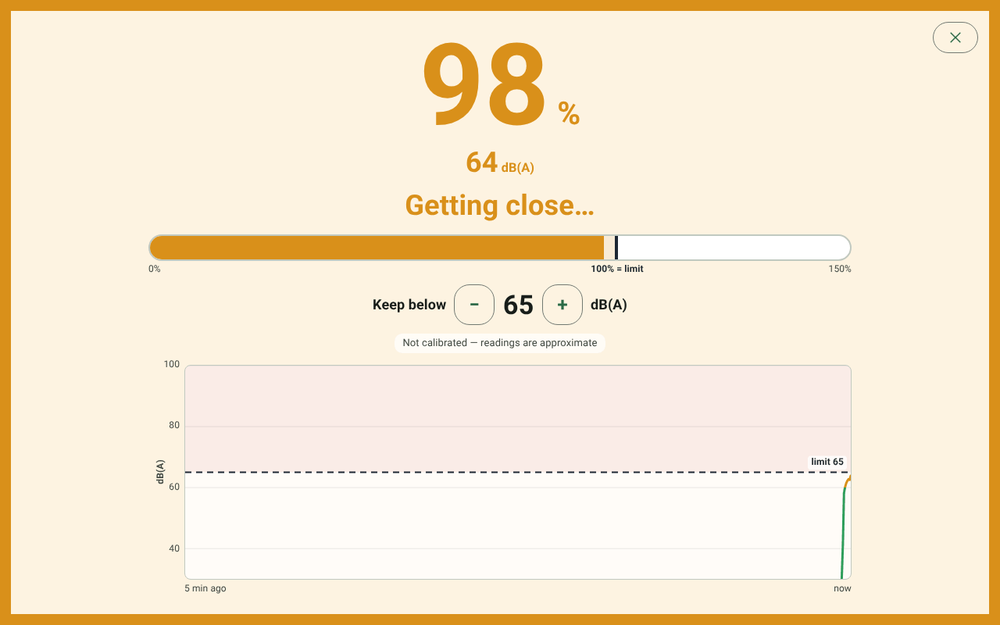

**On other screens** the meter keeps listening, as a small pop-up in the bottom-right corner (inside the side panel
in teaching mode) showing the % and dB(A) in the same colours, with **Stop** and a button back to the meter. It
stacks with the test timer's pop-up. Switching the tool off in Settings also stops it.

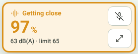
