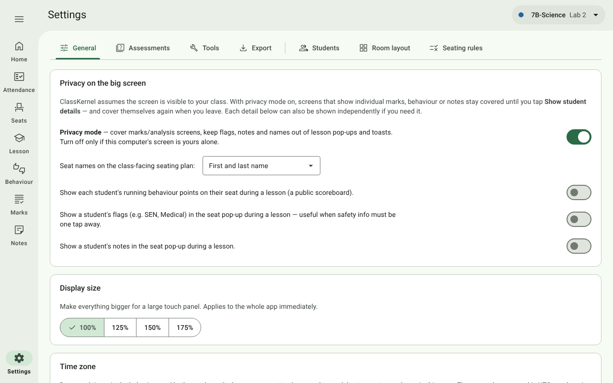
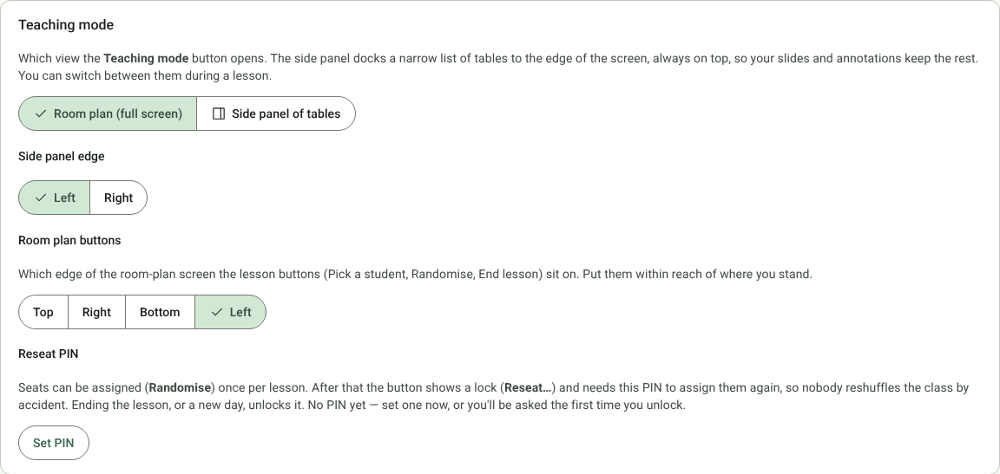
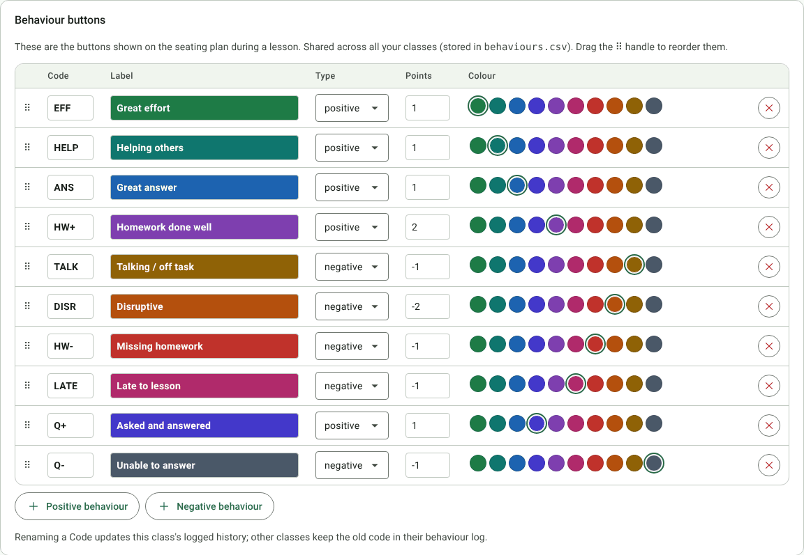
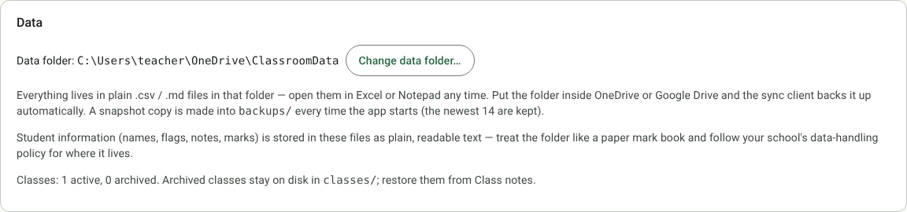
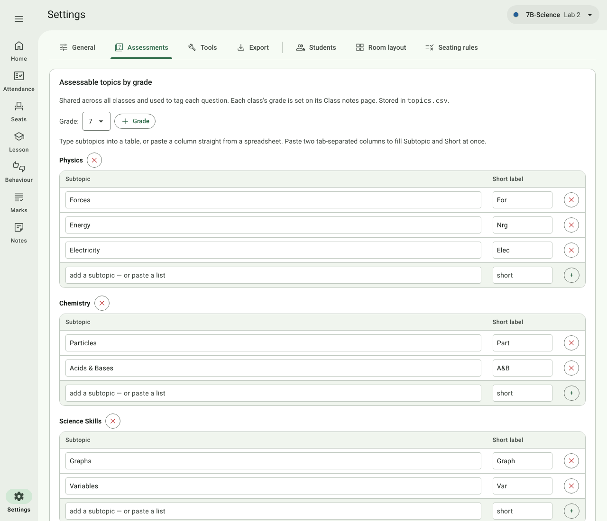
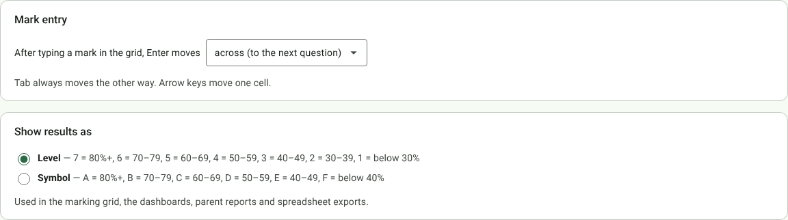
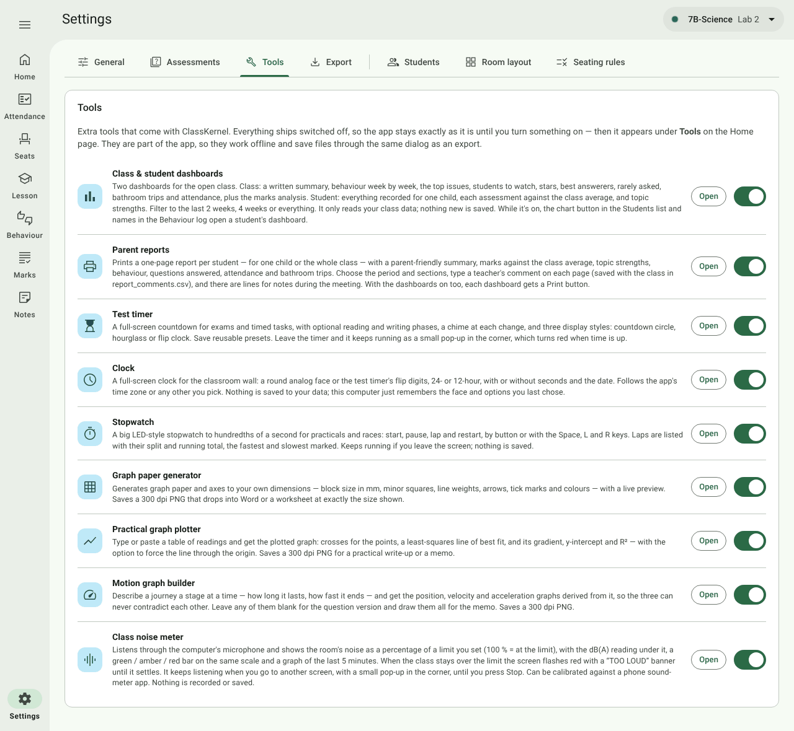
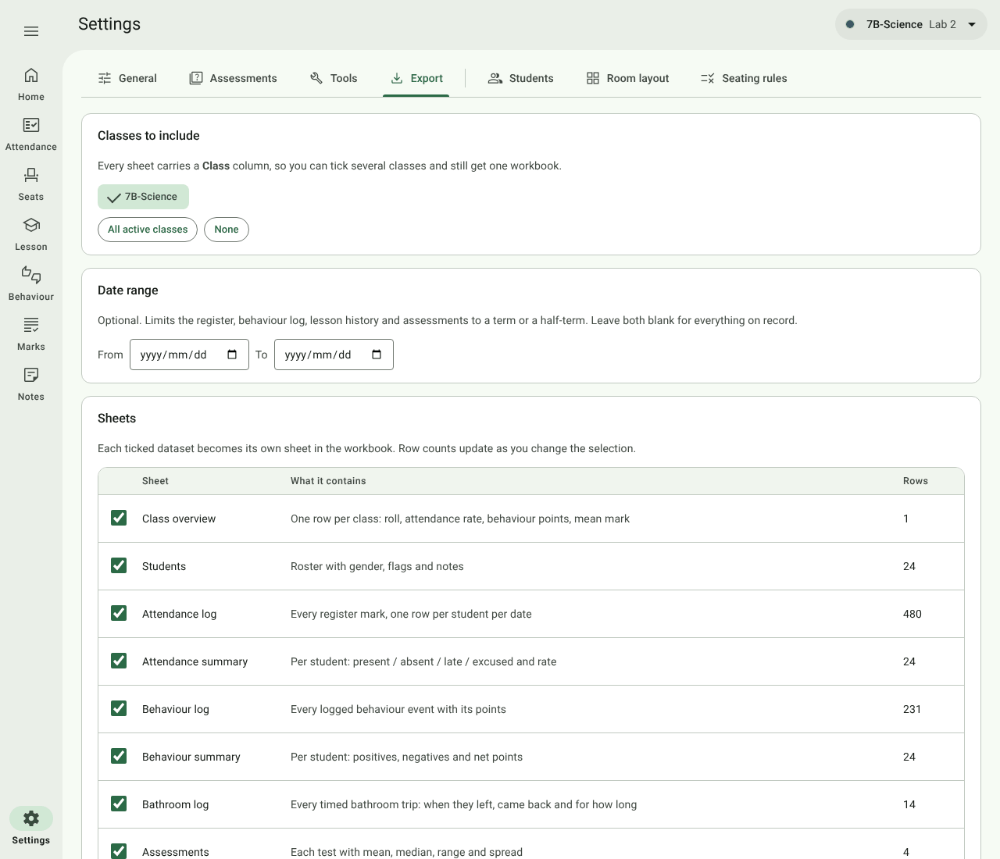

# 10. Settings

[← Teaching tools](09-teaching-tools.md) · [Contents](../README.md) · Next: [Your data and backups →](11-your-data.md)

Open **Settings** at the foot of the navigation rail. The tabs to the left of the divider apply to the whole app;
the tabs to the right belong to the class chosen in the top bar.

| Tab | Covers | Applies to |
| --- | --- | --- |
| [General](#general) | Privacy, display size, time zone, parent-report header, teaching mode, behaviour buttons, data folder | The whole app |
| [Assessments](#assessments) | Topic bank, cognitive levels, mark entry, levels or symbols | The whole app |
| [Tools](#tools) | Switching tools on and off | The whole app |
| [Export](#export) | Spreadsheet export | Any classes you tick |
| [Students](02-setting-up-a-class.md#students) | The class list | The chosen class |
| [Room layout](02-setting-up-a-class.md#room-layout) | The room designer | The chosen class |
| [Seating rules](02-setting-up-a-class.md#seating-rules) | Keep apart / together / front | The chosen class |

Every setting saves as soon as you change it.

## General

### Privacy on the big screen

| Setting | Default | What it does |
| --- | --- | --- |
| **Privacy mode** | On | Covers the marks and analysis screens until you press **Show student details**, and keeps flags, notes and names out of lesson pop-ups and messages. Turn it off only if this computer's screen is yours alone. |
| **Seat names on the class-facing seating plan** | First and last name | Or *First name + initial (Amelia A.)*, or *First name only*. Used on Seats, Lesson, the side panel and Pick a student. |
| **Show running behaviour points on seats** | Off | A public scoreboard during the lesson. |
| **Show flags in the seat pop-up** | Off | For when safety information (e.g. *Medical*) must be one tap away. |
| **Show notes in the seat pop-up** | Off | |

### Display size

**100% / 125% / 150% / 175%** makes the whole app bigger for a large touch panel. It applies immediately.

### Time zone

Dates and times in the logs, attendance, the lesson count and exports are shown in this zone — by default the
computer's own. Times are always saved in UTC, so changing it never alters your records, only how they're shown.

### Parent reports

**School name** and **Your name on reports**, printed at the top of each [parent report](08-dashboards-and-reports.md#parent-reports).
Leave either blank to leave it off.

### Teaching mode

| Setting | What it does |
| --- | --- |
| **Room plan (full screen)** / **Side panel of tables** | Which style the **Teaching mode** button opens. You can switch during a lesson. |
| **Side panel edge** | Left or right. |
| **Room plan buttons** | Which edge of the full-screen room plan the lesson buttons sit on: top, right, bottom or left. Put them within reach of where you stand. |
| **Reseat PIN** | **Set PIN**, **Change PIN** or **Remove PIN**. Changing or removing it asks for the current PIN first, so a student at the board can't clear it. See [Seats](04-seats.md#once-per-lesson-and-the-reseat-pin). |

### Behaviour buttons

The buttons you tap during a lesson. They are **shared by all your classes** (stored in `behaviours.csv`).

| Column | What it does |
| --- | --- |
| **⠿** | Drag to reorder. The order here is the order on the buttons. |
| **Code** | A short code (e.g. `HW-`). Edit it and click away to rename. Renaming updates the open class's history; other classes keep the old code in their logs. |
| **Label** | The text on the button, shown in the button's own colour. |
| **Type** | Positive or negative. |
| **Points** | e.g. `+2`, `-1`. |
| **Colour** | A fixed set of deep shades that all carry white text. |
| **✕** | Removes the button. Events already logged keep their points. |

**+ Positive behaviour** and **+ Negative behaviour** add a button. *Asked and answered* and *Unable to answer* are
the buttons [Pick a student](05-lesson.md#pick-a-student) uses; you can rename or recolour them like any other.

### Data

- **Data folder** shows where everything is saved. **Change data folder…** switches to another folder (for example,
  a colleague's shared folder, or a fresh one).
- **Restore a backup** lists the newest backups, taken every time the app starts. **Restore…** puts a backup's
  files back (a safety copy of today's data is taken first). See [Your data and backups](11-your-data.md).
- The number of active and archived classes.

## Assessments

### Assessable topics by grade

The topic bank used to tag test questions, shared by all classes (stored in `topics.csv`). Each class's grade is set
on its [Class notes](02-setting-up-a-class.md#class-notes-details-colour-and-notes) page.

- Choose the **Grade**, or **+ Grade** to add one. A new grade starts with the content areas *Chemistry*, *Physics*
  and *Science Skills*.
- Each **content area** has a table of **subtopics**, each with an optional **short label** (e.g. *Nrg* for
  *Energy*) used as the column heading in the marking grid.
- Type a subtopic into the bottom row and press **Enter**, or **paste a whole column from a spreadsheet** into it.
  Paste two tab-separated columns to fill *Subtopic* and *Short label* together.
- **+ Content area** adds an area; the **✕** beside an area's name removes it with its subtopics.

### Cognitive levels, mark entry and results

- **Cognitive levels** — the codes and labels offered when tagging questions (by default L1 *Recall*,
  L2 *Comprehension*, L3 *Analysis / Application*, L4 *Evaluation / Synthesis*). Edit, add (**+ Level**) or remove
  them. Stored in `cognitive_levels.csv`.
- **Mark entry** — whether **Enter** in the per-question grid moves **across** to the next question or **down** to
  the next student. Tab always moves the other way.
- **Show results as** — **Level** (7 = 80%+ … 1 = below 30%) or **Symbol** (A = 80%+ … F = below 40%). Used in the
  marking grid, the dashboards, parent reports and spreadsheet exports. See [Marks](07-marks.md#levels-or-symbols).

## Tools

Switch each tool on or off. A switched-on tool appears under **Tools** on Home and in the navigation drawer, and
has an **Open** button here. Switching one off removes it again and leaves the rest of the app exactly as it was.

While the dashboards are switched off there is no dashboard anywhere in the app, and student names don't link to
one. The tools themselves are described in [Teaching tools](09-teaching-tools.md) and
[Dashboards and parent reports](08-dashboards-and-reports.md).

## Export

Turns what you've collected into one Excel workbook (`.xlsx`) that also opens in LibreOffice or Google Sheets.

1. **Classes to include** — tick one or more classes (archived ones too). **All active classes** and **None** are
   shortcuts. Every sheet has a **Class** column, so several classes export into one workbook and can be pivoted.
2. **Date range** (optional) — limit the register, behaviour log, lesson history and assessments to a term.
3. **Sheets** — tick the datasets you want. The row count for each updates as you change the selection.
   **Select all**, **Reset** (back to the usual set) and **None** are shortcuts.
4. Press **Export spreadsheet (.xlsx)** and choose where to save it, or **Save to data folder** to drop it into the
   `exports/` folder beside your class files.

| Sheet | Contains | Ticked to start |
| --- | --- | --- |
| Class overview | One row per class: roll, attendance rate, behaviour points, mean mark | ✓ |
| Students | Roster with gender, flags and notes | ✓ |
| Attendance log | Every register mark, one row per student per date | ✓ |
| Attendance summary | Per student: present, absent, late, excused and rate | ✓ |
| Behaviour log | Every behaviour event with its points | ✓ |
| Behaviour summary | Per student: positives, negatives and net points | ✓ |
| Bathroom log | Every timed bathroom trip | ✓ |
| Assessments | Each test with mean, median, range and spread | ✓ |
| Marks | Per student per assessment: mark, % and level or symbol | ✓ |
| Question marks | Per-question marks with topic and cognitive level (large) | |
| Topic performance | Per student per topic: marks gained out of marks available | ✓ |
| Seating plans | Which student sits at which desk seat | |
| Lesson history | Per lesson: where each student sat and how they behaved | |
| Seating insights | Desk-by-desk behaviour per student, and pairings that turn disruptive (two sheets) | |

Exports are snapshots: editing the spreadsheet never changes the app's data.
