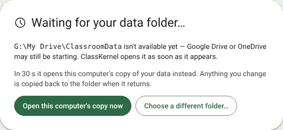
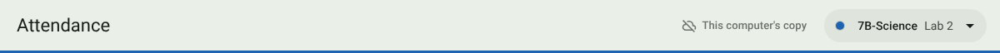
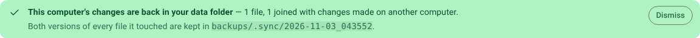

# 11. Your data and backups

[← Settings](10-settings.md) · [Contents](../README.md)

## Where your data lives

Everything ClassKernel records is kept in the **data folder** you chose on first launch, as plain `.csv` and `.md`
files. There is no database, no account and no server.

```
ClassroomData/
  behaviours.csv, topics.csv, cognitive_levels.csv,
  settings.csv, timer_presets.csv,
  note_sections.csv                      app-wide settings and lists
  classes/
    10A Physical Sciences/               one folder per class
      class.md                           details and notes
      students.csv, attendance.csv, behaviour.csv, bathroom.csv,
      desks.csv, room.csv, seating.csv, seating_prefs.csv, lessons.csv,
      assessments.csv, assessment_questions.csv, marks.csv,
      question_marks.csv, report_comments.csv, notes.csv
  layouts/                               saved room templates
  exports/                               spreadsheets from "Save to data folder"
  backups/                               older automatic snapshots (they're now kept on
                                         this computer: see Automatic backups)
```

Every file opens in Excel or Notepad. The [data file reference](../data-files.md) lists what each one holds, column
by column.

- **Dates and times** are saved in UTC, so the files mean the same on any computer. The app shows them in the time
  zone chosen under Settings → General.
- **Every save is safe**: the app writes a complete new copy of the file and then swaps it in, so a sync client
  copying the folder mid-save never sees a half-written file.

## Backup and syncing

**Put the data folder inside OneDrive or Google Drive.** The sync client then keeps a copy in the cloud and on your
other computers. ClassKernel itself never touches the network.

To use the same data on another computer, point ClassKernel there at the same synced folder (on first launch, or
under **Settings → General → Data → Change data folder…**). Sync clients copy whole files, so it's safest not to
have the app open on two computers at the same time.

## Sending changes to Google Drive

Every tap that records something (a mark, a behaviour, attendance) changes a file. If each change went straight to
a Google Drive folder, Drive would be uploading all lesson. Instead, ClassKernel saves every change **on this
computer** at once (in its own copy of the data), and sends the changed files to the data folder **together**:

- **every 2 minutes**, if anything has changed;
- at **natural pauses**: **End lesson**, **Done** after marking, switching to another class, the window being
  minimised, and **closing the app**.

The chip at the top of the screen says where things stand:

| Chip | Means |
| --- | --- |
| **Sent 3 min ago** | Everything is in the data folder. |
| **Changes waiting · Send now** | Saved on this computer, not yet sent. |
| **Sending…** | On its way. |
| A small grey cloud, crossed out | The folder can't be reached just now (Google Drive signed out, say). Your changes are safe on this computer and go as soon as it's back. |

Press the chip to send at once. That also takes in anything changed on another computer meanwhile.

If the folder can't be reached, a short message says so **once**; after that only the small grey cloud shows (point
at it for the details), and the app keeps trying by itself every few minutes. When the folder is back, a short
message says your changes are in it.

- **Nothing is lost if the computer crashes, the power goes or the app is closed before a send**: the changes are on
  this computer, and they're sent the next time ClassKernel starts. It opens your data folder as usual and sends them
  straight away.
- **Only ClassKernel's own files are sent**: the `.csv` and `.md` files it keeps. Anything else you keep in the data
  folder (a PDF, a spreadsheet, Windows' `desktop.ini`) is left alone.
- **A file open in another program** (a CSV open in Excel, say) can't be read until it's closed. That one file waits
  and goes with the next send, and everything else is sent as usual. Point at the chip to see which file it is.
- **If it keeps saying it can't reach the folder** while the folder opens fine in File Explorer,
  **Settings → General → Data** shows the last problem in ClassKernel's own words. Close whatever has the file open,
  or pass that line on.
- **Changes made on another computer** are taken in at the next natural pause, or when you press the chip. If the
  same file changed on both computers, the two are joined row by row. Both originals are kept in
  `backups/.sync/`, and a message says what happened if anything needs a look.
- **Renaming a class**, **deleting a room template** and **restoring a backup** change the data folder itself, so
  they send what's waiting first. They need the folder to be reachable.
- **How often** is set under **Settings → General → Data → Send changes to your data folder**: every 2, 5 or 10
  minutes, at pauses only, or **with every save** (the old way). It's chosen on each computer, and it needs **Keep a
  copy on this computer** to be on.

## Automatic backups

Each time ClassKernel starts, it copies the whole data folder into a backup named by date and time. Every backup
from today is kept, plus the last one from each of the 14 most recent earlier days you used the app, so you always
have two teaching weeks to go back to, however often you open it (and a holiday doesn't eat into them). The copy
runs in the background while your classes open.

The backups are kept **on this computer**, in `%LOCALAPPDATA%\com.classkernel.app\backups`, not in your Google
Drive folder. A backup inside Drive would be uploaded in full every time the app starts. Each computer keeps its own
backups of the folder as it was when the app opened there.

- On a computer where **Keep a copy on this computer** is switched off (one other people sign in to), the backups
  hold the same student information, so they're made in the data folder's `backups/` instead, as they used to be.
  Switching that setting off also removes this computer's backups.
- Backups made before this change are still in the data folder's `backups/`. They're listed under Restore (marked
  *in the data folder*), and nothing new is added there. Once you're happy, you can delete them in File Explorer.

To go back to one, open **Settings → General → Data → Restore a backup**, choose a backup and press **Restore…**.
The backup's files replace the current ones (anything created since that backup is kept), and a safety copy of
today's data is taken first, so a restore can itself be undone.

- Only ClassKernel's own files (`.csv` and `.md`) are restored. Anything else in the folder is left alone.
- If a file is open in another program (a CSV open in Excel, say), the safety copy can't be taken, so nothing is
  restored and a message names the file. Close it and try again.
- If one file can't be replaced, the rest are still restored, and the message says which one was missed.

## If Google Drive isn't ready

When Google Drive (or OneDrive) starts after ClassKernel, your data folder isn't there yet at launch. ClassKernel
never asks you to choose it again. Instead it waits:



- If the folder appears within **30 seconds**, it opens as normal.
- Otherwise ClassKernel opens **this computer's copy** of your data (press **Open this computer's copy now** to skip
  the wait). Every save on this computer also updates that copy, so it's as recent as the last time you used the
  app here. A short message says so once; after that, a small **This computer's copy** chip in the top bar is the
  only reminder (point at it to see how old the copy is):



Teach and record as usual. A few things wait for the folder: renaming a class, deleting a room template, restoring
a backup, and **Save to data folder** (Export can still save anywhere).

When the folder is back, and has stayed back for half a minute (so Google Drive has caught up), ClassKernel copies
this computer's changes into it — not mid-lesson in teaching mode, but as soon as you leave it, or straight away by
pressing the chip (it reads **Folder back · Copy back now**). If you close the app first, it happens at the next
launch. A short message says when it's done:



- If nothing else changed the files meanwhile, your changes are simply copied across.
- If another computer changed the same file (say you entered marks at home last night), the two are **joined row by
  row**: every register entry, mark, behaviour and comment from both is kept. Only where both changed the very same
  thing (the same boy's mark in the same test) does this computer's version win. Then a summary stays at the top
  of the screen, listing each one, until you dismiss it.
  Seating plans, room layouts and the behaviour buttons are joined as whole units, so a plan never mixes two
  arrangements.
- Both original versions of every file it touched are kept in `backups/.sync/<date and time>/` (`drive/` and
  `this-computer/`), so nothing is lost even then.
- A class renamed on another computer meanwhile isn't re-created: your changes to it are kept in that folder and the
  summary says so.
- A file that can't be copied just then (open in Excel, say) is left for later; everything else goes, and the app
  carries on sending that file in the background until it's done.

The copy lives in `%LOCALAPPDATA%\com.classkernel.app\local-copy`. It holds the same student information as the
data folder, so on a computer other people sign in to, switch it off under **Settings → General → Data → Keep a
copy on this computer**.

> **Tip:** Google Drive for desktop's **Mirror files** setting keeps My Drive in an ordinary folder that is there
> before Drive starts, which avoids the wait altogether (if your Drive fits on the computer).

## Editing files by hand

You can correct data in Excel or Notepad. Close ClassKernel first, so it doesn't save over your edit, and keep the
first row (the column names) as it is.

## What stays on this computer

A few conveniences are remembered by the computer rather than saved in the data folder, so they don't follow you to
another computer:

- where the data folder is, and this computer's copy of it (see [If Google Drive isn't ready](#if-google-drive-isnt-ready)),
  with any changes not yet sent to the folder (see [Sending changes to Google Drive](#sending-changes-to-google-drive));
- the automatic backups (see [Automatic backups](#automatic-backups));
- how often changes are sent to the data folder;
- whether the navigation rail is expanded;
- the **once-per-lesson** seat lock and when the current lesson started;
- Pick a student's **no-repeat** list for the lesson;
- the dashboards' period, the parent-report sections ticked, and the clock's face and options.

## Student information

Names, flags, notes, behaviour and marks are stored as plain, readable text. Treat the folder like a paper mark
book and follow your school's data-handling policy for where it lives and who can open it.

## Troubleshooting

| Problem | What to do |
| --- | --- |
| A red banner says *"Couldn't save … to disk"* | The folder couldn't be written to (e.g. a drive went offline). Fix that, then press **Try again** before closing the app. |
| A small grey crossed-out cloud stays in the top bar while Google Drive is running | Point at it to see why, or look under **Settings → General → Data** for the *Last problem sending* line. A file open in Excel waits until it's closed; your changes are safe on this computer meanwhile. |
| *"Waiting for your data folder…"* at launch | Google Drive or OneDrive hasn't started yet. Wait, or open this computer's copy. If the folder has moved (a new drive letter), press **Choose a different folder…**: any changes made on this computer are copied into it. |
| Randomise shows **🔒 Reseat…** | Seats were already assigned this lesson. Press **End lesson**, or **Reseat…** and your PIN. See [Seats](04-seats.md#once-per-lesson-and-the-reseat-pin). |
| Forgotten the reseat PIN | Close ClassKernel, open `settings.csv` in the data folder with Notepad, delete the value on the `reseat_pin` row (keep `reseat_pin,`), and save. The next unlock asks you to create a new PIN. |
| A page says *No class selected* | Choose a class from the class menu at the top right. |
| A test offers no topics to choose from | The class's grade has no topic list. Check its grade on the Class page is a plain number (`10`, not `08` or `2026`) that matches a grade under Settings → Assessments, or set that grade to share another grade's list with **Same topics as**. |
| An unexpected grade (e.g. *G2026*) is listed under Settings → Assessments | A class has that as its grade. Change the class's grade on its Class page, then delete the grade with the **✕** beside it. |
| Lesson says it needs a room layout or seating plan | Draw the room under Settings → Room layout, then seat the class on Seats. |
| The marks or behaviour page shows only a button | That's the privacy cover; press **Show student details**. |
| Pick a student says *No students to pick* | Everyone is marked absent or excused. Untick **Skip absent students**. |
