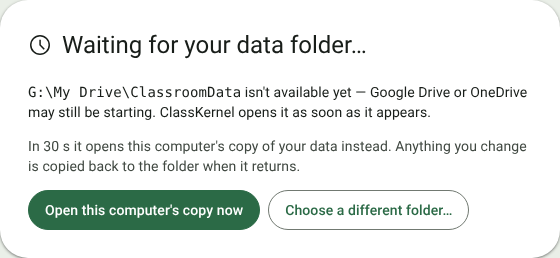
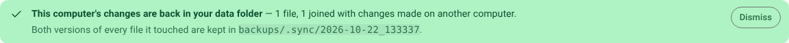

# 11. Your data and backups

[← Settings](10-settings.md) · [Contents](../README.md)

## Where your data lives

Everything ClassKernel records is kept in the **data folder** you chose on first launch, as plain `.csv` and `.md`
files. There is no database, no account and no server.

```
ClassroomData/
  behaviours.csv, topics.csv, cognitive_levels.csv,
  settings.csv, timer_presets.csv        app-wide settings and lists
  classes/
    10A Physical Sciences/               one folder per class
      class.md                           details and notes
      students.csv, attendance.csv, behaviour.csv, bathroom.csv,
      desks.csv, room.csv, seating.csv, seating_prefs.csv, lessons.csv,
      assessments.csv, assessment_questions.csv, marks.csv,
      question_marks.csv, report_comments.csv
  layouts/                               saved room templates
  exports/                               spreadsheets from "Save to data folder"
  backups/                               automatic snapshots
```

Every file opens in Excel or Notepad. The [data file reference](../data-files.md) lists what each one holds, column
by column.

- **Dates and times** are saved in UTC, so the files mean the same on any computer. The app shows them in the time
  zone chosen under Settings → General.
- **Every save is safe**: the app writes a complete new copy of the file and then swaps it in, so a sync client
  copying the folder mid-save never sees a half-written file.

## Backup and syncing

**Put the data folder inside OneDrive or Google Drive.** The sync client then keeps a copy in the cloud and on your
other computers. ClassKernel itself never touches the network.

To use the same data on another computer, point ClassKernel there at the same synced folder (on first launch, or
under **Settings → General → Data → Change data folder…**). Sync clients copy whole files, so it's safest not to
have the app open on two computers at the same time.

## Automatic backups

Each time ClassKernel starts, it copies the whole data folder into `backups/` (named by date and time). Every
backup from today is kept, plus the last one from each of the 14 most recent earlier days you used the app, so
you always have two teaching weeks to go back to, however often you open it (and a holiday doesn't eat into
them). The copy runs in the background while your classes open.

To go back to one, open **Settings → General → Data → Restore a backup**, choose a backup and press **Restore…**.
The backup's files replace the current ones (anything created since that backup is kept), and a safety copy of
today's data is taken first, so a restore can itself be undone.

## If Google Drive isn't ready

When Google Drive (or OneDrive) starts after ClassKernel, your data folder isn't there yet at launch. ClassKernel
never asks you to choose it again. Instead it waits:



- If the folder appears within **30 seconds**, it opens as normal.
- Otherwise ClassKernel opens **this computer's copy** of your data (press **Open this computer's copy now** to skip
  the wait). Every save on this computer also updates that copy, so it's as recent as the last time you used the
  app here. A banner says so, and how old the copy is:


Teach and record as usual. A few things wait for the folder: renaming a class, deleting a room template, restoring
a backup, and **Save to data folder** (Export can still save anywhere).

When the folder is back, and has stayed back for half a minute (so Google Drive has caught up), ClassKernel copies
this computer's changes into it — not mid-lesson in teaching mode, but as soon as you leave it, or straight away with
**Copy my changes back now**. If you close the app first, it happens at the next launch.



- If nothing else changed the files meanwhile, your changes are simply copied across.
- If another computer changed the same file (say you entered marks at home last night), the two are **joined row by
  row**: every register entry, mark, behaviour and comment from both is kept. Only where both changed the very same
  thing (the same boy's mark in the same test) does this computer's version win, and the summary lists each one.
  Seating plans, room layouts and the behaviour buttons are joined as whole units, so a plan never mixes two
  arrangements.
- Both original versions of every file it touched are kept in `backups/.sync/<date and time>/` (`drive/` and
  `this-computer/`), so nothing is lost even then.
- A class renamed on another computer meanwhile isn't re-created: your changes to it are kept in that folder and the
  summary says so.

The copy lives in `%LOCALAPPDATA%\com.classkernel.app\local-copy`. It holds the same student information as the
data folder, so on a computer other people sign in to, switch it off under **Settings → General → Data → Keep a
copy on this computer**.

> **Tip:** Google Drive for desktop's **Mirror files** setting keeps My Drive in an ordinary folder that is there
> before Drive starts, which avoids the wait altogether (if your Drive fits on the computer).

## Editing files by hand

You can correct data in Excel or Notepad. Close ClassKernel first, so it doesn't save over your edit, and keep the
first row (the column names) as it is.

## What stays on this computer

A few conveniences are remembered by the computer rather than saved in the data folder, so they don't follow you to
another computer:

- where the data folder is, and this computer's copy of it (see [If Google Drive isn't ready](#if-google-drive-isnt-ready));
- whether the navigation rail is expanded;
- the **once-per-lesson** seat lock and when the current lesson started;
- Pick a student's **no-repeat** list for the lesson;
- the dashboards' period, the parent-report sections ticked, and the clock's face and options.

## Student information

Names, flags, notes, behaviour and marks are stored as plain, readable text. Treat the folder like a paper mark
book and follow your school's data-handling policy for where it lives and who can open it.

## Troubleshooting

| Problem | What to do |
| --- | --- |
| A red banner says *"Couldn't save … to disk"* | The folder couldn't be written to (e.g. a drive went offline). Fix that, then press **Try again** before closing the app. |
| *"Waiting for your data folder…"* at launch | Google Drive or OneDrive hasn't started yet. Wait, or open this computer's copy. If the folder has moved (a new drive letter), press **Choose a different folder…**: any changes made on this computer are copied into it. |
| Randomise shows **🔒 Reseat…** | Seats were already assigned this lesson. Press **End lesson**, or **Reseat…** and your PIN. See [Seats](04-seats.md#once-per-lesson-and-the-reseat-pin). |
| Forgotten the reseat PIN | Close ClassKernel, open `settings.csv` in the data folder with Notepad, delete the value on the `reseat_pin` row (keep `reseat_pin,`), and save. The next unlock asks you to create a new PIN. |
| A page says *No class selected* | Choose a class from the class menu at the top right. |
| A test offers no topics to choose from | The class's grade has no topic list. Check its grade on the Class notes page is a plain number (`10`, not `08` or `2026`) that matches a grade under Settings → Assessments, or set that grade to share another grade's list with **Same topics as**. |
| An unexpected grade (e.g. *G2026*) is listed under Settings → Assessments | A class has that as its grade. Change the class's grade on its Class notes page, then delete the grade with the **✕** beside it. |
| Lesson says it needs a room layout or seating plan | Draw the room under Settings → Room layout, then seat the class on Seats. |
| The marks or behaviour page shows only a button | That's the privacy cover; press **Show student details**. |
| Pick a student says *No students to pick* | Everyone is marked absent or excused. Untick **Skip absent students**. |
